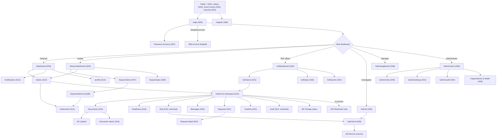

# IMPLEMENTATION_PLAN.md: ClaimGuard RAF

---

## 0. Plan details

| Field | Value |
| --- | --- |
| App name | ClaimGuard RAF (Claim Intelligence & Assurance Platform) |
| Built from PRD version | v1.1 (4 November 2026): PRD v1.0 plus the Section 18 answers, recorded in the PRD Change log. Must match the version in docs/PRD.md |
| Screen designs | Stitch project: https://stitch.withgoogle.com/projects/3126694362497483814 (screens S01–S46 from the ClaimGuard RAF Stitch prompt pack). Exported screens are saved in `docs/designs/` with the file names in Section 7.3 |
| Plan version | v1.6 |
| Repository | https://github.com/mandlenkosii/claimguard-raf |
| Status | Ready to build. All 42 Section 18 rows are Answered |
| Last updated | 08 Nov 2026 |

---

## 1. Start here (instructions for the coding agent)

Before writing any code:

1. Read this whole file from top to bottom.
2. Read `docs/PRD.md`.
3. Look at the screen designs listed in Section 7.3.
4. Check Section 18. Every row must be **Answered** before Phase 1 starts. If any row is **Open**, or the Repository row in Section 0 has no URL, stop and ask the human. Do not start.
5. Check that the prerequisites in Section 4.2 are installed.
6. Start **Phase 1 only**. Follow Section 2 at all times.

---

## 2. Rules for the coding agent (copy word for word, do not edit)

1. **One phase at a time.** Only work on the phase the human asked for. When that phase's Definition of Done is complete, stop and wait for the human to say "Start Phase <number>".
2. **Test-driven development (TDD) for every task.** Follow the cycle in Section 12.1:
    - Write the test.
    - Run it and see it fail for the right reason.
    - Write the smallest code that makes it pass.
    - Run all tests.
    - Refactor while all tests still pass.
3. **Never cheat a test.** Never delete, skip, weaken or change a test just to make it pass. If you believe a test is wrong, stop and explain why to the human.
4. **Never break earlier work.** Every test from earlier phases must still pass before a phase is done.
5. **Build only what is planned.** Build only what is in this file and `docs/PRD.md`. Never build anything in Section 3.3 (Deferred).
6. **Ask, don't guess.** If anything is missing, unclear or contradictory, stop, add it to Section 18, and ask the human.
7. **Match the designs.** Every screen must match its design in Section 7.3: layout, order, labels, text, colours and spacing. Use the design tokens in Section 7.1. Never hard-code colours, font sizes or spacing.
8. **Every state, every screen.** Each screen must handle every state listed for it in Section 7.3 (chosen from normal, empty, loading, error, offline, success, plus any screen-specific states).
9. **Exact wording.** Use the exact labels and messages from the PRD. Never invent wording.
10. **Security first.**
    - Never put secret keys in app code, logs, test files or Git.
    - Every permission rule in Section 9 must be enforced on the server or database, never only in the app.
    - Every permission rule must have a test.
11. **Full check before "done".** Run the full check command (Section 4.3) before saying a phase is done, then add a short summary of the results to the Progress log (Section 17).
12. **Record your progress.** After each phase:
    - tick the checkboxes for that phase in this file;
    - add a row to the Progress log;
    - commit using the commit message given in the phase.
13. **No surprise libraries.** Do not add, remove or upgrade any library or tool not listed in Section 4.1 without asking the human first.
14. **Stuck rule.** If the same problem is still failing after 3 attempts, stop and report:
    - what you tried;
    - the exact error;
    - what you need from the human.
15. **Clean code.** Follow the folder structure in Section 5. Use the PRD's key terms (Section 3.4) for names in code. Keep files small and focused.

---

## 3. Project summary and scope

### 3.1 Summary

ClaimGuard RAF is a secure, explainable and auditable web platform for the South African Road Accident Fund claims ecosystem. It helps claimants, legal practitioners, RAF claims officers, risk investigators, managers and administrators find claim-information problems earlier: missing documents, inconsistent details, conflicting dates and duplicate files. It explains each issue with evidence, scores claim readiness, raises risk alerts for human review and keeps a full timeline and audit history. It complements existing RAF systems and never makes fraud, legal or compensation decisions. This build is a concept prototype that uses fictional data only.

**Platform:** Responsive web app (desktop first at 1440px; tablet 1024px and mobile 390px layouts per PRD 10.5 and designs S45–S46), deployed on Vercel with Supabase.

**How the PRD's IDs map to this plan.** The PRD numbers requirements as FR-AREA-NN, rules as RULE-00N and screens by route. It has no F#, US#, BR#, S# or M# numbers, so this plan assigns them as follows (approved: Section 18 #2):

- **F#** = one PRD Section 5 area (F1 = 5.1 … F14 = 5.14).
- **US#** = one PRD functional requirement (FR-…), in PRD order (table 3.2b). PRD P0 = Must, P1 = Should.
- **S#** = the screen numbers in the Stitch prompt pack (S01–S46). **M#** = the three modals in that pack (M1 = design S17, M2 = design S32, M3 = design S37).
- **BR#** = the business rules in table 3.2c, each traced to the PRD section (or design) it comes from.
- **T-US#-#** tests come from the FR text plus the PRD "Acceptance checks" under the same section.

### 3.2 Features in scope

| ID | Feature | Priority | Built in phase |
| --- | --- | --- | --- |
| F1 | Authentication and user profiles (PRD 5.1) | Must | 3 |
| F2 | Claim intake and management (PRD 5.2) | Must (US13 Should) | 4 (Should part: 12) |
| F3 | Document management (PRD 5.3) | Must (US17, US18, US20 Should) | 5 (Should part: 11) |
| F4 | Document intelligence and OCR (PRD 5.4) | Should (US26 Must) | 5 (US26 + mock extraction service, Section 18 #12), 11 |
| F5 | Claim readiness engine (PRD 5.5) | Must (US33 Should) | 6 (Should part: 13) |
| F6 | Cross-document validation (PRD 5.6) | Must (US38 Should) | 6 (Should part: 13) |
| F7 | Risk and integrity engine (PRD 5.7) | Must | 7 |
| F8 | Investigation workspace (PRD 5.8) | Must | 7 |
| F9 | Information requests (PRD 5.9) | Must | 8 |
| F10 | Secure messaging (PRD 5.10) | Must (US61 Should) | 8 (Should part: 14) |
| F11 | Claim workflow and timeline (PRD 5.11) | Must (US69 Should) | 4 (Should part: 12) |
| F12 | Notifications (PRD 5.12) | Must (US72 Should) | 9 (Should part: 14) |
| F13 | Dashboards and analytics (PRD 5.13) | Must (US77, US78 Should) | 9 (Should part: 15) |
| F14 | Administration (PRD 5.14) | Must (US83 Should) | 10 (Should part: 15) |

**3.2b User stories (one per PRD functional requirement)**

| US | PRD ID | Requirement (PRD wording) | Priority | Feature |
| --- | --- | --- | --- | --- |
| US1 | FR-AUTH-01 | Supported user types can register or receive an authorised account | Must | F1 |
| US2 | FR-AUTH-02 | Users can authenticate and end sessions securely | Must | F1 |
| US3 | FR-AUTH-03 | Users can view and update permitted profile fields | Must | F1 |
| US4 | FR-AUTH-04 | Permissions are determined by authorised role assignments | Must | F1 |
| US5 | FR-AUTH-05 | Disabled or suspended accounts cannot access protected resources | Must | F1 |
| US6 | FR-AUTH-06 | Provide secure account recovery | Must | F1 |
| US7 | FR-CLM-01 | Authorised users can create a claim using a structured form | Must | F2 |
| US8 | FR-CLM-02 | Each claim receives a unique internal reference | Must | F2 |
| US9 | FR-CLM-03 | Capture the minimum information required by the configured workflow | Must | F2 |
| US10 | FR-CLM-04 | Incomplete claims can be saved as drafts | Must | F2 |
| US11 | FR-CLM-05 | Each claim has a workspace for overview, documents, readiness, requests, messages, timeline and authorised risk information | Must | F2 |
| US12 | FR-CLM-06 | Record claimant, representative, organisation and authorised staff assignments | Must | F2 |
| US13 | FR-CLM-07 | Authorised users can search and filter claims | Should | F2 |
| US14 | FR-DOC-01 | Authorised users can upload supported document types | Must | F3 |
| US15 | FR-DOC-02 | Documents are stored privately and accessed through authorised mechanisms | Must | F3 |
| US16 | FR-DOC-03 | Record category, filename, uploader, upload date, processing status and claim | Must | F3 |
| US17 | FR-DOC-04 | Updated documents are stored as new versions | Should | F3 |
| US18 | FR-DOC-05 | Validate file types and size; support appropriate malware scanning | Should (type check: Must, PRD 5.3 acceptance check) | F3 |
| US19 | FR-DOC-06 | Distinguish uploaded, processing, processed, failed and review-required states | Must | F3 |
| US20 | FR-DOC-07 | Deletion follows permissions and retention rules | Should | F3 |
| US21 | FR-INT-01 | Identify or allow selection of document category | Should | F4 |
| US22 | FR-INT-02 | Extract readable text from supported documents | Should | F4 |
| US23 | FR-INT-03 | Identify relevant fields such as names, dates and references where supported | Should | F4 |
| US24 | FR-INT-04 | Record extraction confidence or validation status where available | Should | F4 |
| US25 | FR-INT-05 | Allow authorised correction while preserving original extraction and correction history | Should | F4 |
| US26 | FR-INT-06 | Record failures and provide retry or manual-review paths | Must | F4 |
| US27 | FR-READY-01 | Check configured required document categories | Must | F5 |
| US28 | FR-READY-02 | Identify missing required claim fields | Must | F5 |
| US29 | FR-READY-03 | Run defined validation rules against available claim and document data | Must | F5 |
| US30 | FR-READY-04 | Calculate readiness using documented rules | Must | F5 |
| US31 | FR-READY-05 | Explain contributing issues and how to address them | Must | F5 |
| US32 | FR-READY-06 | Recalculate when relevant claim information or documents change | Must | F5 |
| US33 | FR-READY-07 | Retain previous assessments | Should | F5 |
| US34 | FR-VAL-01 | Compare selected fields across claim records and extracted document data | Must | F6 |
| US35 | FR-VAL-02 | Flag defined discrepancies such as conflicting identity information or dates | Must | F6 |
| US36 | FR-VAL-03 | Identify source fields/documents supporting each discrepancy | Must | F6 |
| US37 | FR-VAL-04 | Track issues as open, under review, resolved or dismissed with a reason | Must | F6 |
| US38 | FR-VAL-05 | Prevent repeated runs creating uncontrolled duplicate open issues | Should | F6 |
| US39 | FR-RISK-01 | Create alerts from defined, configurable indicators | Must | F7 |
| US40 | FR-RISK-02 | Support LOW, MEDIUM, HIGH and CRITICAL severity | Must | F7 |
| US41 | FR-RISK-03 | Include explanation and evidence references | Must | F7 |
| US42 | FR-RISK-04 | Support OPEN, UNDER REVIEW, ESCALATED, RESOLVED and DISMISSED states | Must | F7 |
| US43 | FR-RISK-05 | Allow authorised investigator assignment | Must | F7 |
| US44 | FR-RISK-06 | Record outcome, rationale and next action | Must | F7 |
| US45 | FR-RISK-07 | Never automatically label a claim or person fraudulent based solely on an alert | Must | F7 |
| US46 | FR-RISK-08 | Audit changes to severity, assignment, status and outcomes | Must | F7 |
| US47 | FR-INV-01 | Investigators view alerts they are authorised to review | Must | F8 |
| US48 | FR-INV-02 | Display severity, evidence, relevant documents, issues and history | Must | F8 |
| US49 | FR-INV-03 | Allow notes with author and timestamp | Must | F8 |
| US50 | FR-INV-04 | Allow authorised assignment and escalation | Must | F8 |
| US51 | FR-INV-05 | Record outcome, explanation and next action | Must | F8 |
| US52 | FR-INV-06 | Restrict sensitive investigative notes and evidence | Must | F8 |
| US53 | FR-REQ-01 | Authorised staff can request missing information or clarification | Must | F9 |
| US54 | FR-REQ-02 | Request includes title, description, recipient, creation date, status and optional due date | Must | F9 |
| US55 | FR-REQ-03 | Intended recipient can submit a response and supporting documents | Must | F9 |
| US56 | FR-REQ-04 | Track pending, responded-to, under-review and closed requests | Must | F9 |
| US57 | FR-REQ-05 | Notify relevant participants of requests and responses | Must | F9 |
| US58 | FR-REQ-06 | Preserve request, response, attachment and status history | Must | F9 |
| US59 | FR-MSG-01 | Allow claim-linked messages between authorised participants | Must | F10 |
| US60 | FR-MSG-02 | Retain author and timestamp | Must | F10 |
| US61 | FR-MSG-03 | Support authorised, securely stored attachments | Should | F10 |
| US62 | FR-MSG-04 | Prevent access to messages from inaccessible claims | Must | F10 |
| US63 | FR-MSG-05 | Notify recipients of new messages | Must | F10 |
| US64 | FR-MSG-06 | Apply audit and retention policies | Must | F10 |
| US65 | FR-WF-01 | Allow only valid transitions for role and current state | Must | F11 |
| US66 | FR-WF-02 | Record previous/new state, actor, timestamp and required reason | Must | F11 |
| US67 | FR-WF-03 | Display chronological claim activity | Must | F11 |
| US68 | FR-WF-04 | Enforce prerequisites before transitions | Must | F11 |
| US69 | FR-WF-05 | Support authorised withdrawal, escalation and exceptional outcomes | Should | F11 |
| US70 | FR-NOT-01 | In-app notifications for requests, responses, assignments and updates | Must | F12 |
| US71 | FR-NOT-02 | Identify unread notifications | Must | F12 |
| US72 | FR-NOT-03 | Manage permitted notification preferences | Should | F12 |
| US73 | FR-NOT-04 | Avoid unnecessary disclosure of sensitive claim details in external notifications | Must | F12 |
| US74 | FR-DASH-01 | Provide role-specific dashboards | Must | F13 |
| US75 | FR-DASH-02 | Show relevant claim counts and workflow statuses | Must | F13 |
| US76 | FR-DASH-03 | Identify outstanding requests and unresolved issues | Must | F13 |
| US77 | FR-DASH-04 | Show permitted risk workload summaries | Should | F13 |
| US78 | FR-DASH-05 | Provide readiness, outstanding-work and issue-resolution reports | Should | F13 |
| US79 | FR-DASH-06 | Respect permissions and data boundaries | Must | F13 |
| US80 | FR-DASH-07 | Never present invented statistics as real RAF data | Must | F13 |
| US81 | FR-ADM-01 | Authorised administrators manage accounts within scope | Must | F14 |
| US82 | FR-ADM-02 | Role assignment is restricted and checked server-side | Must | F14 |
| US83 | FR-ADM-03 | Manage selected workflow settings and validation rules | Should | F14 |
| US84 | FR-ADM-04 | Log administrative actions | Must | F14 |
| US85 | FR-ADM-05 | Administrative access does not automatically grant unrestricted claim or investigation access | Must | F14 |

**3.2c Business rules**

| BR | Rule | Source | Tests |
| --- | --- | --- | --- |
| BR1 | Every claim gets a unique reference generated on the server (format `CG-YYYY-NNNNNN` from the designs); alerts get `RA-YYYY-NNNNN` | FR-CLM-02, 5.2 check, S11, S36 | T-BR1-1, T-BR1-2, T-BR1-3 |
| BR2 | Incomplete claims can be saved as drafts, and a draft never counts as ready | FR-CLM-04, 5.2 check | T-BR2-1, T-BR2-2 |
| BR3 | Required claim fields are validated before the transitions that need them | FR-CLM-03, 5.2 check | T-BR3-1, T-BR3-2 |
| BR4 | Only transitions valid for the user's role and the claim's current state are allowed, prerequisites are enforced, and direct API updates cannot bypass the workflow; a claimant cannot move a claim from Draft to Settlement | FR-WF-01, FR-WF-04, 5.11 checks | T-BR4-1, T-BR4-2, T-BR4-3 |
| BR5 | Every transition records previous state, new state, actor, timestamp and required reason | FR-WF-02 | T-BR5-1 |
| BR6 | Blocked transition attempts are logged | 5.11 check | T-BR6-1 |
| BR7 | RULE-001 Required document missing: a completeness issue, action "request or upload the document", never a risk alert | 9.2, 5.5 check, 8.1 | T-BR7-1, T-BR7-2 |
| BR8 | RULE-002 Identity information conflict: a consistency issue, and a risk alert only when the rule is configured to create one; final decision by a human | 9.2 | T-BR8-1, T-BR8-2 |
| BR9 | RULE-003 Date inconsistency: a review issue, action "confirm dates and correct errors" | 9.2 | T-BR9-1 |
| BR10 | RULE-004 Duplicate file: two files with the same SHA-256 hash give a potential duplicate-document finding, action "determine whether duplication is expected" | 9.2 | T-BR10-1, T-BR10-2 |
| BR11 | RULE-005 Extraction uncertainty: low-confidence or failed-validation OCR gives "manual verification required" | 9.2 | T-BR11-1 |
| BR12 | Readiness = weighted categories (documentation 30%, required information 25%, identity 15%, timeline 15%, cross-document 15%); each category score = passed checks ÷ applicable checks × 100 (Section 18 #10); weights total 100; identical inputs and rules version give identical results; the rules version is recorded | FR-READY-04, 5.5 checks, 9.3 | T-BR12-1, T-BR12-2, T-BR12-3, T-BR12-4 |
| BR13 | A score never conceals a blocking issue: show overall score, blocking issues, warnings, resolved issues and date of last assessment; Ready is blocked while a blocking issue is open | 9.3 | T-BR13-1, T-BR13-2 |
| BR14 | Every failed check has an explanation and a corrective action | 5.5 check, FR-READY-05 | T-BR14-1 |
| BR15 | Issues are open, under review, resolved or dismissed; dismissing needs a reason; resolving never erases history | FR-VAL-04, 5.6 check | T-BR15-1, T-BR15-2, T-BR15-3 |
| BR16 | Alert severity is LOW, MEDIUM, HIGH or CRITICAL; alert status is OPEN, UNDER REVIEW, ESCALATED, RESOLVED or DISMISSED | FR-RISK-02, FR-RISK-04 | T-BR16-1 |
| BR17 | Every alert has an explanation and at least one evidence reference | FR-RISK-03 | T-BR17-1 |
| BR18 | No claim or person is labelled fraudulent automatically; closing an alert never closes or rejects the claim | FR-RISK-07, 5.8 check | T-BR18-1, T-BR18-2 |
| BR19 | Investigation notes cannot be silently overwritten (append-only, corrections added as new notes); finalised reviews record who completed them and when | 5.8 checks | T-BR19-1, T-BR19-2 |
| BR20 | Requests are pending, responded, under review or closed; a response never closes a request before review; a request is overdue when its due date has passed and it is not closed; requests without a due date are shown differently | FR-REQ-04, 5.9 checks | T-BR20-1, T-BR20-2 |
| BR21 | Messages keep their author and timestamp; the author is always the signed-in user | FR-MSG-02 | T-BR21-1 |
| BR22 | Notifications never include sensitive claim details: event type, claim reference and link only, using templates TXT-60 … TXT-64 | FR-NOT-04, S12 | T-BR22-1, T-BR22-2 |
| BR23 | Users cannot grant themselves privileged roles; role assignment is done by an administrator on the server; an administrator cannot assign roles to themselves | 5.1 check, FR-ADM-02, S39 | T-BR23-1, T-BR23-2 |
| BR24 | Disabled or suspended accounts cannot access protected resources | FR-AUTH-05, 14.3 | T-BR24-1 |
| BR25 | Administrator access does not grant claim or investigation access; manager access does not expose confidential investigation evidence | FR-ADM-05, 3.5, 3.6 | T-BR25-1, T-BR25-2 |
| BR26 | Audit records capture actor, action, resource, timestamp and reason where required; they are append-only and never contain credentials, document contents or unnecessary personal information | 10.7, 8.2 | T-BR26-1, T-BR26-2, T-BR26-3 |
| BR27 | Documents are stored privately and are downloaded only through short-lived signed links (5 minutes, from S15) | FR-DOC-02, S15 | T-BR27-1 |
| BR28 | Upload success is shown only after the server confirms the upload | 5.3 check | T-BR28-1 |
| BR29 | Only supported file types (PDF, JPG, PNG) up to 10 MB are accepted, checked in the app and on the server (Section 18 #14) | FR-DOC-01, FR-DOC-05, 5.3 check | T-BR29-1, T-BR29-2 |
| BR30 | Extracted fields are suggestions until validated; corrections keep the original value and the correction history; source-document references are preserved | 5.4 checks, FR-INT-05 | T-BR30-1 |
| BR31 | Dashboards show actual application data, labelled as demonstration data, and never invented statistics presented as real RAF data | FR-DASH-07, PRD 13 Phase 8 exit | T-BR31-1 |
| BR32 | The prototype notice "ClaimGuard RAF — Concept Prototype. Not an official RAF system. Demonstration data only." is visible on every page | 12.3, 17 | T-BR32-1 |
| BR33 | Messaging shows "Messages are not official RAF submissions or legal notices." | 5.10 check, S20 | T-BR33-1 |
| BR34 | Repeated validation runs do not create duplicate open issues (Should) | FR-VAL-05 | T-BR34-1 |
| BR35 | An updated document is stored as a new version and earlier versions are kept (Should) | FR-DOC-04, 5.3 check | T-BR35-1 |
| BR36 | Demo login or role switching is clearly labelled as a simulation and never protects real data | 12.1 | T-BR36-1 |
| BR37 | Demo data is fictional: example.com emails, synthetic documents, no real identity numbers | 12.2 | T-BR37-1 |

### 3.3 Deferred: do NOT build

From PRD 2.2 (out of scope for the initial MVP):

- Replacing RAF's existing claims-management systems.
- Connecting to confidential RAF production systems without authorisation.
- Automatically approving or rejecting claims.
- Automatically determining that a person has committed fraud.
- Calculating final legal entitlements or compensation awards.
- Replacing legal advice or professional investigation.
- Processing compensation payments.
- Accessing government identity databases without approved integration.
- Training production AI models on confidential claimant data.
- Guaranteeing processing-time reductions before pilot evaluation.

Future work named elsewhere in the PRD:

- Any real OCR/AI provider (PRD 11.3, 11.4). This build uses the mock extraction provider only.
- AI classification, extraction and summarisation (PRD 11.4).
- Integrations with RAF claims systems, document services, identity providers, external notification services and reporting (PRD 11.5). The prototype uses mock interfaces and seeded data only.
- Production configuration and deployment beyond the Vercel preview, unless approved (PRD 13 Phase 9).
- Controlled pilot: stakeholders, real or authorised data, baselines, user training, monitoring and feedback (PRD 13 Phase 10).
- Success-metric measurement and pilot evaluation (PRD 15).
- Backups and recovery for production, and monitoring for an operational pilot (PRD 10.4).
- Processing real claimant data, including the POPIA assessment that must come first (PRD 10.2).

Deferred by the Section 18 answers:

- Risk indicators with no defined logic: vehicle inconsistency, claim-reference mismatch, similar documents, suspicious metadata and conflicting extracted information (Section 18 #11).
- Stored or manual tasks, the "New task" button on S29 and the "Notes" tab on S28 (Section 18 #16).
- Email notifications and the email toggles on S12 (Section 18 #18).
- Saved filter views on S10 (Section 18 #40).
- Teams and team-based queues (Section 18 #7).
- Claim types (Section 18 #34).
- Hard deletion of documents, messages or user accounts (Section 18 #15; accounts are suspended or disabled instead, Section 8.2).
- Export formats other than CSV (Section 18 #42).

### 3.4 Key terms (use these names in code)

| Term (PRD 1.7) | Name in code | Meaning |
| --- | --- | --- |
| Profile | `Profile`, table `profiles` | A signed-in user's account record |
| Organisation | `Organisation`, table `organisations` | A law firm or other authorised organisation |
| Role | `Role`, tables `roles`, `user_roles` | One of: claimant, lawyer, raf_officer, investigator, manager, admin |
| Permission | `Permission`, tables `permissions`, `role_permissions` | A capability from the PRD Section 4 RBAC table |
| Claimant | `Claimant`, table `claimants` | The injured person the claim is for; may or may not have a login |
| Legal practitioner | `LegalPractitioner`, table `legal_practitioners` | A lawyer linked to an organisation |
| Client relationship | `ClientRelationship`, table `client_relationships` | A firm's authorised link to a claimant, with assigned lawyer |
| Claim | `Claim`, table `claims` | The main claim record with workflow status |
| Claim reference | `claim.reference` | Unique internal reference, e.g. CG-2026-000142 |
| Claim workspace | `ClaimWorkspace` | The tabbed claim screen (S14–S24) |
| Claim party | `ClaimParty`, table `claim_parties` | A person or organisation linked to a claim |
| Assignment | `ClaimAssignment`, table `claim_assignments` | Authorised staff linked to a claim |
| Workflow status | `ClaimStatus` | One of the claim statuses in Section 8.3 |
| Document | `ClaimDocument`, table `documents` | An uploaded claim document |
| Document version | `DocumentVersion`, table `document_versions` | One stored file of a document |
| Document extraction | `DocumentExtraction`, table `document_extractions` | Mock OCR output for one version |
| Extracted field | `ExtractedField`, table `extracted_fields` | One field found in a document; a suggestion until validated |
| Validation rule | `ValidationRule`, table `validation_rules` | A rule such as RULE-001 |
| Claim check | `ClaimCheck`, table `claim_checks` | One result produced by an automated rule |
| Claim issue | `ClaimIssue`, table `claim_issues` | An actionable problem needing correction or review |
| Readiness assessment | `ReadinessAssessment`, table `readiness_assessments` | One readiness score run |
| Risk alert | `RiskAlert`, table `risk_alerts` | A potential indicator for human review, never a fraud finding |
| Risk evidence | `RiskEvidence`, table `risk_evidence` | A source item supporting an alert |
| Risk review | `RiskReview`, table `risk_reviews` | An investigator's recorded outcome |
| Investigation note | `InvestigationNote`, table `investigation_notes` | An append-only investigator note |
| Severity | `RiskSeverity` | LOW, MEDIUM, HIGH, CRITICAL |
| Information request | `InformationRequest`, table `information_requests` | A request for missing information or clarification |
| Request response | `RequestResponse`, table `request_responses` | A reply to an information request |
| Message | `Message`, tables `message_threads`, `messages` | Claim-linked communication |
| Timeline event | `TimelineEvent`, table `claim_timeline_events` | One chronological claim event |
| Notification | `Notification`, table `notifications` | An in-app notification |
| Audit log | `AuditLog`, table `audit_logs` | An important action or security event |

---

## 4. Tech stack, prerequisites and commands

### 4.1 Stack

The PRD (11.1, 11.2, 11.6) names the app, backend and hosting tools. It names no testing, lint or secret-scan tools; the rows marked "Section 18 #1" were approved in Section 18 #1.

| Layer | Tool | Version | Used for |
| --- | --- | --- | --- |
| Frontend | React, Vite, React Router, Lucide React | latest stable at setup | Single-page web app, routing, icons (PRD 11.1) |
| Language | TypeScript | latest stable at setup | All app, rules and test code (PRD 11.1) |
| Styling | Tailwind CSS | latest stable at setup | Design tokens and layouts (PRD 11.1) |
| Backend and database | Supabase: PostgreSQL, Auth, Row Level Security, private Storage, migrations (Supabase CLI) | latest stable at setup | Data, sign-in, permissions, documents (PRD 11.2) |
| Server functions | Supabase Edge Functions (Deno) | latest stable at setup | Privileged operations: `process-document`, `run-readiness`, `admin-invite-user`, `demo-sign-in` (PRD 11.2, Section 18 #9) |
| Data fetching and caching | TanStack Query | latest stable at setup | Server state in the frontend (PRD 11.1) |
| Unit and component tests | Vitest + React Testing Library + jsdom (Section 18 #1) | latest stable at setup | Rules, helpers, components and screens |
| Database and permission tests | pgTAP, run by `scripts/test-db.mjs` with `pg` (node-postgres, Section 18 #48; the plan originally used `supabase test db`, Section 18 #1) | pgTAP on the Supabase project; `pg` 8.23.1 | Constraints, triggers, RLS allow/deny |
| Integration tests | Vitest + supabase-js against the local backend (Section 18 #1) | latest stable at setup | Backend operations and Edge Functions |
| End-to-end tests | Playwright + @axe-core/playwright (Section 18 #1) | latest stable at setup | User flows, accessibility, timing |
| Lint and type check | ESLint, TypeScript compiler (`tsc --noEmit`) (Section 18 #1) | latest stable at setup | Code quality |
| Secret scan | gitleaks (Section 18 #1) | latest stable at setup | Finds keys in the repo and its history |
| Build and hosting | GitHub, Vercel (web), Supabase hosted project | n/a | Version control, preview deployment, demo backend (PRD 11.6) |

### 4.2 Prerequisites on the computer

- [ ] Node.js (current LTS)
- [ ] Git, with a GitHub account
- Docker Desktop is not required: development uses the hosted Supabase project (Section 18 #46)
- [ ] Supabase CLI (run through `npx supabase`)
- [ ] Deno (for Edge Function type checks; the Supabase CLI runs functions itself)
- [ ] gitleaks (Section 18 #1)
- [ ] A Supabase account with one hosted project for the demo (Section 18 #33)
- [ ] A Vercel account linked to the GitHub repository
- [ ] A desktop browser plus a phone or browser device emulation at 390px and 1024px for manual checks

### 4.3 Commands

The backend is the hosted Supabase project (Section 18 #46); `.env` must point at it before the full check. Edge Functions are deployed to it with `npm run functions:deploy`. End-to-end tests also need the app running (`npm run dev`), so they are left out of the full check and run in Step 4 of each feature phase.

| Purpose | Command |
| --- | --- |
| Install dependencies | `npm install` |
| Apply migrations / deploy functions to the hosted project | `npm run db:push` (runs `supabase db push --remote`) and `npm run functions:deploy` (runs `scripts/deploy-functions.mjs`: sets the function secrets, then deploys with `--use-api`) |
| Reset the database (migrations + seed data) | `npm run db:reset` (runs `supabase db reset --remote` on the hosted project, then `node scripts/seed-demo-users.mjs`) |
| Start the app | `npm run dev` |
| Unit and component tests | `npm run test:unit` (Vitest: `tests/unit`, `tests/component`) |
| Database and permission tests | `npm run test:db` (runs `node scripts/test-db.mjs`, Section 18 #48) |
| Integration tests | `npm run test:integration` (Vitest with `vitest.integration.config.ts`) |
| End-to-end tests | `npm run test:e2e` (Playwright) |
| Lint | `npm run lint` |
| Type check | `npm run typecheck` (`tsc --noEmit` for the app and `deno check` for `supabase/functions`) |
| Secret scan | `npm run scan:secrets` (gitleaks over the working tree and Git history) |
| **Full check (run before every "done")** | `npm run check` (lint → typecheck → scan:secrets → test:unit → test:db → test:integration) |
| Build for release | `npm run build` (Vite production build); deploy with `npx supabase db push` and `npx supabase functions deploy` to the hosted project, and a Git push for the Vercel preview |

---

## 5. Folder structure

```
claimguard-raf/
  src/
    app/                     App.tsx, router.tsx, providers (TanStack Query, auth session)
    layouts/                 PublicLayout.tsx (public nav + footer), AppShell.tsx (sidebar + top bar),
                             ClaimWorkspaceLayout.tsx (claim header + tab bar), PrototypeNotice placement
    pages/
      public/                S01 LandingPage.tsx, S02 AboutPage.tsx, S03 HowItWorksPage.tsx, S04 SecurityPage.tsx
      auth/                  S05 LoginPage.tsx, S06 RegisterPage.tsx, S07 PasswordRecoveryPage.tsx,
                             S08 AccountDisabledPage.tsx, S08 AccessDeniedPage.tsx
      shared/                S09 ClaimantDashboardPage.tsx, S10 ClaimsListPage.tsx, S11 NewClaimPage.tsx,
                             S12 NotificationsPage.tsx, S13 ProfilePage.tsx
      claims/workspace/      S14 OverviewTab.tsx, S15 DocumentsTab.tsx, S16 DocumentViewerPage.tsx,
                             S18 ReadinessTab.tsx, S19 RiskTab.tsx, S20 MessagesTab.tsx, S21 RequestsTab.tsx,
                             S22 RequestDetailPage.tsx, S23 TimelineTab.tsx, S24 AuditTab.tsx,
                             S25 RestrictedClaimView.tsx
      lawyer/                S26 LawyerDashboardPage.tsx, S27 ClientsPage.tsx, S28 ClientDetailPage.tsx,
                             S29 LawyerTasksPage.tsx
      raf/                   S30 RafDashboardPage.tsx, S31 ClaimsQueuePage.tsx, S33 OfficerTasksPage.tsx,
                             S34 ReportsPage.tsx, S38 ManagementDashboardPage.tsx
      risk/                  S35 RiskQueuePage.tsx, S36 InvestigationWorkspacePage.tsx
      admin/                 S39 UsersPage.tsx, S40 RolesPage.tsx, S41 SettingsPage.tsx, S42 AuditLogPage.tsx,
                             S43 OrganisationsHealthPage.tsx
    modals/                  M1 UploadDocumentModal.tsx, M2 ChangeStatusModal.tsx, M3 RecordOutcomeModal.tsx
    components/
      ui/                    Base building blocks (Section 7.2): Button, TextField, Select, Toggle, Modal, Drawer …
      domain/                ClaimGuard components: StatusChip, SeverityChip, ReadinessRing, ClaimHeader …
    features/                One folder per feature (auth, claims, documents, readiness, risk, requests,
                             messaging, notifications, dashboards, admin): api.ts (supabase-js calls) and
                             TanStack Query hooks. No business rules here.
    lib/                     supabase.ts (public anon client only), format/ (dates, references), access/ (UI-only
                             capability helpers that mirror, never replace, server rules)
    theme/                   tokens.ts (Section 7.1) and the Tailwind preset that reads it
  supabase/
    config.toml
    migrations/              SQL migrations in Section 8.6 order
    seed.sql                 Fictional seed data (Section 8.7), no passwords
    functions/
      _shared/rules/         Pure TypeScript business rules (readiness, validation rules RULE-001..005,
                             workflow transitions, file validation, notification text). No Deno-only imports,
                             so Vitest and the frontend import the same code through the `@rules` alias.
      _shared/ocr/           OCR provider interface + mock provider (PRD 11.3)
      _shared/scan/          Malware-scanner interface + mock scanner (Should, Section 18 #14)
      process-document/      Edge Function OP21
      run-readiness/         Edge Function OP24
      admin-invite-user/     Edge Function OP42
      demo-sign-in/          Edge Function OP8 (demo environments only)
    tests/database/          pgTAP tests (*.test.sql)
  tests/
    unit/                    Vitest unit tests (*.test.ts)
    component/               Vitest + React Testing Library (*.test.tsx)
    integration/             Vitest + supabase-js against the local backend (*.test.ts)
    e2e/                     Playwright specs (*.spec.ts)
    fixtures/                Fake data for component tests, built from the seed data set
  fixtures/sample-documents/ Synthetic documents, each clearly marked SAMPLE (PRD 12.2)
  scripts/
    seed-demo-users.mjs      Creates the demo auth users with the service role key from .env
  docs/
    PRD.md
    designs/                 Exported Stitch screens (file names in Section 7.3)
  IMPLEMENTATION_PLAN.md
  .env.example
  README.md
```

**Rule:** a new folder may only be created if it is added to this section first.

---

## 6. Environment variables and secrets

| Name | What it is | Where to get it | Public or secret | Used by |
| --- | --- | --- | --- | --- |
| VITE_SUPABASE_URL | Supabase API URL | `npx supabase status` (local) / Supabase dashboard → Project settings → API (hosted) | Public | App |
| VITE_SUPABASE_ANON_KEY | Supabase anon (publishable) key; every request is still limited by RLS | Same as above | Public | App |
| VITE_APP_ENV | `development`, `preview` or `production` (PRD 11.6: separate configurations) | Set by hand; Vercel environment settings | Public | App |
| SUPABASE_SERVICE_ROLE_KEY | Service role key; bypasses RLS | `npx supabase status` / Supabase dashboard | Secret | Edge Functions (Supabase sets it for them), `scripts/seed-demo-users.mjs`, integration tests only |
| SUPABASE_DB_URL | Direct Postgres connection string | `npx supabase status` | Secret | Integration tests only |
| DEMO_USER_PASSWORD | Password given to every seeded demo account | Chosen by the human; written only in `.env` and in Supabase Edge Function secrets | Secret | `scripts/seed-demo-users.mjs`, Edge Function `demo-sign-in`, integration and end-to-end tests only (Section 18 #9) |
| DEMO_LOGIN_ENABLED | `true` in local and preview, `false` in production; when false, `demo-sign-in` refuses every call | Set by hand; Supabase Edge Function secrets | Secret (server config) | Edge Function `demo-sign-in` |
| OCR_PROVIDER | Which OCR provider the service interface uses; only `mock` exists | Set by hand | Secret (server config) | Edge Function `process-document` |
| SUPABASE_ACCESS_TOKEN | Personal access token used to deploy Edge Functions and set their secrets without Docker (Section 18 #46) | Supabase dashboard → Account → Access Tokens | Secret | `scripts/deploy-functions.mjs` only |

`.env.example` (committed to Git, placeholder values only):

```
VITE_SUPABASE_URL=https://your-project-ref.supabase.co
VITE_SUPABASE_ANON_KEY=replace-with-project-anon-key
VITE_APP_ENV=development
SUPABASE_SERVICE_ROLE_KEY=replace-with-project-service-role-key
SUPABASE_DB_URL=replace-with-project-postgres-connection-string
DEMO_USER_PASSWORD=replace-with-a-demo-password
DEMO_LOGIN_ENABLED=true
OCR_PROVIDER=mock
SUPABASE_ACCESS_TOKEN=replace-with-supabase-personal-access-token
```

Rules:

- Real values go in `.env`, which is listed in `.gitignore` and never committed.
- For a mobile app, the backend address the **phone** uses is not `127.0.0.1` (that is the phone itself). Use your computer's Wi-Fi IP address, or the emulator's special address.
- Secret values are never used in app code. They are used only in server functions, scripts or integration tests, read from `.env`.
- If a new variable is needed, add it here and to `.env.example` first.
- Only variables starting with `VITE_` reach the browser bundle. A secret must never start with `VITE_` (checked by T-NFR-10).
- Vercel holds only the three `VITE_` variables. Supabase holds the Edge Function secrets (`npx supabase secrets set`).

---
## 7. Design system and screens

### 7.1 Design tokens

The PRD has no visual design section. Every value below comes from the design master prompt ("DESIGN SYSTEM") in the Stitch prompt pack. All tokens live in `src/theme/tokens.ts`. The Tailwind preset reads them, and screens use tokens only. The master prompt does not give values for tints, severity chip colours, the notice bar colour, shadows or button height. Those are taken from the exported Stitch screens once they exist (Section 18 #39).

| Token | Value | From PRD |
| --- | --- | --- |
| `color.primary` | #0F2A44 (navy: sidebar, headings) | Design master prompt (PRD has no design section) |
| `color.accent` | #0E7C7B (teal: primary buttons, links, active states) | Design master prompt |
| `color.background` | #F6F8FA | Design master prompt |
| `color.surface` | #FFFFFF | Design master prompt |
| `color.border` | #E2E8F0 | Design master prompt |
| `color.text` / `color.textSecondary` | #0F172A / #475569 | Design master prompt |
| `color.error` / `color.success` / `color.warning` | #B91C1C / #15803D / #B45309 | Design master prompt |
| `color.info` | #1D4ED8 | Design master prompt |
| `color.*Tint`, `color.severity.low/medium/high/critical`, `color.notice` | From exported designs | Section 18 #39 |
| `font.family` / `font.familyMono` | Inter / IBM Plex Mono (claim references and IDs) | Design master prompt |
| `font.size.h1` / `h2` / `h3` | 28/36 semibold / 22/30 semibold / 18/26 semibold | Design master prompt |
| `font.size.body` / `small` | 14/22 regular / 12/18 regular | Design master prompt |
| `space.1` … `space.6` | 8, 16, 24, 32, 40, 48px (8px scale); `space.gutter` = 24px | Design master prompt |
| `layout.grid` / `layout.desktop` / `layout.tablet` / `layout.mobile` | 12 columns / 1440px / 1024px / 390px | Design master prompt, S45, S46 |
| `layout.sidebar` | 248px, collapsible to an icon rail (S46) | Design master prompt, S46 |
| `radius.card` / `radius.input` / `radius.chip` | 8px / 8px / 6px | Design master prompt |
| `border.width` | 1px | Design master prompt |
| `size.icon` | 20px (Lucide line icons) | Design master prompt |
| `size.button` / `size.touchMin` | From exported designs (Section 18 #39) / 44px | S45 |

### 7.2 Shared components

| Component | File | Variants and states | Used on | Tests |
| --- | --- | --- | --- | --- |
| Button | components/ui/Button.tsx | primary (teal), secondary, ghost, danger; disabled; loading; focus ring | All | T-C-1 |
| TextField / Textarea | components/ui/TextField.tsx | default, required (asterisk), helper text, error with icon + text, read-only with lock icon and tooltip; textarea with counter | S05–S07, S11, S13, M2, M3 | T-C-2 |
| Select / MultiSelect | components/ui/Select.tsx | default, required, error, disabled | S10, S11, S31, S35, M1 | T-C-3 |
| Checkbox / Radio / Toggle / SegmentedControl | components/ui/Choice.tsx | checked, unchecked, disabled, error | S06, S11, S12, S39, M1, M3 | T-C-4 |
| PasswordField + StrengthMeter | components/ui/PasswordField.tsx | show/hide toggle, strength meter, requirement checklist | S05, S06, S07 | T-C-5 |
| PrototypeNotice | components/domain/PrototypeNotice.tsx | full text; short mobile text "Concept prototype · Demo data only" (S45) | Every screen | T-C-6 |
| Logo | components/domain/Logo.tsx | shield-with-checkmark + "ClaimGuard RAF" wordmark; never the official RAF logo | S01–S08, AppShell | T-C-7 |
| PublicNav / Footer | layouts/PublicLayout.tsx | links About, How it works, Security; Sign in (ghost), Register (primary) | S01–S04 | T-C-8 |
| AppShell (Sidebar + TopBar) | layouts/AppShell.tsx | role-specific sidebar items; collapsed icon rail; top bar with search, bell + unread count, role badge, avatar menu; mobile bottom tab bar (S45) | S09–S43 | T-C-9 |
| StatusChip | components/domain/StatusChip.tsx | one per workflow status (Section 8.3), text + colour | S09, S10, S14, S26–S31 | T-C-10 |
| SeverityChip | components/domain/SeverityChip.tsx | LOW, MEDIUM, HIGH, CRITICAL; always text + colour + icon | S19, S35, S36 | T-C-11 |
| StateChip (generic) | components/domain/StateChip.tsx | document processing (Uploaded, Processing + spinner, Processed, Failed, Review required); issue (Open, Under review, Resolved, Dismissed); alert (Open, Under review, Escalated, Resolved, Dismissed); request (Pending, Responded, Under review, Closed, Overdue); confidence (High, Medium, Low); account (Active, Invited, Suspended, Disabled) | S15, S16, S18, S19, S21, S35, S39 | T-C-12 |
| ReadinessRing / CategoryBar | components/domain/Readiness.tsx | sizes large / mini; value 0–100; category bar with weight label; expandable | S09, S14, S18, S26 | T-C-13 |
| Card / KpiCard | components/ui/Card.tsx | default; KPI with label, value, optional trend arrow and "Demonstration data" label | Dashboards | T-C-14 |
| DataTable + Pagination | components/ui/DataTable.tsx | sortable columns, row action menu, bulk selection, expandable row, empty, loading skeleton, error | S10, S15, S24, S27, S31, S35, S39, S42 | T-C-15 |
| FilterBar | components/ui/FilterBar.tsx | search, selects, toggles, clear filters | S10, S12, S23, S31, S35, S42 | T-C-16 |
| Tabs | components/ui/Tabs.tsx | active, with count badge, with lock icon, hidden tab (not rendered) | S12, S14–S24, S28, S31, S35 | T-C-17 |
| Stepper | components/ui/Stepper.tsx | horizontal workflow tracker (current stage highlighted); vertical wizard; vertical status history | S03, S09, S11, S14, S22 | T-C-18 |
| Modal / Drawer / ConfirmDialog | components/ui/Overlay.tsx | open/closed; Escape and Cancel close; focus trapped | M1–M3, S21, S39, S44 | T-C-19 |
| Toast | components/ui/Toast.tsx | success, warning, error, info | All | T-C-20 |
| EmptyState / Skeleton / ErrorState / OfflineBanner | components/ui/States.tsx | empty with icon, one line of guidance and action; skeleton for table and card; error with "Try again"; offline/connection-lost banner (S44) | All | T-C-21 |
| Timeline | components/domain/Timeline.tsx | events grouped by date; actor + role chip; blocked action shown in grey | S09, S14, S23 | T-C-22 |
| FileDropzone / FileUploadItem | components/domain/Upload.tsx | drop zone; per-file progress: uploading %, scanning for malware, confirmed ✓, rejected with reason | S15, M1, S22, S45 | T-C-23 |
| ClaimHeader | components/domain/ClaimHeader.tsx | breadcrumb, reference (mono, copy icon), title, status chip, readiness mini-ring, blocking chip, avatars, actions, tab bar | S14–S24 | T-C-24 |
| IssueCard | components/domain/IssueCard.tsx | rule ID chip, title, explanation, evidence links, recommended action, status; comparison variant with two buttons | S18, S45 | T-C-25 |
| AlertCard | components/domain/AlertCard.tsx | severity, title, rule, created, status, assignee, evidence count, link | S19 | T-C-26 |
| ComparisonTable | components/domain/ComparisonTable.tsx | Field / Source A / Source B / Match (Match, Mismatch) | S18, S36 | T-C-27 |
| MessageThread / Composer | components/domain/Messages.tsx | thread list with unread counts; bubbles with author, role chip, timestamp; attachment chips (Should); notice above composer | S20 | T-C-28 |
| NotificationItem | components/domain/NotificationItem.tsx | unread dot + bold; read; type icon | S12, top bar | T-C-29 |
| Chart (bar, line, histogram, sparkline) | components/domain/Chart.tsx | data, empty, "Demonstration data" label (charting approach: Section 18 #39) | S26, S30, S34, S38, S18 | T-C-30 |
| DocumentPreview | components/domain/DocumentPreview.tsx | image/PDF preview from a signed URL; SAMPLE label; highlighted field boxes (Should; rendering approach: Section 18 #39) | S16, S36 | T-C-31 |
| PermissionMatrix | components/domain/PermissionMatrix.tsx | text cell values (Yes, Own, Authorised, Assigned, Limited, Restricted, Summary, No) with subtle colour | S40 | T-C-32 |
| RestrictedNotice | components/domain/RestrictedNotice.tsx | shield icon, explanation, "Back to dashboard" | S08, S25 | T-C-33 |

### 7.3 Screens

Design files are the exported Stitch screens, saved as `docs/designs/<file>` with the names below (Section 18 #29). Some screens were exported as Stitch HTML code, so their file uses the same base name with `.html` instead of `.png` (e.g. `S05_sign_in.html`). S46 has three files: `S46_lawyer_tablet_claims.png`, `S46_lawyer_tablet_claims.html` and `S46_lawyer_tablet_readiness.png`. `design_system_reference.png` is the Stitch design-system sheet used for Section 7.1 values. Where design text conflicts with the PRD or this plan, the PRD/plan wording wins (Section 18 #45). "Tab bar" means the claimant mobile bottom tab bar from S45. Every other screen uses the AppShell sidebar.

Logged-in roles: C = claimant, L = lawyer, O = RAF officer, I = investigator, Mg = manager, A = administrator. "Dashboard" in a redirect means the user's role dashboard (Section 11).

| ID | Screen | Route / file | Design | Who can open it (else redirect to) | Tab bar | Required states | Phase |
| --- | --- | --- | --- | --- | --- | --- | --- |
| S01 | Landing page | `/`, pages/public/LandingPage.tsx | S01_landing.png | Anyone | No | Normal | 1 |
| S02 | About | `/about`, pages/public/AboutPage.tsx | S02_about.png | Anyone | No | Normal | 1 |
| S03 | How it works | `/how-it-works`, pages/public/HowItWorksPage.tsx | S03_how_it_works.png | Anyone | No | Normal; role-journey tab selected | 1 |
| S04 | Security | `/security`, pages/public/SecurityPage.tsx | S04_security.png | Anyone | No | Normal | 1 |
| S05 | Sign in | `/login`, pages/auth/LoginPage.tsx | S05_sign_in.png | Logged out (else Dashboard) | No | Normal, Loading, Error ("Email or password is incorrect"), Offline, Demo accounts section | 3 |
| S06 | Register | `/register`, pages/auth/RegisterPage.tsx | S06_register.png | Logged out (else Dashboard) | No | Normal (Claimant), Legal practitioner fields, Loading, Inline validation error, Offline, Success | 3 |
| S07 | Password recovery | `/reset-password` (Section 18 #19), pages/auth/PasswordRecoveryPage.tsx | S07_password_recovery.png | Logged out, or holder of a reset link | No | Request form, Loading, Confirmation (neutral), Set new password, Error, Offline, Success toast | 3 |
| S08 | Account disabled / Access denied | shown in place of any protected route, pages/auth/AccountDisabledPage.tsx and AccessDeniedPage.tsx | S08_account_access.png | Disabled or suspended users (account variant); legal practitioners awaiting verification (pending variant, Section 18 #8); any user opening a route their role may not open (403 variant) | No | Account disabled, Pending verification (TXT-11), 403 | 3 |
| S09 | Claimant dashboard | `/dashboard`, pages/shared/ClaimantDashboardPage.tsx | S09_claimant_dashboard.png | C (other roles → their Dashboard) | Yes (mobile, S45) | Normal, Empty (no claim yet), Loading, Error, Offline | 9 (claim card in 4) |
| S10 | Claims list | `/claims` and `/lawyer/claims` (same screen, Section 18 #19), pages/shared/ClaimsListPage.tsx | S10_claims_list.png | C, L, O, I, Mg, A; rows scoped by SEC1–SEC6 | Yes (mobile) | Normal, Empty ("No claims match these filters" + "Clear filters"), Loading, Error, Offline | 4 (filters: 12) |
| S11 | New claim wizard | `/claims/new`, pages/shared/NewClaimPage.tsx | S11_new_claim.png | C, L, O with create permission (else S08 403) | Yes (mobile) | Normal per step 1–6, Draft saved, Validation errors, Loading, Error, Offline, Success | 4 |
| S12 | Notifications | `/notifications`, pages/shared/NotificationsPage.tsx | S12_notifications.png | Any active signed-in user | Yes (mobile) | Normal, Empty (TXT-50), Loading, Error, Offline; Unread / Read; preferences card without email toggles (Section 18 #18) | 9 (preferences card: 14) |
| S13 | Profile & settings | `/profile` and `/lawyer/profile` (same screen, Section 18 #19), pages/shared/ProfilePage.tsx | S13_profile.png | Any active signed-in user | Yes (mobile) | Normal, Loading, Error, Offline, Success toast, Read-only fields | 3 |
| S14 | Claim workspace: Overview | `/claims/:id` and `/raf/claims/:id` (same screen, Section 18 #19), pages/claims/workspace/OverviewTab.tsx | S14_workspace_overview.png | Users with claim access (else S25) | Yes (mobile) | Normal, Loading, Error, Offline, Restricted (S25) | 4 |
| S15 | Claim workspace: Documents | `/claims/:id/documents`, pages/claims/workspace/DocumentsTab.tsx | S15_workspace_documents.png | Users with claim access (else S25); upload controls only for SEC11 | Yes (mobile) | Normal, Empty, Loading, Error, Offline; rows Processing / Failed / Review required | 5 |
| S16 | Document viewer & extraction review | `/claims/:id/documents/:documentId`, pages/claims/workspace/DocumentViewerPage.tsx | S16_document_viewer.png | Users with claim access except Mg and A (SEC12) (else S25) | No | Normal, Loading, Error, Offline, No extraction yet, Field edit mode | 11 |
| M1 | Upload document modal | opened from S15/S22, modals/UploadDocumentModal.tsx | S17_upload_modal.png | SEC11 | No | Normal, Upload disabled (no category), Uploading %, Scanning (Should), Confirmed, Rejected file, Error, Offline | 5 |
| S18 | Claim workspace: Readiness | `/claims/:id/readiness`, pages/claims/workspace/ReadinessTab.tsx | S18_workspace_readiness.png | SEC13 (else S25) | Yes (mobile, S45) | Normal, Not yet assessed, Loading, Re-running, Error, Offline; Blocking / Warnings / Resolved groups | 6 (history: 13) |
| S19 | Claim workspace: Risk | `/claims/:id/risk`, pages/claims/workspace/RiskTab.tsx | S19_workspace_risk.png | SEC14 (tab not rendered for others) | No | Normal, Empty (no alerts), Loading, Error, Offline | 7 |
| S20 | Claim workspace: Messages | `/claims/:id/messages`, pages/claims/workspace/MessagesTab.tsx | S20_workspace_messages.png | SEC21 (else S25) | Yes (mobile) | Normal, Empty (no threads), Loading, Sending, Error, Offline | 8 |
| S21 | Claim workspace: Requests | `/claims/:id/requests`, pages/claims/workspace/RequestsTab.tsx | S21_workspace_requests.png | Users with claim access (else S25); "New request" only for SEC18 | Yes (mobile) | Normal, Empty, Loading, Error, Offline; New request drawer open; Overdue / No due date rows | 8 |
| S22 | Request detail & response | `/claims/:id/requests/:requestId`, pages/claims/workspace/RequestDetailPage.tsx | S22_request_detail.png | Users with claim access; composer only for SEC19 | Yes (mobile, S45) | Normal, Loading, Submitting, Error, Offline, Success | 8 |
| S23 | Claim workspace: Timeline | `/claims/:id/timeline`, pages/claims/workspace/TimelineTab.tsx | S23_workspace_timeline.png | Users with claim access (else S25) | Yes (mobile) | Normal, Empty (filters), Loading, Error, Offline; blocked-action events | 4 |
| S24 | Claim workspace: Audit | `/claims/:id/audit`, pages/claims/workspace/AuditTab.tsx | S24_workspace_audit.png | SEC24 (tab not rendered for others) | No | Normal, Empty, Loading, Error, Offline; expanded row | 10 |
| S25 | Restricted view (permission demo) | rendered by ClaimWorkspaceLayout, pages/claims/workspace/RestrictedClaimView.tsx | S25_restricted_view.png | Shown when a user lacks access to a claim or tab | No | Manager summary view (Risk and Audit tabs not rendered); "You don't have permission to view this claim" | 4 |
| S26 | Lawyer dashboard | `/lawyer/dashboard`, pages/lawyer/LawyerDashboardPage.tsx | S26_lawyer_dashboard.png | L (else Dashboard) | No | Normal, Empty, Loading, Error, Offline | 9 |
| S27 | Clients | `/lawyer/clients`, pages/lawyer/ClientsPage.tsx | S27_clients.png | L (else Dashboard) | No | Normal, Empty, Loading, Error, Offline | 4 |
| S28 | Client detail | `/lawyer/clients/:id`, pages/lawyer/ClientDetailPage.tsx | S28_client_detail.png | L in the client's firm (else S08 403) | No | Normal, Loading, Error, Offline; tabs Overview, Claims, Documents (no Notes tab, Section 18 #16) | 4 |
| S29 | Lawyer tasks | `/lawyer/tasks`, pages/lawyer/LawyerTasksPage.tsx | S29_lawyer_tasks.png | L (else Dashboard) | No | List / Board (built from requests and issues; no "New task", Section 18 #16), Normal, Empty, Loading, Error, Offline | 9 |
| S30 | RAF officer dashboard | `/raf/dashboard`, pages/raf/RafDashboardPage.tsx | S30_raf_dashboard.png | O (else Dashboard) | No | Normal, Empty, Loading, Error, Offline | 9 |
| S31 | Claims queue | `/raf/claims`, pages/raf/ClaimsQueuePage.tsx | S31_claims_queue.png | O (else Dashboard) | No | Normal, Empty, Loading, Error, Offline; bulk selection | 4 (filters: 12) |
| M2 | Change status modal | opened from S14, modals/ChangeStatusModal.tsx | S32_change_status.png | Users allowed at least one transition (SEC9) | No | Normal, Blocked transitions disabled with reason, Missing reason error, Submitting, Error, Offline, Success | 4 |
| S33 | Officer tasks | `/raf/tasks`, pages/raf/OfficerTasksPage.tsx | S33_officer_tasks.png | O (else Dashboard) | No | Normal, Empty, Loading, Error, Offline; selected task panel (built from requests and issues, Section 18 #16) | 9 |
| S34 | Reports | `/raf/reports`, pages/raf/ReportsPage.tsx | S34_reports.png | O only (operational scope, Section 18 #19) (else Dashboard) | No | Normal, Empty, Loading, Error, Offline | 15 |
| S35 | Risk queue | `/raf/risk`, pages/risk/RiskQueuePage.tsx | S35_risk_queue.png | I (else Dashboard) | No | Normal, Empty, Loading, Error, Offline | 7 (workload card: 15) |
| S36 | Investigation workspace | `/raf/risk/:id`, pages/risk/InvestigationWorkspacePage.tsx | S36_investigation_workspace.png | I with access to the alert (SEC14) (else S08 403) | No | Normal, Loading, Error, Offline; note saving; correction note | 7 |
| M3 | Record outcome modal | opened from S36, modals/RecordOutcomeModal.tsx | S37_record_outcome.png | SEC17 | No | Normal, Validation errors (summary, confirmation), Submitting, Error, Offline, Success | 7 |
| S38 | Management dashboard | `/raf/management`, pages/raf/ManagementDashboardPage.tsx | S38_management_dashboard.png | Mg (else Dashboard) | No | Normal, Empty, Loading, Error, Offline | 9 (risk workload chart: 15) |
| S39 | Admin: users | `/admin/users`, pages/admin/UsersPage.tsx | S39_admin_users.png | A (else Dashboard) | No | Normal, Empty, Loading, Error, Offline; Edit user drawer; self-assignment warning | 10 |
| S40 | Admin: roles & permissions | `/admin/roles`, pages/admin/RolesPage.tsx | S40_admin_roles.png | A (else Dashboard) | No | Normal, Loading, Error, Offline; selected role panel (editing: Section 18 #32) | 10 |
| S41 | Admin: settings | `/admin/settings`, pages/admin/SettingsPage.tsx | S41_admin_settings.png | A (else Dashboard) | No | Normal, Loading, Error, Offline; rule editor; weights must total 100% error; Success | 15 |
| S42 | Admin: audit log | `/admin/audit`, pages/admin/AuditLogPage.tsx | S42_admin_audit.png | A (else Dashboard) | No | Normal, Empty, Loading, Error, Offline | 10 |
| S43 | Admin: organisations & system health | `/admin/organisations` (Section 18 #19), pages/admin/OrganisationsHealthPage.tsx | S43_admin_orgs_health.png | A (else Dashboard) | No | Organisations: Normal, Empty, Loading, Error, Offline; System health: Operational / Degraded / Down (browser checks, Section 18 #28) | 10 |
| S44 | System states sheet | design reference only (no route); implemented by the components in 7.2 | S44_system_states.png | n/a | No | Skeleton, Empty, Error, Inline validation, Processing failed, Toasts, Confirmation dialog, Offline banner | 1 (components), 16 (review) |
| S45 | Claimant mobile layouts | responsive variants of S09, S18, M1, S22, S12 at 390px | S45_claimant_mobile.png | As the desktop screens | Yes | As the desktop screens; tap targets at least 44px | 16 |
| S46 | Lawyer tablet layouts | responsive variants of S10 and S18 at 1024px | S46_lawyer_tablet.png | As the desktop screens | No (sidebar icon rail) | As the desktop screens; expandable table rows | 16 |

---
## 8. Data model and database

The PRD (Section 8) lists logical entities and integrity rules but gives no field lists, lengths or allowed values. Columns below come from the PRD where it names a field (e.g. FR-DOC-03, FR-REQ-02, FR-WF-02, PRD 10.7) and otherwise from the designs. Every text length limit is marked "len" and was approved in Section 18 #3. Every table has RLS switched on (Section 9). Timestamps are `timestamptz`, stored in UTC and shown in SAST.

### 8.1 Tables

**Table: `organisations`**: a law firm or other authorised organisation (PRD 3.6, 8)

| Column | Type | Null? | Default | Constraints | Notes |
| --- | --- | --- | --- | --- | --- |
| id | uuid | No | generated | primary key | |
| name | text | No | | len 1–200; unique | |
| type | text | No | | check in ('law_firm','raf','other') | Values: Section 18 #3 |
| registration_number | text | Yes | | len ≤ 50 | Shown on S43 |
| status | text | No | 'active' | check in ('active','inactive') | |
| created_at | timestamptz | No | now() | | |
| updated_at | timestamptz | No | now() | | trigger `set_updated_at` |

**Table: `profiles`**: one signed-in user (PRD 5.1)

| Column | Type | Null? | Default | Constraints | Notes |
| --- | --- | --- | --- | --- | --- |
| id | uuid | No | | primary key; foreign key → auth.users (on delete cascade) | |
| first_name | text | No | | len 1–100 | |
| surname | text | No | | len 1–100 | |
| email | text | No | | unique; copied from auth.users | Seed: @example.com only (BR37) |
| mobile | text | Yes | | len ≤ 20 | Shown masked to others |
| preferred_language | text | Yes | | len ≤ 30 | S13 |
| preferred_contact_method | text | Yes | | check in ('email','phone') | Values: Section 18 #3 |
| account_type | text | No | | check in ('claimant','legal_practitioner','staff') | Set at registration or invite |
| account_status | text | No | 'active' | check in ('active','invited','suspended','disabled') | Changed only through OP44 (BR24) |
| popia_consent_at | timestamptz | Yes | | required when account_type is claimant or legal_practitioner | S06 consent |
| created_at | timestamptz | No | now() | | |
| updated_at | timestamptz | No | now() | | |

**Table: `roles`**: the six PRD roles

| Column | Type | Null? | Default | Constraints | Notes |
| --- | --- | --- | --- | --- | --- |
| key | text | No | | primary key; check in ('claimant','lawyer','raf_officer','investigator','manager','admin') | |
| name | text | No | | len 1–50 | |

**Table: `permissions`**: capabilities from the PRD Section 4 table

| Column | Type | Null? | Default | Constraints | Notes |
| --- | --- | --- | --- | --- | --- |
| key | text | No | | primary key; check in ('claims.view','claims.create','documents.upload','readiness.view','risk.view_evidence','requests.create','investigations.review','users.manage', plus 'claims.assign','audit.view' and Should keys 'extractions.correct','reports.export','settings.manage') | Keys beyond the PRD's eight: Section 18 #6 |
| description | text | No | | len 1–200 | |

**Table: `role_permissions`**: the PRD Section 4 matrix

| Column | Type | Null? | Default | Constraints | Notes |
| --- | --- | --- | --- | --- | --- |
| role_key | text | No | | foreign key → roles (on delete cascade) | |
| permission_key | text | No | | foreign key → permissions (on delete cascade) | |
| scope | text | No | | check in ('own','authorised','assigned','permitted','limited','restricted','summary','aggregated','configuration','admin','investigation','yes','no') | PRD cell values; meanings: Section 18 #6 |
| | | | | primary key (role_key, permission_key) | |

**Table: `user_roles`**: role assignments (PRD 5.1, 8.2: users can have multiple roles)

| Column | Type | Null? | Default | Constraints | Notes |
| --- | --- | --- | --- | --- | --- |
| user_id | uuid | No | | foreign key → profiles (on delete cascade) | |
| role_key | text | No | | foreign key → roles (on delete restrict) | |
| assigned_by | uuid | Yes | | foreign key → profiles (on delete set null); check assigned_by <> user_id when role_key is not 'claimant' | BR23 |
| reason | text | No | | len 1–500 | S39 "Reason for change" |
| created_at | timestamptz | No | now() | primary key (user_id, role_key) | |

**Table: `organisation_members`**: who belongs to which organisation

| Column | Type | Null? | Default | Constraints | Notes |
| --- | --- | --- | --- | --- | --- |
| organisation_id | uuid | No | | foreign key → organisations (on delete cascade) | |
| profile_id | uuid | No | | foreign key → profiles (on delete cascade) | |
| created_at | timestamptz | No | now() | primary key (organisation_id, profile_id) | |

**Table: `legal_practitioners`**: lawyer record (PRD 8 "Claimants and lawyers")

| Column | Type | Null? | Default | Constraints | Notes |
| --- | --- | --- | --- | --- | --- |
| profile_id | uuid | No | | primary key; foreign key → profiles (on delete cascade) | |
| organisation_id | uuid | No | | foreign key → organisations (on delete restrict) | |
| practice_number | text | No | | len 1–50 | S06 |
| verification_status | text | No | 'pending' | check in ('pending','verified','rejected') | Section 18 #8 |
| created_at | timestamptz | No | now() | | |

**Table: `claimants`**: the person a claim is for (may have no login)

| Column | Type | Null? | Default | Constraints | Notes |
| --- | --- | --- | --- | --- | --- |
| id | uuid | No | generated | primary key | |
| profile_id | uuid | Yes | | unique; foreign key → profiles (on delete set null) | Set when the claimant has an account |
| first_name | text | No | | len 1–100 | |
| surname | text | No | | len 1–100 | |
| id_number | text | Yes | | len ≤ 20 | Shown masked; demo data synthetic only (BR37); whether to store: Section 18 #3 |
| date_of_birth | date | Yes | | | Used by RULE-002 |
| email | text | Yes | | len ≤ 254 | |
| mobile | text | Yes | | len ≤ 20 | |
| created_by | uuid | No | | foreign key → profiles (on delete restrict) | |
| created_at | timestamptz | No | now() | | |

**Table: `client_relationships`**: a firm's authorised client (S27, S28)

| Column | Type | Null? | Default | Constraints | Notes |
| --- | --- | --- | --- | --- | --- |
| id | uuid | No | generated | primary key | |
| organisation_id | uuid | No | | foreign key → organisations (on delete cascade) | |
| claimant_id | uuid | No | | foreign key → claimants (on delete cascade); unique (organisation_id, claimant_id) | |
| assigned_lawyer_id | uuid | Yes | | foreign key → legal_practitioners (on delete set null) | "Assigned attorney" |
| mandate_status | text | No | 'pending' | check in ('on_file','pending') | S27 chip |
| created_at | timestamptz | No | now() | | |

**Table: `claims`**: the main claim record (PRD 5.2)

| Column | Type | Null? | Default | Constraints | Notes |
| --- | --- | --- | --- | --- | --- |
| id | uuid | No | generated | primary key | |
| reference | text | No | set by trigger | unique; check format CG-YYYY-NNNNNN (4-digit year, 6-digit number) | BR1, Section 18 #31 |
| claimant_id | uuid | No | | foreign key → claimants (on delete restrict) | |
| representing_organisation_id | uuid | Yes | | foreign key → organisations (on delete set null) | |
| status | text | No | 'draft' | check in (statuses in 8.3) | Changed only by OP13 (BR4) |
| claim_type | text | Yes | | Section 18 #34 | PRD 9.1 "applicable claim type" |
| claimant_role | text | Yes | | check in ('driver','passenger','pedestrian','cyclist') | S11 |
| accident_date | date | Yes | | check ≤ current_date | |
| accident_time | time | Yes | | | |
| accident_province | text | Yes | | check in the nine South African provinces | S11 |
| accident_town | text | Yes | | len ≤ 100 | |
| accident_location | text | Yes | | len ≤ 300 | Street/description |
| police_station | text | Yes | | len ≤ 100 | |
| cas_number | text | Yes | | len ≤ 50 | |
| accident_description | text | Yes | | len ≤ 4000 | S11 counter |
| injuries_summary | text | Yes | | len ≤ 2000 | S14 |
| readiness_stale | boolean | No | true | | Set by trigger when inputs change; cleared by OP24 (BR12) |
| created_by | uuid | No | | foreign key → profiles (on delete restrict) | |
| submitted_at | timestamptz | Yes | | | Set when status becomes 'submitted' |
| created_at | timestamptz | No | now() | | |
| updated_at | timestamptz | No | now() | | |

Drafts may have every nullable field empty (BR2). Required fields for leaving Draft: Section 18 #3 (BR3).

**Table: `claim_parties`**: people and organisations linked to a claim (PRD 5.2, S14 "Parties")

| Column | Type | Null? | Default | Constraints | Notes |
| --- | --- | --- | --- | --- | --- |
| id | uuid | No | generated | primary key | |
| claim_id | uuid | No | | foreign key → claims (on delete cascade) | |
| party_type | text | No | | check in ('claimant','legal_representative','other_driver','other_party') | Values: Section 18 #3 |
| full_name | text | Yes | | len ≤ 200 | |
| organisation_id | uuid | Yes | | foreign key → organisations (on delete set null) | |
| details | jsonb | No | '{}' | | Contact details per #3 |
| created_at | timestamptz | No | now() | | |

**Table: `claim_vehicles`**: vehicles on a claim (S11 step 4; used by the vehicle-inconsistency indicator)

| Column | Type | Null? | Default | Constraints | Notes |
| --- | --- | --- | --- | --- | --- |
| id | uuid | No | generated | primary key | |
| claim_id | uuid | No | | foreign key → claims (on delete cascade) | |
| party_id | uuid | Yes | | foreign key → claim_parties (on delete set null) | |
| registration_number | text | Yes | | len ≤ 20 | |
| make_model | text | Yes | | len ≤ 100 | Fields: Section 18 #3 |
| created_at | timestamptz | No | now() | | |

**Table: `claim_assignments`**: authorised staff and lawyers on a claim (FR-CLM-06)

| Column | Type | Null? | Default | Constraints | Notes |
| --- | --- | --- | --- | --- | --- |
| id | uuid | No | generated | primary key | |
| claim_id | uuid | No | | foreign key → claims (on delete cascade) | |
| profile_id | uuid | No | | foreign key → profiles (on delete restrict) | |
| assignment_role | text | No | | check in ('lawyer','raf_officer','investigator') | |
| assigned_by | uuid | No | | foreign key → profiles (on delete restrict) | |
| assigned_at | timestamptz | No | now() | | |
| ended_at | timestamptz | Yes | | unique (claim_id, profile_id, assignment_role) where ended_at is null | Ending keeps history; changes audited |

**Table: `document_categories`**: configured categories (PRD 16.2; values from S15, Section 18 #4)

| Column | Type | Null? | Default | Constraints | Notes |
| --- | --- | --- | --- | --- | --- |
| key | text | No | | primary key | 'identity_document','accident_report','hospital_medical_report','serious_injury_assessment','proof_of_earnings' |
| name | text | No | | len 1–100 | |
| is_required | boolean | No | false | | Used by RULE-001 |

**Table: `documents`**: one uploaded claim document (FR-DOC-03)

| Column | Type | Null? | Default | Constraints | Notes |
| --- | --- | --- | --- | --- | --- |
| id | uuid | No | generated | primary key | |
| claim_id | uuid | No | | foreign key → claims (on delete restrict) | Retention: Section 18 #15 |
| category_key | text | No | | foreign key → document_categories | |
| current_version | integer | No | 1 | check ≥ 1 | |
| processing_status | text | No | 'uploaded' | check in ('uploaded','processing','processed','failed','review_required') | FR-DOC-06 |
| processing_error | text | Yes | | len ≤ 500 | Plain-language failure reason (FR-INT-06) |
| uploaded_by | uuid | No | | foreign key → profiles (on delete restrict) | |
| uploaded_at | timestamptz | No | now() | | |
| deleted_at | timestamptz | Yes | | | Should, US20 |

**Table: `document_versions`**: one stored file (FR-DOC-04, PRD 8.2)

| Column | Type | Null? | Default | Constraints | Notes |
| --- | --- | --- | --- | --- | --- |
| id | uuid | No | generated | primary key | |
| document_id | uuid | No | | foreign key → documents (on delete restrict); unique (document_id, version) | |
| version | integer | No | | check ≥ 1 | |
| storage_path | text | No | | unique; check starts with 'claims/' | `claims/{claim_id}/{document_id}/v{version}/{filename}` |
| filename | text | No | | len 1–255 | |
| mime_type | text | No | | check in ('application/pdf','image/jpeg','image/png') | BR29, Section 18 #14 |
| size_bytes | integer | No | | check between 1 and 10485760 | BR29 (10 MB) |
| sha256 | text | Yes | | check 64 lowercase hex characters | Set by OP21; RULE-004 |
| confirmed | boolean | No | false | | True only after OP20 (BR28) |
| malware_scan_status | text | No | 'not_scanned' | check in ('not_scanned','pending','clean','infected') | Should, US18 |
| uploaded_by | uuid | No | | foreign key → profiles (on delete restrict) | |
| uploaded_at | timestamptz | No | now() | | |

**Table: `document_extractions`**: mock OCR output for one version (FR-INT-02)

| Column | Type | Null? | Default | Constraints | Notes |
| --- | --- | --- | --- | --- | --- |
| id | uuid | No | generated | primary key | |
| document_version_id | uuid | No | | foreign key → document_versions (on delete cascade) | |
| provider | text | No | 'mock' | check in ('mock') | PRD 11.3 |
| status | text | No | | check in ('succeeded','failed') | |
| extracted_text | text | Yes | | | Never copied into audit logs (BR26) |
| error | text | Yes | | len ≤ 500 | |
| created_at | timestamptz | No | now() | | |

**Table: `extracted_fields`**: one field found in a document (FR-INT-03, 04)

| Column | Type | Null? | Default | Constraints | Notes |
| --- | --- | --- | --- | --- | --- |
| id | uuid | No | generated | primary key | |
| extraction_id | uuid | No | | foreign key → document_extractions (on delete cascade) | |
| field_key | text | No | | check in ('full_name','id_number','date_of_birth','accident_date','admission_date','treating_facility','diagnosis','vehicle_registration','claim_reference') | Keys: Section 18 #3 |
| value | text | Yes | | len ≤ 500 | |
| confidence | numeric(4,3) | Yes | | check between 0 and 1 | RULE-005 threshold: Section 18 #13 |
| source_page | integer | Yes | | check ≥ 1 | Source reference (PRD 5.4) |
| bounding_box | jsonb | Yes | | | S16 highlight (Should) |
| validation_status | text | No | 'suggested' | check in ('suggested','validated','corrected') | BR30 |

**Table: `extracted_field_corrections`** (Should, US25): correction history

| Column | Type | Null? | Default | Constraints | Notes |
| --- | --- | --- | --- | --- | --- |
| id | uuid | No | generated | primary key | |
| field_id | uuid | No | | foreign key → extracted_fields (on delete restrict) | |
| original_value | text | Yes | | | Kept forever (BR30) |
| corrected_value | text | No | | len ≤ 500 | |
| reason | text | No | | len 1–500 | S16 "Reason for correction" |
| corrected_by | uuid | No | | foreign key → profiles (on delete restrict) | |
| corrected_at | timestamptz | No | now() | | Append-only |

**Table: `validation_rules`**: rule definitions (PRD 9.1, 9.2)

| Column | Type | Null? | Default | Constraints | Notes |
| --- | --- | --- | --- | --- | --- |
| id | text | No | | primary key; check format RULE-NNN | RULE-001 … RULE-005 |
| name | text | No | | len 1–100 | |
| version | text | No | | len 1–20 | |
| claim_type | text | Yes | | | Section 18 #34 |
| readiness_category | text | No | | check in ('documentation','required_information','identity','timeline','cross_document') | PRD 9.3 |
| required_inputs | jsonb | No | empty JSON array | | |
| impact | text | No | | check in ('blocking','warning') | Section 18 #10 |
| explanation | text | No | | len 1–500 | BR14 |
| corrective_action | text | No | | len 1–300 | BR14 |
| blocks_transition | boolean | No | | | |
| creates_risk_alert | boolean | No | false | | RULE-001 always false (BR7) |
| risk_indicator | text | Yes | | check in indicator list (risk_alerts) | Section 18 #11 |
| risk_severity | text | Yes | | check in ('LOW','MEDIUM','HIGH','CRITICAL') | Section 18 #11 |
| enabled | boolean | No | true | | |
| updated_by | uuid | Yes | | foreign key → profiles | |
| updated_at | timestamptz | No | now() | | |

**Table: `readiness_settings`**: one row with weights (PRD 9.3)

| Column | Type | Null? | Default | Constraints | Notes |
| --- | --- | --- | --- | --- | --- |
| id | boolean | No | true | primary key; check id = true (single row) | |
| rules_version | text | No | | len 1–20 | Recorded on each assessment |
| weight_documentation | integer | No | 30 | check between 0 and 100 | |
| weight_required_information | integer | No | 25 | check between 0 and 100 | |
| weight_identity | integer | No | 15 | check between 0 and 100 | |
| weight_timeline | integer | No | 15 | check between 0 and 100 | |
| weight_cross_document | integer | No | 15 | check between 0 and 100; check all five weights sum to 100 | BR12 |
| updated_by | uuid | Yes | | foreign key → profiles | |
| updated_at | timestamptz | No | now() | | |

**Table: `readiness_assessments`**: one readiness run (FR-READY-04, 07)

| Column | Type | Null? | Default | Constraints | Notes |
| --- | --- | --- | --- | --- | --- |
| id | uuid | No | generated | primary key | |
| claim_id | uuid | No | | foreign key → claims (on delete cascade) | |
| rules_version | text | No | | | BR12 |
| input_hash | text | No | | | Same inputs + version → same hash and score (BR12) |
| score | integer | No | | check between 0 and 100 | |
| category_scores | jsonb | No | | | Five categories, 0–100 each |
| blocking_count | integer | No | | check ≥ 0 | |
| warning_count | integer | No | | check ≥ 0 | |
| resolved_count | integer | No | | check ≥ 0 | |
| triggered_by | uuid | Yes | | foreign key → profiles | Null when automatic |
| assessed_at | timestamptz | No | now() | | |

**Table: `claim_checks`**: one rule result (PRD 8.1)

| Column | Type | Null? | Default | Constraints | Notes |
| --- | --- | --- | --- | --- | --- |
| id | uuid | No | generated | primary key | |
| assessment_id | uuid | No | | foreign key → readiness_assessments (on delete cascade) | |
| claim_id | uuid | No | | foreign key → claims (on delete cascade) | |
| rule_id | text | No | | foreign key → validation_rules | |
| rule_version | text | No | | | |
| result | text | No | | check in ('passed','failed','not_applicable') | |
| details | jsonb | No | '{}' | | Sources compared |
| created_at | timestamptz | No | now() | | |

**Table: `claim_issues`**: actionable problems (PRD 8.1, FR-VAL-04)

| Column | Type | Null? | Default | Constraints | Notes |
| --- | --- | --- | --- | --- | --- |
| id | uuid | No | generated | primary key | |
| claim_id | uuid | No | | foreign key → claims (on delete cascade) | |
| rule_id | text | No | | foreign key → validation_rules | |
| issue_key | text | No | | len 1–200 | Identifies "the same issue" across runs (BR34) |
| check_id | uuid | Yes | | foreign key → claim_checks (on delete set null) | |
| title | text | No | | len 1–200 | |
| explanation | text | No | | len 1–1000 | BR14 |
| corrective_action | text | No | | len 1–300 | BR14 |
| impact | text | No | | check in ('blocking','warning') | |
| status | text | No | 'open' | check in ('open','under_review','resolved','dismissed') | BR15 |
| dismiss_reason | text | Yes | | required (len 1–500) when status = 'dismissed' | BR15 |
| classification | text | Yes | | check in ('extraction_error','genuine_discrepancy') | FR-VAL-02 acceptance check |
| evidence | jsonb | No | | check jsonb_array_length(evidence) ≥ 1 for RULE-002/003/004 | FR-VAL-03 |
| created_at | timestamptz | No | now() | | |
| updated_by | uuid | Yes | | foreign key → profiles | |
| updated_at | timestamptz | No | now() | | |

**Table: `claim_issue_history`**: append-only issue status history (BR15)

| Column | Type | Null? | Default | Constraints | Notes |
| --- | --- | --- | --- | --- | --- |
| id | uuid | No | generated | primary key | |
| issue_id | uuid | No | | foreign key → claim_issues (on delete restrict) | |
| from_status | text | Yes | | | |
| to_status | text | No | | | |
| actor_id | uuid | Yes | | foreign key → profiles | Null for automatic |
| reason | text | Yes | | len ≤ 500 | |
| created_at | timestamptz | No | now() | | |

**Table: `risk_alerts`**: potential indicators (PRD 5.7)

| Column | Type | Null? | Default | Constraints | Notes |
| --- | --- | --- | --- | --- | --- |
| id | uuid | No | generated | primary key | |
| reference | text | No | set by trigger | unique; check format RA-YYYY-NNNNN (4-digit year, 5-digit number) | Design S36 (Section 18 #31) |
| claim_id | uuid | No | | foreign key → claims (on delete restrict) | |
| rule_id | text | Yes | | foreign key → validation_rules | |
| indicator_type | text | No | | check in ('identity_mismatch','date_inconsistency','duplicate_hash') | PRD 5.7; only the three indicators with defined logic (RULE-002, RULE-003, RULE-004); the other five are Deferred (Section 18 #11) |
| severity | text | No | | check in ('LOW','MEDIUM','HIGH','CRITICAL') | BR16 |
| status | text | No | 'OPEN' | check in ('OPEN','UNDER_REVIEW','ESCALATED','RESOLVED','DISMISSED') | BR16 |
| title | text | No | | len 1–200 | |
| explanation | text | No | | len 1–1000 | BR17 |
| assigned_to | uuid | Yes | | foreign key → profiles (on delete set null) | |
| created_at | timestamptz | No | now() | | |
| updated_at | timestamptz | No | now() | | |

**Table: `risk_evidence`**: evidence items (PRD 8.2)

| Column | Type | Null? | Default | Constraints | Notes |
| --- | --- | --- | --- | --- | --- |
| id | uuid | No | generated | primary key | |
| alert_id | uuid | No | | foreign key → risk_alerts (on delete cascade) | |
| document_version_id | uuid | Yes | | foreign key → document_versions | |
| extracted_field_id | uuid | Yes | | foreign key → extracted_fields | |
| claim_field | text | Yes | | len ≤ 100 | |
| description | text | No | | len 1–500 | |
| | | | | check at least one of document_version_id, extracted_field_id, claim_field is set | BR17 |

**Table: `risk_alert_history`**: append-only changes (FR-RISK-08)

| Column | Type | Null? | Default | Constraints | Notes |
| --- | --- | --- | --- | --- | --- |
| id | uuid | No | generated | primary key | |
| alert_id | uuid | No | | foreign key → risk_alerts (on delete restrict) | |
| change_type | text | No | | check in ('severity','assignment','status','outcome') | |
| old_value | text | Yes | | | |
| new_value | text | Yes | | | |
| actor_id | uuid | Yes | | foreign key → profiles | |
| reason | text | Yes | | len ≤ 500 | |
| created_at | timestamptz | No | now() | | |

**Table: `investigation_notes`**: append-only notes (FR-INV-03)

| Column | Type | Null? | Default | Constraints | Notes |
| --- | --- | --- | --- | --- | --- |
| id | uuid | No | generated | primary key | |
| alert_id | uuid | No | | foreign key → risk_alerts (on delete restrict) | |
| author_id | uuid | No | auth.uid() | foreign key → profiles; check author_id = auth.uid() on insert | BR19 |
| body | text | No | | len 1–5000 | |
| corrects_note_id | uuid | Yes | | foreign key → investigation_notes | Correction note (S36) |
| created_at | timestamptz | No | now() | | |

**Table: `risk_reviews`**: recorded outcomes (FR-RISK-06, FR-INV-05, M3)

| Column | Type | Null? | Default | Constraints | Notes |
| --- | --- | --- | --- | --- | --- |
| id | uuid | No | generated | primary key | |
| alert_id | uuid | No | | foreign key → risk_alerts (on delete restrict) | |
| outcome | text | No | | check in ('no_issue_explained','extraction_error_corrected','discrepancy_confirmed_referred','escalated_senior') | M3 radio options |
| finding_summary | text | No | | len 1–2000 | |
| rationale | text | No | | len 1–4000 | |
| evidence_ids | uuid array | No | empty array | | M3 evidence references |
| next_action | text | No | | len 1–300 | |
| next_action_due | date | Yes | | | |
| resulting_status | text | No | | check in ('RESOLVED','DISMISSED','ESCALATED') | |
| confirmed | boolean | No | | check confirmed = true | M3 confirmation |
| recorded_by | uuid | No | auth.uid() | foreign key → profiles | BR19 |
| recorded_at | timestamptz | No | now() | | Immutable |

**Table: `information_requests`** (FR-REQ-02)

| Column | Type | Null? | Default | Constraints | Notes |
| --- | --- | --- | --- | --- | --- |
| id | uuid | No | generated | primary key | |
| claim_id | uuid | No | | foreign key → claims (on delete restrict) | |
| title | text | No | | len 1–200 | |
| description | text | No | | len 1–4000 | |
| recipient_type | text | No | | check in ('claimant','legal_representative') | S21 |
| linked_issue_id | uuid | Yes | | foreign key → claim_issues (on delete set null) | S21 optional |
| requests_documents | boolean | No | false | | S21 checkbox |
| due_date | date | Yes | | | Optional (BR20) |
| status | text | No | 'pending' | check in ('pending','responded','under_review','closed') | BR20 |
| created_by | uuid | No | auth.uid() | foreign key → profiles | |
| created_at | timestamptz | No | now() | | |
| closed_by | uuid | Yes | | foreign key → profiles | |
| closed_at | timestamptz | Yes | | | |

**Table: `request_responses`** (FR-REQ-03)

| Column | Type | Null? | Default | Constraints | Notes |
| --- | --- | --- | --- | --- | --- |
| id | uuid | No | generated | primary key | |
| request_id | uuid | No | | foreign key → information_requests (on delete restrict) | |
| author_id | uuid | No | auth.uid() | foreign key → profiles | |
| body | text | No | | len 1–4000 | |
| document_ids | uuid array | No | empty array | | Supporting documents uploaded to the claim through M1 |
| created_at | timestamptz | No | now() | | Append-only |

**Table: `request_status_history`**: append-only (FR-REQ-06)

| Column | Type | Null? | Default | Constraints | Notes |
| --- | --- | --- | --- | --- | --- |
| id | uuid | No | generated | primary key | |
| request_id | uuid | No | | foreign key → information_requests (on delete restrict) | |
| from_status | text | Yes | | | |
| to_status | text | No | | | |
| actor_id | uuid | No | | foreign key → profiles | |
| created_at | timestamptz | No | now() | | |

**Table: `message_threads`**: thread list on S20 (Section 18 #17)

| Column | Type | Null? | Default | Constraints | Notes |
| --- | --- | --- | --- | --- | --- |
| id | uuid | No | generated | primary key | |
| claim_id | uuid | No | | foreign key → claims (on delete restrict) | |
| title | text | No | | len 1–150 | |
| created_by | uuid | No | auth.uid() | foreign key → profiles | |
| created_at | timestamptz | No | now() | | |

**Table: `messages`** (FR-MSG-01, 02)

| Column | Type | Null? | Default | Constraints | Notes |
| --- | --- | --- | --- | --- | --- |
| id | uuid | No | generated | primary key | |
| thread_id | uuid | No | | foreign key → message_threads (on delete restrict) | |
| claim_id | uuid | No | | foreign key → claims; check matches the thread's claim | |
| author_id | uuid | No | auth.uid() | foreign key → profiles; check author_id = auth.uid() | BR21 |
| body | text | No | | len 1–4000 | |
| created_at | timestamptz | No | now() | | No edit or delete (retention: Section 18 #15) |

**Table: `message_attachments`** (Should, US61)

| Column | Type | Null? | Default | Constraints | Notes |
| --- | --- | --- | --- | --- | --- |
| id | uuid | No | generated | primary key | |
| message_id | uuid | No | | foreign key → messages (on delete cascade) | |
| storage_path | text | No | | unique | Private bucket `message-attachments` |
| filename | text | No | | len 1–255 | |
| mime_type | text | No | | same allowed values as document_versions | |
| size_bytes | integer | No | | check between 1 and 10485760 | |

**Table: `claim_timeline_events`**: chronological activity (FR-WF-03)

| Column | Type | Null? | Default | Constraints | Notes |
| --- | --- | --- | --- | --- | --- |
| id | uuid | No | generated | primary key | |
| claim_id | uuid | No | | foreign key → claims (on delete restrict) | |
| event_type | text | No | | check in ('claim_created','claim_updated','status_changed','status_change_blocked','document_uploaded','document_version_added','document_processed','validation_run','readiness_assessed','request_sent','response_received','request_closed','assignment_changed','message_posted') | |
| actor_id | uuid | Yes | | foreign key → profiles | Null for system |
| actor_role | text | Yes | | | Role chip |
| summary | text | No | | len 1–300 | No sensitive values (BR26) |
| from_status / to_status | text | Yes | | | FR-WF-02 |
| reason | text | Yes | | len ≤ 500 | |
| created_at | timestamptz | No | now() | | Append-only |

**Table: `notifications`** (FR-NOT-01, 02)

| Column | Type | Null? | Default | Constraints | Notes |
| --- | --- | --- | --- | --- | --- |
| id | uuid | No | generated | primary key | |
| recipient_id | uuid | No | | foreign key → profiles (on delete cascade) | |
| type | text | No | | check in ('request','response','assignment','claim_update','message') | |
| claim_id | uuid | Yes | | foreign key → claims (on delete cascade) | |
| title | text | No | | len 1–120 | |
| summary | text | No | | len 1–300 | Built by `notificationText` (BR22) |
| link | text | No | | len 1–300 | App route |
| read_at | timestamptz | Yes | | | Unread when null |
| created_at | timestamptz | No | now() | | |

**Table: `notification_preferences`** (Should, US72)

| Column | Type | Null? | Default | Constraints | Notes |
| --- | --- | --- | --- | --- | --- |
| user_id | uuid | No | | foreign key → profiles (on delete cascade) | |
| category | text | No | | check in notification types | primary key (user_id, category) |
| in_app | boolean | No | true | | |
| email | boolean | No | false | | Email sending: Section 18 #18 |

**Table: `audit_logs`**: important actions and security events (PRD 10.7)

| Column | Type | Null? | Default | Constraints | Notes |
| --- | --- | --- | --- | --- | --- |
| id | bigint | No | generated identity | primary key | |
| actor_id | uuid | Yes | | foreign key → profiles (on delete restrict) | Null only for system actions. Profiles are never deleted (8.2) |
| actor_role | text | Yes | | | |
| action | text | No | | len 1–60 | e.g. DOCUMENT_UPLOADED, STATUS_CHANGED, ALERT_SEVERITY_CHANGED, FIELD_CORRECTED, ROLE_CHANGED, ACCESS_DENIED |
| resource_type | text | No | | len 1–60 | |
| resource_id | text | Yes | | | |
| claim_id | uuid | Yes | | foreign key → claims (on delete restrict) | |
| change_summary | jsonb | No | '{}' | | Before → after of non-sensitive fields only (BR26) |
| reason | text | Yes | | len ≤ 500 | |
| outcome | text | No | 'success' | check in ('success','denied') | S42 |
| session_ref | text | Yes | | | Hashed session id only |
| created_at | timestamptz | No | now() | | Append-only |

There is **no `tasks` table**: S29 and S33 are built from open information requests and unresolved claim issues (Section 18 #16).

**Storage buckets:** `claim-documents` (private, Must) and `message-attachments` (private, Should). No public bucket.

### 8.2 Relationships and delete behaviour

- **Users are never deleted.** Accounts are suspended or disabled with OP44. Every foreign key that points from an append-only table (`audit_logs`, `claim_timeline_events`, `investigation_notes`, `risk_reviews`, `claim_issue_history`, `risk_alert_history`, `request_responses`, `request_status_history`, `extracted_field_corrections`) uses **on delete restrict**, never set null or cascade, because PostgreSQL carries out those actions as UPDATE or DELETE statements, which the `append_only` trigger rejects. A delete of a referenced row is therefore refused cleanly by the foreign key (T-DB-11).
- `profiles.id` → `auth.users.id`, on delete cascade (in practice an auth user with audit history cannot be deleted, because the profile delete is restricted).
- `user_roles.user_id` → `profiles.id`, on delete cascade; `user_roles.role_key` → `roles.key`, on delete restrict.
- `organisation_members`, `legal_practitioners.profile_id` → `profiles.id`, on delete cascade. `legal_practitioners.organisation_id` → `organisations.id`, on delete restrict.
- `client_relationships` → `organisations` and `claimants`, on delete cascade.
- `claims.claimant_id` → `claimants.id`, on delete restrict (claims are never removed by deleting a person).
- `claim_parties`, `claim_vehicles`, `claim_assignments`, `claim_checks`, `claim_issues`, `readiness_assessments` → `claims.id`, on delete cascade; `claim_timeline_events` → `claims.id`, on delete restrict. Claims themselves are never deleted by the app (no delete operation exists).
- `documents.claim_id` → `claims.id`, on delete restrict; `document_versions.document_id` → `documents.id`, on delete restrict (FR-DOC-04 keeps history).
- `document_extractions` → `document_versions`, on delete cascade; `extracted_fields` → `document_extractions`, on delete cascade; `extracted_field_corrections` → `extracted_fields`, on delete restrict.
- `risk_alerts.claim_id` → `claims.id`, on delete restrict; `risk_evidence` → `risk_alerts`, on delete cascade; `risk_alert_history`, `investigation_notes`, `risk_reviews` → `risk_alerts`, on delete restrict.
- `information_requests.claim_id` → `claims.id`, on delete restrict; `request_responses` → `information_requests`, on delete restrict.
- `messages.thread_id` → `message_threads.id`, on delete restrict.
- `notifications.recipient_id` → `profiles.id`, on delete cascade.
- `audit_logs.actor_id` → `profiles.id` and `audit_logs.claim_id` → `claims.id`, on delete restrict (the log row always stays and is never updated).

### 8.3 Status changes

Claim statuses (labels from the designs): Draft (`draft`), Documents Needed (`documents_needed`), Validation (`validation`), Ready (`ready`), Submitted (`submitted`), RAF Review (`raf_review`), Information Required (`information_required`), Assessment (`assessment`), Negotiation (`negotiation`), Settlement (`settlement`), Closed (`closed`), Withdrawn (`withdrawn`), Rejected (`rejected`), Escalated (`escalated`).

The PRD defines no transition matrix. The claim rows below were approved in Section 18 #5; every transition requires a reason. The matrix lives in `supabase/functions/_shared/rules/workflow.ts` and in the SQL function `transition_claim_status`, and T-BR4-1 checks that the two agree.

| Table.column | From | To | Triggered by | Enforced by |
| --- | --- | --- | --- | --- |
| claims.status | draft | documents_needed | C (own) or L (authorised); required fields complete (BR3) | `transition_claim_status`, trigger `guard_claim_status` |
| claims.status | documents_needed | validation | C or L; all required document categories present | `transition_claim_status` |
| claims.status | validation | ready | C, L or O; no open blocking issues and readiness not stale (BR13) | `transition_claim_status` |
| claims.status | ready | submitted | C or L | `transition_claim_status` |
| claims.status | submitted | raf_review | O (assigned) | `transition_claim_status` |
| claims.status | raf_review | information_required / assessment | O (assigned) | `transition_claim_status` |
| claims.status | information_required | raf_review | O (assigned) | `transition_claim_status` |
| claims.status | assessment | negotiation | O (assigned) | `transition_claim_status` |
| claims.status | negotiation | settlement | O (assigned) | `transition_claim_status` |
| claims.status | settlement | closed | O (assigned) | `transition_claim_status` |
| claims.status | any status except closed | withdrawn | C or L (Should, US69) | `transition_claim_status` |
| claims.status | raf_review / assessment | escalated / rejected; escalated → raf_review | O with permission (Should, US69) | `transition_claim_status` |
| claims.status | any | any not listed above | — | Rejected and logged as `status_change_blocked` (BR6) |
| documents.processing_status | uploaded | processing | automatic after OP20 | Edge Function `process-document` (service role only) |
| documents.processing_status | processing | processed / failed / review_required | automatic | `process-document` |
| documents.processing_status | failed | processing (retry) / review_required (manual review) | User with upload access | `retry_document_processing`, `mark_document_manual_review` |
| claim_issues.status | open | under_review / resolved / dismissed (reason required) | Authorised user (Section 18 #26) or automatic resolve when the rule passes | `update_issue_status`, `run-readiness` |
| claim_issues.status | under_review | resolved / dismissed (reason required) / open | Authorised user | `update_issue_status` |
| risk_alerts.status | OPEN | UNDER_REVIEW | I (assigned) | `update_risk_alert` |
| risk_alerts.status | OPEN / UNDER_REVIEW | ESCALATED | I | `update_risk_alert` |
| risk_alerts.status | UNDER_REVIEW / ESCALATED | RESOLVED / DISMISSED / ESCALATED | I, only through a review (M3) | `record_risk_review` |
| information_requests.status | pending | responded | Recipient submits a response (never closes it, BR20) | `respond_to_request` |
| information_requests.status | responded | under_review / closed / pending (more information needed) | Request creator or assigned officer (Section 18 #27) | `update_request_status` |
| information_requests.status | under_review | closed / pending | Request creator or assigned officer | `update_request_status` |
| profiles.account_status | active / invited | suspended / disabled | A | `admin_set_account_status` |
| profiles.account_status | suspended / disabled | active | A | `admin_set_account_status` |

### 8.4 Indexes

- `claims (status)`, `claims (claimant_id)`, `claims (representing_organisation_id)`, `claims (updated_at desc)` for lists and queues.
- `claims` trigram or `ilike` index on `reference` for search (Should, US13).
- `claim_assignments (profile_id, assignment_role) where ended_at is null` for access checks and queues.
- `client_relationships (organisation_id)`, `organisation_members (profile_id)`, `user_roles (user_id)`.
- `documents (claim_id, category_key)`, `document_versions (sha256)` for RULE-004.
- `claim_issues (claim_id, status)`; unique `claim_issues (claim_id, rule_id, issue_key) where status in ('open','under_review')` (Should, BR34).
- `readiness_assessments (claim_id, assessed_at desc)`.
- `risk_alerts (assigned_to, status)`, `risk_alerts (severity, status)`, `risk_alerts (claim_id)`.
- `information_requests (claim_id, status)`, `information_requests (due_date) where status <> 'closed'`.
- `messages (thread_id, created_at)`, `notifications (recipient_id, read_at, created_at desc)`.
- `claim_timeline_events (claim_id, created_at)`, `audit_logs (created_at desc)`, `audit_logs (claim_id, created_at desc)`, `audit_logs (actor_id)`.

### 8.5 Automatic jobs and triggers

| Name | Runs when | What it does | BR# | Test |
| --- | --- | --- | --- | --- |
| `handle_new_user` | after insert on auth.users | Creates the `profiles` row from sign-up metadata; adds the `claimant` role for claimant sign-ups; creates a pending `legal_practitioners` row for legal practitioner sign-ups and grants no lawyer role (Section 18 #8) | BR23 | T-DB-2, T-US1-1 |
| `set_claim_reference` | before insert on claims | Ignores any client value; sets the next `CG-YYYY-NNNNNN` from a per-year sequence | BR1 | T-BR1-2, T-BR1-3 |
| `guard_claim_status` | before update on claims | Rejects any change to `status` that is not made inside `transition_claim_status` | BR4 | T-BR4-3 |
| `mark_readiness_stale` | after insert/update on claims fields, claim_parties, claim_vehicles, documents, document_versions, extracted_fields | Sets `claims.readiness_stale = true` | BR12 | T-US32-1 |
| `set_alert_reference` | before insert on risk_alerts | Sets the next `RA-YYYY-NNNNN` | BR1 | T-DB-3 |
| `append_only` | before update or delete on audit_logs, claim_timeline_events, investigation_notes, risk_reviews, claim_issue_history, risk_alert_history, request_responses, request_status_history, extracted_field_corrections | Raises an error | BR19, BR26 | T-BR19-1, T-BR19-2, T-BR26-2 |
| `audit_*` | after insert/update on claims, claim_assignments, documents, document_versions, information_requests, request_responses, messages, risk_alerts, risk_reviews, user_roles, profiles.account_status, organisations, validation_rules, readiness_settings, extracted_field_corrections | Writes an `audit_logs` row with actor, action, resource, time, reason and a non-sensitive change summary | BR26 | T-BR26-1, T-BR26-3 |
| `timeline_*` | after the same claim-level events | Writes a `claim_timeline_events` row | BR5 | T-US67-1 |
| `history_*` | after update of claim_issues.status, risk_alerts (severity, assigned_to, status), information_requests.status | Writes the matching history row | BR15, BR20 | T-US37-2, T-US46-1, T-US58-1 |
| `notify_*` | after insert on information_requests, request_responses, claim_assignments, messages; after a claims.status change | Inserts `notifications` rows for the relevant participants, with title and summary from the SQL function `notification_text(type, reference, status)` (templates TXT-60 … TXT-64). The same templates live in `_shared/rules/notificationText.ts`; both are built and tested in Phase 2, so the triggers write final text from the start | BR22 | T-BR22-1, T-BR22-2, T-US57-1, T-US63-1, T-US70-1 |
| `set_updated_at` | before update on tables with `updated_at` | Sets `updated_at = now()` | — | T-DB-4 |

There are no scheduled jobs. Overdue requests are calculated when read (BR20).

### 8.6 Migrations (in order)

1. `20261103000100_extensions_and_helpers.sql`: extensions (pgcrypto), `set_updated_at`, `append_only` trigger function.
2. `20261103000200_access_model.sql`: `organisations`, `profiles`, `roles`, `permissions`, `role_permissions`, `user_roles`, `organisation_members`, `legal_practitioners`, `handle_new_user`; helper functions `is_active_user()`, `has_role(text)`, `has_permission(text)`.
3. `20261103000300_claimants_and_claims.sql`: `claimants`, `client_relationships`, `claims`, `claim_parties`, `claim_vehicles`, `claim_assignments`, `set_claim_reference`, `guard_claim_status`, helper `can_access_claim(uuid)`.
4. `20261103000400_documents.sql`: `document_categories`, `documents`, `document_versions`, `document_extractions`, `extracted_fields`, `extracted_field_corrections`, storage buckets and storage policies.
5. `20261103000500_readiness_and_validation.sql`: `validation_rules`, `readiness_settings`, `readiness_assessments`, `claim_checks`, `claim_issues`, `claim_issue_history`.
6. `20261103000600_risk_and_investigation.sql`: `risk_alerts`, `risk_evidence`, `risk_alert_history`, `investigation_notes`, `risk_reviews`, `set_alert_reference`, helper `can_access_alert(uuid)`.
7. `20261103000700_requests_and_messaging.sql`: `information_requests`, `request_responses`, `request_status_history`, `message_threads`, `messages`, `message_attachments`.
8. `20261103000800_timeline_notifications_audit.sql`: `claim_timeline_events`, `notifications`, `notification_preferences`, `audit_logs`, the function `notification_text()` and the `audit_*`, `timeline_*`, `history_*`, `notify_*`, `mark_readiness_stale` triggers.
9. `20261103000900_rls_policies.sql`: RLS on for every table and every policy in Section 9.
10. `20261103001000_indexes.sql`: every index in Section 8.4.
11. Operation functions (Section 10), one migration per feature phase, added in the phase that builds them: `…_ops_auth.sql` (Phase 3), `…_ops_claims_workflow.sql` (4), `…_ops_documents.sql` (5), `…_ops_readiness.sql` (6), `…_ops_risk.sql` (7), `…_ops_requests_messaging.sql` (8), `…_ops_dashboards.sql` (9), `…_ops_admin.sql` (10), `…_ops_should_<area>.sql` (11–15). Each file name starts with the timestamp of the day it is written.

### 8.7 Seed data and test accounts

- **Seed file:** `supabase/seed.sql` (roles, permissions, role permissions, document categories, RULE-001 … RULE-005, readiness settings, organisations, the demo `auth.users` rows with fixed ids and no usable password, profiles, claimants, claims and all related rows). After the reset, `scripts/seed-demo-users.mjs` sets each demo user's password from `DEMO_USER_PASSWORD` through the Auth admin API, so no password is ever in Git. It loads the sample data set from PRD 12.2. All names are fictional, all emails end in @example.com, and all documents are synthetic files marked SAMPLE in `fixtures/sample-documents/`:
    1. High-readiness claim with no major outstanding issues.
    2. Claim with missing supporting documents (hospital medical report missing → RULE-001).
    3. Claim with conflicting identity information (ID document "Sipho M. Ndlovu" vs medical report "S. Ndhlovu" → RULE-002; claim CG-2026-000142 from designs S14 and S18).
    4. Claim with an open information request ("Provide hospital medical report", S22).
    5. Claim requiring investigator review (alert RA-2026-00031, accident dates 12 Mar 2026 vs 21 Mar 2026, S36).
    - Organisations: "Nkosi & Partners Attorneys" (from the designs) and "Demo Firm B Attorneys", a fictional second firm used only for cross-organisation deny tests (Section 18 #41).
    - Claim ownership (Section 18 #41): CG-2026-000142 (identity conflict, S14, S18) belongs to Sipho Ndlovu; Thandiwe Mokoena owns the missing-documents claim shown on S09.
- **Test accounts:** one per role, plus a second claimant and a second lawyer for deny tests:
    - `claimant.demo@example.com` (Thandiwe Mokoena), `claimant2.demo@example.com` (Sipho Ndlovu)
    - `lawyer.demo@example.com` (Nkosi & Partners Attorneys), `lawyer2.demo@example.com` (second firm)
    - `officer.demo@example.com` (Demo RAF Officer), `investigator.demo@example.com` (Ayesha Patel), `manager.demo@example.com` (Demo Manager), `admin.demo@example.com` (Demo Administrator)
    - Passwords come from `DEMO_USER_PASSWORD` in `.env` and are listed in the README. Never write them in this file.

---

## 9. Security and permissions

All rules are PostgreSQL RLS policies or `SECURITY DEFINER` database functions. Each function checks `auth.uid()`, `is_active_user()` and the role and claim checks below before it writes. Every policy also requires `is_active_user()` (SEC29). Helper functions live in migration 2, 3 and 6. The PRD Section 4 table cells ("Authorised", "Assigned/permitted", "If permitted", "Limited", "Restricted", "Summary", "Admin scope", "Configuration", "Investigation context") have no definitions. The meanings below were approved in Section 18 #6, #24, #25, #35 and #36.

**Meanings used in the rules (Section 18 #6):**

- **Own**: the claim's claimant record is linked to the user's profile.
- **Authorised (lawyer)**: the claim's `representing_organisation_id` is one of the user's organisations, and the user is the client's assigned lawyer or holds an active `claim_assignments` row as lawyer.
- **Assigned/permitted (officer)**: an active `claim_assignments` row as raf_officer, or the `claims.view` permission with scope `permitted`.
- **Risk-authorised (investigator)**: an active assignment as investigator, or an alert on the claim assigned to the user.
- **If permitted**: the user's role has the permission in `role_permissions`. The seed grants only `claims.assign` and `audit.view` to raf_officer; every other "If permitted" cell starts as not granted.

| ID | Table / resource | Action | Who is allowed | Rule | Enforced by | Tests (allow / deny) |
| --- | --- | --- | --- | --- | --- | --- |
| SEC1 | claims | read | C | Own claims only | policy `claims_select` via `can_access_claim` | T-SEC-1a / T-SEC-1b |
| SEC2 | claims | read | L | Authorised firm and assigned client only | `claims_select` | T-SEC-2a / T-SEC-2b |
| SEC3 | claims | read | O | Assigned or permitted claims only | `claims_select` | T-SEC-3a / T-SEC-3b |
| SEC4 | claims | read | I | Risk-authorised claims only | `claims_select` | T-SEC-4a / T-SEC-4b |
| SEC5 | claims (summary) | read | Mg | Summary columns only through view `claim_summaries` (no claimant personal details); no base-table access | view `claim_summaries` (security invoker) + `claims_select` | T-SEC-5a / T-SEC-5b |
| SEC6 | claims (admin scope) | read | A | Reference, status and assignments only through `claim_summaries`; no documents, evidence or notes (FR-ADM-05) | `claim_summaries` | T-SEC-6a / T-SEC-6b |
| SEC7 | claims | create | C (own), L (authorised clients), O (if permitted) | Only through `create_claim`; denied for I, Mg, A and anonymous | function `create_claim` | T-SEC-7a / T-SEC-7b |
| SEC8 | claims, claim_parties, claim_vehicles | update | C (own), L (authorised), O (if permitted) | Only before `submitted`; no `status` or `reference` change (Section 18 #26) | policies `claims_update`, column privileges | T-SEC-8a / T-SEC-8b |
| SEC9 | claims.status | update | Per the 8.3 matrix | Only through `transition_claim_status`; a direct update is rejected for everyone | `guard_claim_status`, `transition_claim_status` | T-SEC-9a / T-SEC-9b |
| SEC10 | claim_assignments | create / end | O with `claims.assign`, A (Section 18 #7) | Assigner cannot assign a role they do not hold to themselves; changes audited | function `assign_claim_staff` | T-SEC-10a / T-SEC-10b |
| SEC11 | documents, document_versions, storage `claim-documents` | create | C (own claims), L (authorised claims), O and I (if permitted) | Claim access + upload permission; path must start with `claims/{claim_id}/`; MIME and size checks (BR29) | policies `documents_insert`, storage `claim_documents_insert` | T-SEC-11a / T-SEC-11b |
| SEC12 | documents, document_versions, storage objects | read / signed URL | Users with claim access except Mg and A | Same claim only; signed URLs expire after 300 seconds | `documents_select`, storage `claim_documents_select` | T-SEC-12a / T-SEC-12b |
| SEC13 | readiness_assessments, claim_checks, claim_issues | read | C (own), L (authorised), O (permitted), I (investigation context) | Claim access; Mg sees counts only through `get_dashboard_metrics`; A sees rules only (`validation_rules`) | `readiness_select`, `issues_select` | T-SEC-13a / T-SEC-13b |
| SEC14 | risk_alerts, risk_evidence | read | I (assigned or permitted); O and L "Limited" (Section 18 #6, #36): the neutral "Under review" flag only, plus the final outcome label for officers, through view `claim_risk_flags` | C, Mg and A have no access (PRD 3.5, FR-ADM-05) | `alerts_select`, view `claim_risk_flags` | T-SEC-14a / T-SEC-14b |
| SEC15 | risk_alerts | update (assign, severity, status) | I (assigned, or with `investigations.review` to assign) | Only through `update_risk_alert`; investigators cannot grant themselves extra permissions | `update_risk_alert` | T-SEC-15a / T-SEC-15b |
| SEC16 | investigation_notes | create / read | I with access to the alert | No update or delete for anyone (BR19); not visible to C, L, O, Mg, A (Section 18 #36) | `notes_insert`, `notes_select`, `append_only` | T-SEC-16a / T-SEC-16b |
| SEC17 | risk_reviews | create | I with access to the alert | Immutable after insert | `record_risk_review`, `append_only` | T-SEC-17a / T-SEC-17b |
| SEC18 | information_requests | create | O (yes), L and I (if permitted) | Claim access required; denied for C, Mg and A | `create_information_request` | T-SEC-18a / T-SEC-18b |
| SEC19 | request_responses | create | The intended recipient (claimant) or their legal representative | Others are denied, including the request creator | `respond_to_request` | T-SEC-19a / T-SEC-19b |
| SEC20 | information_requests.status | update (review, close) | Request creator or assigned officer (Section 18 #27) | Only through `update_request_status` | `update_request_status` | T-SEC-20a / T-SEC-20b |
| SEC21 | message_threads, messages | read / create | Claim participants: own claimant, authorised lawyer, assigned officer (Section 18 #17) | Claim access required; inaccessible claims return nothing | `messages_select`, `messages_insert` | T-SEC-21a / T-SEC-21b |
| SEC22 | notifications | read / update read_at | The recipient only | No other column may change | `notifications_select`, `notifications_update` | T-SEC-22a / T-SEC-22b |
| SEC23 | claim_timeline_events | read | Users with claim access | Insert only by triggers; no update or delete | `timeline_select`, `append_only` | T-SEC-23a / T-SEC-23b |
| SEC24 | audit_logs | read | A (all); O with claim access and `audit.view` for one claim (S24, Section 18 #35) | Insert only by triggers or functions; no update or delete | `audit_select`, `append_only` | T-SEC-24a / T-SEC-24b |
| SEC25 | profiles | read / update | The user (own row; first_name, surname, mobile, preferred_language, preferred_contact_method only); A reads all | No user may change `account_type`, `account_status` or `email` directly | `profiles_select`, `profiles_update`, column privileges | T-SEC-25a / T-SEC-25b |
| SEC26 | user_roles | create / delete | A only, through `admin_set_user_roles` with a reason | A cannot change their own roles; no one can grant themselves a role | `admin_set_user_roles`, check on `assigned_by` | T-SEC-26a / T-SEC-26b |
| SEC27 | organisations, organisation_members, legal_practitioners | create / update | A | Members read their own organisation | `orgs_*` policies | T-SEC-27a / T-SEC-27b |
| SEC28 | claimants, client_relationships | read / create | L for their own firm's clients; C for their own claimant record; O and I through claim access | Other firms are denied | `clients_select`, `clients_insert` | T-SEC-28a / T-SEC-28b |
| SEC29 | every protected table | any | Users with `account_status = 'active'` only | Suspended, disabled and invited users are denied even with a valid session | `is_active_user()` in every policy | T-SEC-29a / T-SEC-29b |
| SEC30 | validation_rules, readiness_settings, role_permissions | update | A (Should: US83; role-permission editing: Section 18 #32) | Read by any active user | `settings_update` | T-SEC-30a / T-SEC-30b |
| SEC31 | dashboard metrics | read | Each role, for its own scope only | `get_dashboard_metrics` returns counts only; for Mg, no claimant names or evidence | `get_dashboard_metrics` | T-SEC-31a / T-SEC-31b |
| SEC32 | extracted_fields, extracted_field_corrections | update / create (Should) | L (authorised) and O (assigned) (Section 18 #26) | Original value kept; reason required | `correct_extracted_field` | T-SEC-32a / T-SEC-32b |
| SEC33 | message_attachments, storage `message-attachments` (Should) | create / read | Same as SEC21 | | storage policies | T-SEC-33a / T-SEC-33b |
| SEC34 | any table, storage or function | any | Not anonymous | Anonymous requests can read nothing and call nothing except Supabase Auth endpoints | policies granted to `authenticated` only | T-SEC-34a / T-SEC-34b |

**Always-on security checks** (tested in the hardening phase):

- [ ] Every table has permission rules switched on (e.g. RLS enabled). There is a test that fails if any table has none (T-DB-1).
- [ ] Input is checked in the app **and** on the server or database (T-NFR-6, database checks in 8.1).
- [ ] Rate limits are enforced on the server (Section 18 #21): Supabase Auth's built-in limits for sign-in, sign-up and password reset, and at most 10 document uploads per minute per user (checked in `confirm_document_upload`; message TXT-56).
- [ ] File uploads check type and size before upload and again on the server: PDF, JPG or PNG, at most 10 MB (BR29), checked in M1, in the storage policy and in `confirm_document_upload`.
- [ ] No passwords, tokens or personal data are written to logs (BR26, T-NFR-11).
- [ ] A secret scan of the repository finds no keys (T-REL-3).
- [ ] The service role key is never in the browser bundle (T-NFR-10).
- [ ] Cross-claim and cross-organisation access is tested (PRD 10.1, T-SEC-1b, T-SEC-2b, T-SEC-28b).

---
## 10. Backend operations

Every user-facing message is exact wording. Messages in quotes come from the designs; the rest come from the message catalogue below, approved in Section 18 #20. Messages are referenced by their TXT ID and live in one file, `src/lib/format/messages.ts` (notification templates also in `_shared/rules/notificationText.ts` and the SQL function `notification_text()`), so tests import the same strings. `{…}` marks a value filled in at run time. Every operation also shows TXT-2 for an unexpected server error and TXT-1 when offline (PRD 10.4: understandable errors, no silent data loss). The agent must never write a user-facing message that is not in the designs or this catalogue.

**Message catalogue**

| ID | Where used | Exact wording |
| --- | --- | --- |
| TXT-1 | Offline banner (all screens) | "You're offline. Your changes will be saved when your connection returns." |
| TXT-2 | Unexpected server error (all operations), with a "Try again" button where retrying is safe | "Something went wrong. Please try again." |
| TXT-3 | Page or tab failed to load (ErrorState) | "We couldn't load this page. Please try again." |
| TXT-4 | Required field left empty (all forms) | "This field is required." |
| TXT-5 | Invalid email (S05, S06, S07, OP42) | "Enter a valid email address." |
| TXT-6 | Passwords do not match (S06, S07) | "Passwords do not match." |
| TXT-7 | Password too weak (S06, S07, S13) | "Use at least 8 characters, including a letter and a number." |
| TXT-8 | POPIA consent not ticked (S06) | "Please accept the privacy notice to continue." |
| TXT-9 | Registration submitted (S06) | "Check your email to confirm your account." |
| TXT-10 | Reset or confirmation link expired or invalid (S07) | "This link has expired. Please request a new one." |
| TXT-11 | Legal practitioner awaiting verification (S08 pending variant) | "Your legal practitioner account is waiting for an administrator to verify it. You'll be able to sign in once it is approved." |
| TXT-12 | Session ended (any protected route) | "Your session has ended. Please sign in again." |
| TXT-13 | Profile saved (S13) | "Profile updated." |
| TXT-14 | Signed out of other sessions (S13) | "Signed out of other sessions." |
| TXT-15 | Draft auto-saved (S11), shown as in the design | "Draft saved {time} ago" |
| TXT-16 | Draft could not be saved (S11, OP10) | "We couldn't save your draft. Your changes are still on this page. Please try again." |
| TXT-17 | Required claim fields missing before a transition (S11, M2, OP13) | "Complete these fields before continuing: {field list}." |
| TXT-18 | Reason missing (M2, M3, OP25 dismiss, OP43, OP44, OP54, S39) | "Please give a reason." |
| TXT-19 | Status changed (M2) | "Claim status updated to {status}." |
| TXT-20 | Transition refused by the server after the modal opened (M2, OP13) | "This status change isn't allowed right now. {reason}" (reason from OP14, e.g. "Ready — 1 blocking issue open") |
| TXT-21 | Assignment saved (OP15) | "Assignment updated." |
| TXT-22 | Client added (S27, OP18) | "Client added." |
| TXT-23 | File too large (M1, OP19, OP52, OP57) | "File is larger than 10 MB." |
| TXT-24 | File type not supported (M1, OP19, OP57), as in the design | "File type not supported (.{extension})" |
| TXT-25 | Upload could not be confirmed (M1, OP20) | "Upload could not be confirmed. Please try again." |
| TXT-26 | Document processing failed (stored `processing_error`, S15) | "We couldn't read this document. Retry, or send it for manual review." |
| TXT-27 | File failed the malware scan (M1, OP52) | "This file failed the security scan and was not uploaded." |
| TXT-28 | Document sent to manual review (S15, OP22) | "Sent for manual review." |
| TXT-29 | Checks re-run (S18, OP24) | "Checks updated." |
| TXT-30 | Issue status changed (S18, OP25) | "Issue updated." |
| TXT-31 | Alert updated (S36, OP29) | "Alert updated." |
| TXT-32 | Note added (S36, OP30) | "Note added." |
| TXT-33 | Outcome confirmation not ticked (M3, OP31) | "Please confirm this outcome is based on your own review of the evidence." |
| TXT-34 | Outcome recorded (M3, OP31) | "Outcome recorded." |
| TXT-35 | Request sent (S21, OP32) | "Request sent." |
| TXT-36 | Response submitted (S22, OP33) | "Response submitted. An officer will review it." |
| TXT-37 | Request status changed (S22, OP34) | "Request updated." |
| TXT-38 | Message failed to send (S20, OP36) | "Message not sent. Please try again." |
| TXT-39 | Invitation sent (S39, OP42) | "Invitation sent." |
| TXT-40 | Roles saved (S39, OP43) | "Roles updated." |
| TXT-41 | Account status changed (S39, OP44) | "Account status updated to {status}." |
| TXT-42 | Organisation saved (S43, OP48) | "Organisation saved." |
| TXT-43 | Document deleted (S15, OP53) | "Document deleted." |
| TXT-44 | Document cannot be deleted (S15, OP53) | "This document can't be deleted after the claim has been submitted." |
| TXT-45 | Correction saved (S16, OP54) | "Correction saved." |
| TXT-46 | Readiness weights do not total 100 (S41, OP61) | "Weights must add up to 100%." |
| TXT-47 | Rule saved (S41, OP61) | "Rule saved as version {version}." |
| TXT-48 | No claims yet (S09, S10 without filters) | "You don't have any claims yet." (claimant and lawyer also see a "New claim" button) |
| TXT-49 | No documents (S15) | "No documents uploaded yet." |
| TXT-50 | No notifications (S12) | "You're all caught up." |
| TXT-51 | Readiness not yet assessed (S18) | "Checks haven't run for this claim yet." with a "Run checks" button |
| TXT-52 | No risk alerts (S19) / no alerts in queue (S35) | "No risk alerts for this claim." / "No alerts match these filters." |
| TXT-53 | No requests (S21) | "No information requests yet." |
| TXT-54 | No messages (S20) | "No messages yet. Start a conversation." |
| TXT-55 | No timeline or audit rows for the filters (S23, S24, S42) | "No activity matches these filters." |
| TXT-56 | Rate limit reached (uploads, sign-in) | "Too many attempts. Please wait a minute and try again." |
| TXT-57 | No clients (S27) | "No clients yet." with an "Add client" button |
| TXT-58 | Nothing outstanding (S29, S33, S09 to-do list) | "Nothing outstanding." |
| TXT-59 | No users or report data for the filters (S39, S34, dashboards) | "No results for the selected filters." |
| TXT-60 | Notification: new information request | Title "New information request"; summary "You have a new information request on claim {reference}." |
| TXT-61 | Notification: new response | Title "New response"; summary "A response was submitted on claim {reference}." |
| TXT-62 | Notification: assignment | Title "Claim assigned"; summary "You have been assigned to claim {reference}." |
| TXT-63 | Notification: claim status update | Title "Claim status updated"; summary "Claim {reference} is now {status}." |
| TXT-64 | Notification: new message | Title "New message"; summary "You have a new message on claim {reference}." |

**Operations**


| ID | Operation | Who can call it | Input | Output | Rules | Errors (exact message) | Built as | Tests |
| --- | --- | --- | --- | --- | --- | --- | --- | --- |
| OP1 | Register account | Anonymous | account type (Claimant / Legal practitioner), first name, surname, email, mobile, password, confirm password, POPIA consent; firm name and practice number for legal practitioners | Session (claimant) or "check your email" state (TXT-9); legal practitioners stay pending (TXT-11, Section 18 #8) | BR23, SEC34 | TXT-4, TXT-5, TXT-6, TXT-7, TXT-8; success TXT-9 | Supabase Auth `signUp` + trigger `handle_new_user` | T-US1-1 … T-US1-4 |
| OP2 | Sign in | Anonymous | email, password | Session; redirect to role dashboard | BR24 | "Email or password is incorrect"; TXT-56 when rate-limited | Supabase Auth `signInWithPassword` | T-US2-1, T-US2-2 |
| OP3 | Sign out | Signed-in user | — | Session ended | — | — | Supabase Auth `signOut` | T-US2-3 |
| OP4 | Request password reset | Anonymous | email | Neutral confirmation | Never reveals whether the account exists | "If an account exists for this email, we've sent a reset link" (always shown) | Supabase Auth `resetPasswordForEmail` | T-US6-1 |
| OP5 | Set new password | Holder of a valid reset link | new password, confirm password | Toast "Password updated. Please sign in." | — | TXT-6, TXT-7, TXT-10 | Supabase Auth `updateUser` | T-US6-2 |
| OP6 | Get my profile and capabilities | Active user | — | profile, roles, capability list | BR24, SEC25 | — | select `profiles` + function `my_capabilities()` | T-US4-1, T-US4-2 |
| OP7 | Update my profile | Active user | first name, surname, mobile, preferred language, preferred contact method | Updated profile; success toast | SEC25 | TXT-4, TXT-7; success TXT-13 | table update (column privileges) | T-US3-1, T-US3-2 |
| OP8 | Demo sign-in | Anonymous (only when `DEMO_LOGIN_ENABLED` is true) | one of the six demo role buttons | Session for that seeded demo account | BR36 | TXT-2 | Edge Function `demo-sign-in`: accepts only a role key, signs in the matching `*.demo@example.com` account with `DEMO_USER_PASSWORD` on the server and returns the session; the password never reaches the browser (Section 18 #9) | T-AUTH-4, T-INT-5 |
| OP9 | Create claim draft | C, L, O (SEC7) | claimant (or authorised client), any S11 fields | Claim with reference, status draft | BR1, BR2, SEC7 | 403: "You don't have access to this page" | function `create_claim` | T-US7-1 … T-US7-3, T-US8-1 |
| OP10 | Update claim details | SEC8 | S11 fields, parties, vehicles | Saved claim; "Draft saved" timestamp | BR2, SEC8; marks readiness stale | TXT-16; success TXT-15 | table updates with RLS | T-US10-1 |
| OP11 | List claims | Any active user | page, sort | Page of claims scoped by SEC1–SEC6 | SEC1–SEC6 | — | select view `claims_list` with `range()` | T-US11-1, T-NFR-4 |
| OP12 | Get claim workspace | Users with claim access | claim id | Claim, parties, assignments, counts | SEC1–SEC6 | "You don't have permission to view this claim" (S25) | select with RLS | T-EDGE-1 |
| OP13 | Transition claim status | Per 8.3 matrix | claim id, target status, reason, note to participants, notify flag (M2) | New status, timeline event, audit row, notifications | BR3, BR4, BR5, BR6, BR13, SEC9 | Disabled options with reasons, e.g. "Ready — 1 blocking issue open", "Submitted — claim must be Ready first"; TXT-17, TXT-18, TXT-20; success TXT-19 | function `transition_claim_status` | T-US65-1 … T-US68-3 |
| OP14 | Get allowed transitions | Users with claim access | claim id | Allowed list + blocked list with reasons | Same matrix as OP13 | — | function `allowed_transitions` | T-US68-1 |
| OP15 | Assign staff to claim | SEC10 | claim id, profile id, assignment role | Active assignment; old assignment ended | SEC10, BR26 | TXT-2; success TXT-21 | function `assign_claim_staff` | T-US12-1, T-US12-2 |
| OP16 | List timeline | Users with claim access | claim id, filters (event type, actor, date range) | Events, newest first by date group | SEC23 | — | select `claim_timeline_events` | T-US67-1 |
| OP17 | List clients / get client | L | page, filters (has active claim, assigned attorney) | Clients of the user's firm | SEC28 | — | select `client_relationships` + `claimants` | T-S27-1, T-S28-1 |
| OP18 | Add client | L | claimant details, assigned attorney, mandate status | New client relationship | SEC28 | TXT-4; success TXT-22 | function `add_client` | T-S27-2 |
| OP19 | Start upload | SEC11 | claim id, category, file | Unconfirmed document version; file in private storage | BR29, SEC11 | TXT-24 "File type not supported (.exe)" (extension of the rejected file); TXT-23 over 10 MB | Storage upload (RLS policy) + insert `documents` / `document_versions` | T-US14-1 … T-US14-3 |
| OP20 | Confirm upload | Uploader | document version id | `confirmed = true`; status uploaded; processing started | BR28, BR29 | TXT-25; TXT-56 over the upload limit | function `confirm_document_upload`, then call to `process-document` | T-US14-4, T-BR28-1 |
| OP21 | Process document (mock OCR) | Service role only (called by OP20 and OP22) | document version id | sha256, processing status, extraction + fields (or error) | BR10, BR11, BR30; then calls OP24 | Stored `processing_error` text: TXT-26 | Edge Function `process-document` (OCR provider interface, mock provider) | T-US19-1, T-US26-1, T-INT-1 |
| OP22 | Retry processing / send to manual review | Users with upload access on the claim | document id | Status processing or review_required | FR-INT-06 | Success TXT-28 | functions `retry_document_processing`, `mark_document_manual_review` | T-US26-2 |
| OP23 | Get download link | SEC12 | document version id | Signed URL valid for 300 seconds | BR27, SEC12 | "You don't have permission to view this claim" | Storage `createSignedUrl` under RLS | T-US15-2, T-US15-3 |
| OP24 | Run readiness | Service role (automatic) or users with claim access ("Re-run checks") | claim id | Assessment, checks, issues created or resolved, alerts created for rules with `creates_risk_alert` | BR7–BR15, BR34; clears `readiness_stale` | TXT-2; success TXT-29 | Edge Function `run-readiness` using `_shared/rules` | T-US27-1 … T-US32-1, T-INT-2 |
| OP25 | Update issue status / classify discrepancy | Section 18 #26 | issue id, new status, reason, classification | Updated issue + history row | BR15, SEC13 | TXT-18 when dismissing without a reason; success TXT-30 | function `update_issue_status` | T-US35-2, T-US37-1, T-US37-2 |
| OP26 | Get readiness | SEC13 | claim id | Latest assessment, category scores, issues grouped | BR13 | — | select with RLS | T-US30-3 |
| OP27 | List risk queue | I | tab, filters (severity, status, indicator type, assignee, age), page | Alerts in scope; counts by severity | SEC14 | — | select `risk_alerts` with RLS | T-US47-1 |
| OP28 | Get alert workspace | SEC14 | alert id | Alert, evidence, related documents and issues, history, notes | SEC14, SEC16 | "You don't have access to this page" | select with RLS | T-US48-1, T-US48-2 |
| OP29 | Assign / escalate alert / change severity | SEC15 | alert id, assignee or status or severity, reason | Updated alert + history + audit | BR16, BR18 | TXT-18; success TXT-31 | function `update_risk_alert` | T-US43-1, T-US50-1, T-US46-1 |
| OP30 | Add investigation note | SEC16 | alert id, body, corrects note id (optional) | New note | BR19 | TXT-4; success TXT-32 | table insert | T-US49-1, T-US49-2 |
| OP31 | Record review outcome | SEC17 | alert id, M3 fields, confirmation | Review row; alert status changed; claim status unchanged | BR18, BR19 | TXT-4 (finding summary), TXT-33 (confirmation); success TXT-34 | function `record_risk_review` | T-US44-1, T-US51-1 … T-US51-4 |
| OP32 | Create information request | SEC18 | claim id, title, description, recipient, linked issue, due date, requests documents flag | Request (pending) + notification | BR20, SEC18 | TXT-4; success TXT-35 | function `create_information_request` | T-US53-1, T-US54-1 |
| OP33 | Respond to request | SEC19 | request id, text, document ids | Response; request becomes responded; notification | BR20, SEC19 | TXT-4; success TXT-36 | function `respond_to_request` | T-US55-1 … T-US55-3 |
| OP34 | Review / close request | SEC20 | request id, new status | Updated request + history | BR20 | TXT-2; success TXT-37 | function `update_request_status` | T-US56-1 |
| OP35 | List requests | Users with claim access | claim id | Requests with overdue flag and counts | BR20 | — | select with RLS | T-US56-2 |
| OP36 | Create thread / send message | SEC21 | claim id, thread title or thread id, body | Message + notifications | BR21, SEC21 | TXT-4, TXT-38 | table inserts | T-US59-1, T-US60-1 |
| OP37 | List threads and messages | SEC21 | claim id, thread id | Threads with unread counts; messages | SEC21 | — | select with RLS | T-US62-1 |
| OP38 | List notifications / mark read | Recipient | tab, page / ids or "Mark all as read" | Notifications; unread count | SEC22 | — | select / update `read_at` | T-US71-1 |
| OP39 | Dashboard metrics | Each role | role, filters | Counts and statuses for the role's scope only | BR31, SEC31 | — | function `get_dashboard_metrics` | T-US75-1, T-US79-1, T-US80-2 |
| OP40 | Outstanding work / tasks | L, O | filters | Outstanding requests and unresolved issues (no stored tasks, Section 18 #16) | SEC31 | — | function `get_outstanding_work` | T-US76-1 |
| OP41 | Admin list users | A | filters (role, organisation, status), page | Users with roles, status, last sign-in, MFA flag | SEC25 | — | function `admin_list_users` | T-US81-1 |
| OP42 | Admin invite user | A | email, name, roles, organisation, reason | Invited user | BR23, SEC26 | TXT-4, TXT-5; success TXT-39 | Edge Function `admin-invite-user` (service role, Auth admin API) | T-US81-1, T-US1-3 |
| OP43 | Admin set roles | A | user id, roles, reason | Updated roles + audit | BR23, SEC26 | "Admins cannot assign roles to themselves." | function `admin_set_user_roles` | T-US82-1, T-US82-2 |
| OP44 | Admin set account status | A | user id, status, reason | Updated status + audit | BR24 | TXT-18; success TXT-41 | function `admin_set_account_status` | T-US5-1, T-US81-1 |
| OP45 | Admin view / edit role permissions | A | role key | Permission matrix (view only in Must; editing comes with OP61 in Phase 15, Section 18 #32) | SEC30 | — | select `role_permissions` | T-S40-1 |
| OP46 | Admin list audit log | A | filters (date range, actor, role, event category, severity), page | Audit rows + summary counts | SEC24 | — | select `audit_logs` | T-US84-1 |
| OP47 | Claim audit log | SEC24 | claim id, filters | Audit rows for one claim | SEC24 | — | select `audit_logs` | T-S24-1 |
| OP48 | Admin manage organisations | A | name, type, registration number, status | Organisation | SEC27 | TXT-4; success TXT-42 | table insert / update | T-S43-1 |
| OP49 | System health | A | — | Operational / Degraded / Down for Auth, Database, Storage, Edge Functions and the mock OCR provider, labelled demo (Section 18 #28) | — | TXT-3 | Browser checks: Auth session call, a `select 1` RPC, a storage list call, a health call to each Edge Function | T-S43-2 |
| OP50 | Search and filter claims (Should) | Any active user | search text, status, readiness range, assigned to, date created, has blocking issues | Filtered page | SEC1–SEC6 | — | select `claims_list` with filters | T-US13-1 … T-US13-3 |
| OP51 | Upload new version (Should) | SEC11 | document id, file | New version; old kept | BR35 | — | Storage upload + `add_document_version` | T-US17-1, T-US17-2 |
| OP52 | Size check and malware scan (Should) | Service role | document version id | malware_scan_status; infected files rejected | BR29 | TXT-23, TXT-27 | inside `process-document` (scanner interface, mock scanner) | T-US18-1, T-US18-2 |
| OP53 | Delete document (Should) | The uploader, before the claim is Submitted (Section 18 #15) | document id, reason | Soft-deleted document; audit | SEC11 | TXT-44; success TXT-43 | function `delete_document` | T-US20-1, T-US20-2 |
| OP54 | Correct extracted field (Should) | SEC32 | field id, corrected value, reason | Correction row; field corrected | BR30 | TXT-18; success TXT-45 | function `correct_extracted_field` | T-US25-1 |
| OP55 | Readiness history (Should) | SEC13 | claim id | Previous assessments | — | — | select `readiness_assessments` | T-US33-1 |
| OP56 | Withdraw / escalate / exceptional outcome (Should) | Per 8.3 matrix | claim id, target, reason | As OP13 | BR4 | As OP13 | `transition_claim_status` | T-US69-1, T-US69-2 |
| OP57 | Message attachments (Should) | SEC33 | message id, file | Attachment | BR29 | As OP19 | Storage + insert | T-US61-1 |
| OP58 | Notification preferences (Should) | Own user | category, in-app, email | Preferences | — | — | upsert `notification_preferences` | T-US72-1 |
| OP59 | Risk workload summary (Should) | I, Mg | filters | Counts by severity and status; no case details | SEC31 | — | function `get_risk_workload` | T-US77-1 |
| OP60 | Reports and export (Should) | O only (Section 18 #19) | report type, filters | Report data; CSV export (Section 18 #42) | BR31 | — | function `get_report` | T-US78-1 |
| OP61 | Manage validation rules and readiness weights (Should) | A | rule fields / five weights | Updated rule (new version) / weights | BR12, SEC30 | TXT-46; success TXT-47 | functions `admin_update_rule`, `admin_update_weights`, `admin_update_role_permissions` | T-US83-1 |

---

## 11. Navigation rules

- **Logged out:** can only open S01–S07. Any other route → `/login`, returning to the requested route after sign-in.
- **Logged in, setup not finished:** the PRD has no setup step. Disabled, suspended or invited accounts → S08 "Account disabled" on every protected route. A legal practitioner awaiting verification sees the S08 pending variant with TXT-11 until an administrator assigns the lawyer role (Section 18 #8).
- **Logged in:** opening `/login` or `/register` → the role dashboard. Role landing pages (Section 18 #19): Claimant → `/dashboard` (S09); Lawyer → `/lawyer/dashboard` (S26); RAF officer → `/raf/dashboard` (S30); Investigator → `/raf/risk` (S35); Manager → `/raf/management` (S38); Administrator → `/admin/users` (S39). Users with more than one role go to the first role in that list (Section 18 #23).
- **Role routes:** a route for another role (e.g. a claimant opening `/admin/users`) shows S08 "You don't have access to this page". A claim the user cannot access shows S25 "You don't have permission to view this claim". Tabs the role may not see (Risk, Audit) are not rendered, and their URLs show S25. The browser is not the security boundary: every check is repeated by RLS (PRD 11.1).
- **Tabs:** the desktop AppShell sidebar items are per role. They follow the designs, minus the items that had no PRD route (Section 18 #19):
    - Claimant: Dashboard (`/dashboard`), My claims (`/claims`), Notifications, Profile. Requests and messages are reached through the claim workspace tabs.
    - Lawyer: Dashboard (`/lawyer/dashboard`), Clients (`/lawyer/clients`), Claims (`/lawyer/claims`), Tasks (`/lawyer/tasks`), Notifications, Profile (`/lawyer/profile`).
    - RAF officer: Dashboard (`/raf/dashboard`), Claims queue (`/raf/claims`), Tasks (`/raf/tasks`), Reports (`/raf/reports`), Notifications, Profile. (No Risk item: officers see only the neutral risk flag inside a claim, Section 18 #6.)
    - Investigator: Risk queue (`/raf/risk`, also the landing page; its "Assigned to me" tab replaces "My investigations"), Notifications, Profile.
    - Manager: Overview (`/raf/management`), Notifications, Profile. (Workload, Readiness and Risk workload are sections of S38.)
    - Administrator: Users (`/admin/users`), Roles & permissions (`/admin/roles`), Organisations (`/admin/organisations`, S43, whose second tab is System health), Settings (`/admin/settings`), Audit log (`/admin/audit`).
    - Claimant mobile (390px) uses the bottom tab bar from S45: Home, Claim, Requests, Messages, More.
    - The claim workspace tab bar: Overview, Documents, Readiness, Risk (lock icon, permission-controlled), Messages, Requests, Timeline, Audit (lock icon, permission-controlled).
- **Back button:** the browser back button moves between routes. Modals (M1–M3) and drawers close with Cancel, the close icon or Escape (PRD 10.5 keyboard navigation) and keep the page underneath. Unsaved S11 drafts are saved before leaving (no silent data loss, PRD 10.4).
- **Navigation map:** the PRD has no Mermaid map, so this map is drawn from PRD Section 7 routes and the design sidebars.



---

## 12. Testing strategy

### 12.1 The TDD cycle (every task, every phase)

1. **Red:** write one test for the behaviour, using the acceptance criterion or rule. Run it. It must **fail**, and fail for the expected reason (e.g. "screen not found", not "syntax error").
2. **Green:** write the **smallest** amount of code that makes that test pass. Run **all** tests.
3. **Refactor:** clean up names, remove duplication, move code to the right folder. Run all tests again. They must still pass.
4. Repeat for the next test.

### 12.2 Test levels

| Level | What it proves | Tool | Folder | Command |
| --- | --- | --- | --- | --- |
| Unit | Business rules and helper functions give the right answers | Vitest | tests/unit | `npm run test:unit` |
| Component | Each component and screen shows the right things in every state, with fake data | Vitest + React Testing Library + jsdom | tests/component | `npm run test:unit` |
| Database and permissions | Constraints, triggers and permission rules allow and deny the right people | pgTAP (`supabase test db`) | supabase/tests/database | `npm run test:db` |
| Integration | Each backend operation works against the real local backend | Vitest + supabase-js (signed in as seeded demo users) | tests/integration | `npm run test:integration` |
| End-to-end | Whole user flows work on a real app build | Playwright + @axe-core/playwright | tests/e2e | `npm run test:e2e` |
| Manual | Screens match the designs; real-device checks | Human | Checklists in each phase | — |

### 12.3 Test IDs

Every automated test name starts with its ID, so a single test can be found and run on its own.

| Prefix | Comes from | Example |
| --- | --- | --- |
| T-SETUP-# | Phase 1 tool and setup checks | T-SETUP-1 |
| T-US#-# | PRD functional requirements and Section 5 acceptance checks (table 3.2b) | T-US1-2 |
| T-AUTH-# | Account rules (PRD 5.1 acceptance checks, 12.1 demo roles) | T-AUTH-1 |
| T-BR#-# | Business rules (table 3.2c) | T-BR1-1 |
| T-SEC-#a / b | Permission rules (Section 9), allow / deny | T-SEC-3b |
| T-DB-# | Database constraints and triggers not covered by a BR | T-DB-2 |
| T-INT-# | Backend operations not covered by a T-US test (Section 10) | T-INT-1 |
| T-C-# | Shared components (Section 7.2) | T-C-4 |
| T-S#-# / T-M#-# | Extra states or behaviour of one screen or modal | T-S27-1 |
| T-NAV-# | Navigation rules (Section 11) | T-NAV-1 |
| T-EDGE-# | Edge cases (Section 15 list, drawn from PRD 5, 9, 10 and 14) | T-EDGE-2 |
| T-E2E-# | User flows (PRD 6 journeys, 12.3 required demonstrations, 14.4 end-to-end tests) | T-E2E-1 |
| T-NFR-# | Quality requirements (PRD 10) | T-NFR-3 |
| T-REL-# | Release checks (release phase, PRD 17 MVP acceptance criteria) | T-REL-1 |

The same ID may be used at two levels when both prove the same criterion, e.g. T-US1-1 as a component test and as an integration test.

The PRD has no edge-case section, so the T-EDGE list in Section 15 is drawn from PRD 5, 9, 10 and 14 (approved: Section 18 #2). T-S# uses the design screen number without the leading zero (e.g. T-S1-1 for S01).

### 12.4 Test data rules

- Tests never depend on each other or on the order they run in.
- Database tests start from a fresh reset (migrations + seed).
- Component tests use fake data from the PRD sample data set (PRD 12.2, Section 8.7), never real network calls.
- Tests never use real personal data or real passwords.
- Integration and end-to-end tests sign in as the seeded demo accounts (Section 8.7), with the password read from `DEMO_USER_PASSWORD`.
- pgTAP tests set the JWT claims of a seeded user (`set local role authenticated; set local request.jwt.claims …`) to test each allow and deny case.

### 12.5 Coverage rules

- 100% of PRD acceptance criteria (T-US…) have an automated test, or a manual check where automation is not possible (marked "manual").
- 100% of business rules have unit or database tests.
- 100% of permission rules have an allow test and a deny test.
- 100% of PRD edge cases have a test.
- At least 80% line coverage for business-rule code (`supabase/functions/_shared/rules`).

---
## 13. Phases

### 13.0 Phase overview

| Phase | Name | Features | Screens | Main tests |
| --- | --- | --- | --- | --- |
| 1 | Foundation | — | S01–S04, AppShell, S44 components | T-SETUP-1 … 8, T-C-1 … 9, T-C-14 … 21, T-BR32-1, T-S1-1 … T-S4-1, T-NAV-1, T-NAV-2 |
| 2 | Data and security | — | — | T-DB-1 … 10, T-BR (database), T-SEC (policy rules) |
| 3 | Authentication and profiles | F1 | S05–S08, S13 | T-US1 … T-US6, T-AUTH-1 … 4, T-NAV-3 … 5, T-EDGE-14, T-EDGE-15 |
| 4 | Claims and workflow | F2, F11 (Must) | S10, S11, S14, S23, S25, S27, S28, S31, M2 | T-US7 … T-US12, T-US65 … T-US68, T-SEC-7, 9, 10, T-EDGE-1, 2, 3, 17, 20, T-E2E-4, 5, 7 |
| 5 | Documents | F3 (Must), F4 (US26) | S15, M1 | T-US14 … T-US16, T-US19, T-US26, T-BR27 … 29, T-INT-1, T-EDGE-4, 5, 6, 23 |
| 6 | Readiness and validation | F5, F6 (Must) | S18 | T-US27 … T-US32, T-US34 … T-US37, T-BR7 … 15, T-INT-2, T-EDGE-7, 8, 10, 18, 24, T-E2E-1 |
| 7 | Risk and investigation | F7, F8 | S19, S35, S36, M3 | T-US39 … T-US52, T-SEC-15, 17, T-EDGE-13, 19, 22, T-E2E-2 |
| 8 | Requests and messaging | F9, F10 (Must) | S20, S21, S22 | T-US53 … T-US60, T-US62 … T-US64, T-SEC-18 … 20, T-EDGE-11, 12, T-E2E-3 |
| 9 | Notifications and dashboards | F12, F13 (Must) | S09, S12, S26, S29, S30, S33, S38 | T-US70, 71, 73 … 76, 79, 80, T-SEC-31, T-E2E-6 |
| 10 | Administration | F14 (Must) | S24, S39, S40, S42, S43 | T-US81, 82, 84, 85, T-SEC-26, T-INT-3, T-EDGE-21, T-E2E-8 |
| 11 | Should: document versions and intelligence | F3, F4 (Should) | S16, M1 (versions, scan) | T-US17, 18, 20 … 25, T-BR30, T-BR35, T-SEC-32 |
| 12 | Should: claim search and workflow outcomes | F2, F11 (Should) | S10, S31 (filters), M2 | T-US13, T-US69 |
| 13 | Should: readiness history and duplicate prevention | F5, F6 (Should) | S18 | T-US33, T-US38, T-BR34, T-EDGE-9 |
| 14 | Should: attachments and notification preferences | F10, F12 (Should) | S20, S12 | T-US61, T-US72 |
| 15 | Should: risk workload, reports and settings | F13, F14 (Should) | S34, S35, S38, S41 | T-US77, T-US78, T-US83 |
| 16 | Hardening | — | All (incl. S44–S46) | T-EDGE-16, T-NFR-1 … 17, T-NAV-7, full T-E2E suite |
| 17 | Release | — | All | Full suite, T-REL-1 … 25 |

---

### Phase 1: Foundation

**Goal:** the human can run the app locally, open the four public pages built to their designs with the prototype notice, and run one passing test at every level.

**Covers:** Features — · Stories — · Screens S01, S02, S03, S04 (plus PublicLayout, AppShell skeleton, S44 base states) · Rules BR32 · Operations — · Permissions —

**Starts when:** every Section 18 row is Answered, the Repository row in Section 0 has a URL, and the human says "Start Phase 1".

**Step 1: Write the failing tests first (Red)**

| Test ID | Level | File | What it checks |
| --- | --- | --- | --- |
| T-SETUP-1 | Unit | tests/unit/setup.test.ts | Given the project, when Vitest runs, then `theme/tokens.ts` exports `color.primary` = #0F2A44 and `color.accent` = #0E7C7B |
| T-SETUP-2 | Component | tests/component/App.test.tsx | Given the app, when it renders at `/`, then it renders without errors |
| T-SETUP-3 | Database | supabase/tests/database/setup.test.sql | Given the local database, when pgTAP runs, then `has_schema('public')` passes |
| T-SETUP-4 | Integration | tests/integration/setup.test.ts | Given the local backend, when the anon client calls the Auth health endpoint, then it responds without error |
| T-SETUP-5 | E2E | tests/e2e/setup.spec.ts | Given `npm run dev`, when Playwright opens `/`, then the page shows the prototype notice |
| T-SETUP-6 | Unit | tests/unit/env.test.ts | Given the repo, then `.gitignore` lists `.env` and `.env.example` lists every variable in Section 6 |
| T-SETUP-7 | Unit | tests/unit/env.test.ts | Given `src/`, then no file mentions `SERVICE_ROLE` or any non-`VITE_` secret name |
| T-SETUP-8 | Manual + tool | `npm run scan:secrets` | Given the repo, when gitleaks runs, then no secrets are found |
| T-C-1 … T-C-9, T-C-14 … T-C-21 | Component | tests/component/ui/*.test.tsx | Each base component in 7.2 renders every listed variant and state; T-C-6 renders the exact notice text; T-C-7 renders the shield logo and "ClaimGuard RAF" |
| T-BR32-1 | Component | tests/component/layouts.test.tsx | Given PublicLayout and AppShell, then both show "ClaimGuard RAF — Concept Prototype. Not an official RAF system. Demonstration data only." at the very top |
| T-S1-1 | Component | tests/component/public/LandingPage.test.tsx | Given S01, then the sections appear in design order: notice bar, nav, hero ("Catch claim problems early. Resolve them with evidence."), problem strip, 7-step flow, six role cards, principles, human-decision callout, footer ("Concept prototype — not affiliated with or endorsed by the Road Accident Fund") |
| T-S2-1 | Component | tests/component/public/AboutPage.test.tsx | Given S02, then it shows the vision card, 8 objective cards and the "What it does not do" list from the design |
| T-S3-1 | Component | tests/component/public/HowItWorksPage.test.tsx | Given S03, when a role-journey tab is selected, then that role's numbered steps show |
| T-S4-1 | Component | tests/component/public/SecurityPage.test.tsx | Given S04, then it shows 8 principle cards and "This prototype uses fictional data. It is not a legal compliance certification." |
| T-NAV-1 | Component | tests/component/router.test.tsx | Given a logged-out user, when they open `/`, `/about`, `/how-it-works` or `/security`, then the page opens |
| T-NAV-2 | Component | tests/component/router.test.tsx | Given a logged-out user, when they open `/claims`, then they are sent to `/login` |

- [x] All tests above are written, run, and fail for the expected reason.

**Step 2: Backend (Green)**

- [x] `npx supabase init`; `supabase/config.toml` committed; `.env` points at the hosted Supabase project (Section 18 #46).
- [x] `.env.example` created exactly as in Section 6; `.env` in `.gitignore`.
- [x] `supabase/tests/database/setup.test.sql` runs under `npm run test:db`.

**Step 3: Frontend (Green)**

- [x] Vite + React + TypeScript + Tailwind + React Router + TanStack Query + Lucide React set up; path aliases `@`, `@rules`.
- [x] `src/theme/tokens.ts` and the Tailwind preset built from Section 7.1; ESLint rule bans raw hex colours and pixel sizes in `src/pages` and `src/components`.
- [x] Base components T-C-1 … 9 and T-C-14 … 21 built to S44 and the master prompt.
- [x] PublicLayout and an AppShell skeleton (sidebar and top bar with no data yet).
- [x] S01–S04 built to their designs: state Normal (S03 also the role-journey tab state). No invented performance statistics.
- [x] Router with a route guard that sends logged-out users to `/login` (placeholder page until Phase 3).
- [x] `npm run check` script wired as in Section 4.3.

**Step 4: Refactor and full check**

- [x] Code cleaned up; no duplicated logic; names use PRD key terms.
- [x] Full check passes (lint, type check, every automated test from every phase so far).
- [x] `npm run test:e2e` passes (T-SETUP-5).

**Step 5: Manual checks (human)**

- [x] In a desktop browser at 1440px: S01–S04 open, links work, the notice bar is on every page.
- [x] No official RAF logo, crest or government branding appears anywhere.
- [x] Each screen in this phase matches its design side by side: layout, text, colours, spacing.

**Definition of Done**

- [x] Every test in Step 1 passes.
- [x] All earlier tests still pass.
- [x] Every screen in this phase shows all its required states.
- [x] Manual checks are ticked by the human.
- [x] Progress log updated (Section 17), including the exact versions installed.

**Commit message:** `Phase 1: Foundation`

**STOP.** Wait for the human to say "Start Phase 2".

---

### Phase 2: Data and security

**Goal:** the human can reset the local database and get every table, constraint, trigger, storage bucket, RLS policy and the fictional seed data, all proven by database tests. There is no UI in this phase.

**Covers:** Features — · Stories — · Screens — · Rules BR1–BR6, BR15–BR26, BR29, BR37 (database parts; BR22 notification text in full) · Operations — · Permissions SEC1–SEC6, SEC8, SEC11–SEC14, SEC16, SEC21–SEC25, SEC27–SEC30, SEC33, SEC34. The function-enforced rules (SEC7, SEC9, SEC10, SEC15, SEC17–SEC20, SEC26, SEC31, SEC32) get their direct-write deny test here (T-DB-8) and their full allow/deny tests in the phase that builds the function.

**Starts when:** Phase 1 is complete and the human says "Start Phase 2".

**Step 1: Write the failing tests first (Red)**

| Test ID | Level | File | What it checks |
| --- | --- | --- | --- |
| T-DB-1 | Database | supabase/tests/database/rls_enabled.test.sql | Given every table in `public`, then RLS is enabled and at least one policy exists; the test fails if any table has none |
| T-DB-2 | Database | supabase/tests/database/auth_trigger.test.sql | Given a new auth user with claimant metadata, then a profile and the `claimant` role are created; with legal-practitioner metadata, a profile and a `pending` practitioner row are created and no role is granted; metadata asking for `admin` grants nothing |
| T-DB-3 | Database | supabase/tests/database/references.test.sql | Given two new alerts, then each gets a unique `RA-YYYY-NNNNN` reference |
| T-DB-4 | Database | supabase/tests/database/updated_at.test.sql | Given an update, then `updated_at` changes |
| T-DB-5 | Database | supabase/tests/database/checks.test.sql | Given an invalid value for any status, severity, type or role column in 8.1, then the insert fails |
| T-DB-6 | Database | supabase/tests/database/deletes.test.sql | Given a claimant with a claim, then deleting the claimant fails (restrict); given a profile with no history rows, then deleting it cascades to its user_roles, organisation memberships and notifications |
| T-DB-7 | Database | supabase/tests/database/storage.test.sql | Given storage, then buckets `claim-documents` and `message-attachments` exist and are not public |
| T-DB-8 | Database | supabase/tests/database/function_only.test.sql | Given an authenticated user, when they insert directly into `claims`, `claim_assignments`, `user_roles`, `risk_reviews`, `information_requests` or update `information_requests.status` or `risk_alerts`, then the write is denied |
| T-DB-9 | Database | supabase/tests/database/seed.test.sql | Given a fresh reset, then the five PRD 12.2 claims and the eight demo accounts in 8.7 exist |
| T-DB-10 | Database | supabase/tests/database/indexes.test.sql | Given the schema, then every index in 8.4 exists |
| T-DB-11 | Database | supabase/tests/database/deletes.test.sql | Given a profile that has audit, timeline, note or history rows, when the profile (or its auth user) is deleted, then the foreign key refuses the delete with a restrict error (not an `append_only` error) and every history row is unchanged; given the same user, when OP44 disables them, then it succeeds |
| T-BR22-1 | Unit | tests/unit/notificationText.test.ts | Given each notification type, then `notificationText()` returns exactly TXT-60 … TXT-64 with the claim reference (and status) filled in, and the text contains no names, ID numbers, document contents or evidence |
| T-BR22-2 | Database | supabase/tests/database/notifications.test.sql | Given a new request, response, assignment, status change and message, then the `notify_*` triggers insert notifications whose title and summary equal `notification_text()`, which returns the same strings as T-BR22-1's fixtures |
| T-BR1-2 | Database | supabase/tests/database/references.test.sql | Given two claims with the same reference, then the second insert fails |
| T-BR1-3 | Database | supabase/tests/database/references.test.sql | Given an insert that supplies its own reference, then the trigger replaces it with the next `CG-YYYY-NNNNNN` |
| T-BR2-1 | Database | supabase/tests/database/claims.test.sql | Given a claim with only a claimant, then it can be stored with status `draft` |
| T-BR4-3 | Database | supabase/tests/database/claims.test.sql | Given any user, when they update `claims.status` directly, then `guard_claim_status` rejects it |
| T-BR15-1 | Database | supabase/tests/database/issues.test.sql | Given an issue, then status accepts only open, under_review, resolved, dismissed |
| T-BR15-2 | Database | supabase/tests/database/issues.test.sql | Given an issue set to dismissed without a reason, then the update fails |
| T-BR15-3 | Database | supabase/tests/database/issues.test.sql | Given an issue changed from open to resolved, then a `claim_issue_history` row exists and the issue row remains |
| T-BR16-1 | Database | supabase/tests/database/risk.test.sql | Given an alert, then severity accepts only LOW…CRITICAL and status only OPEN…DISMISSED |
| T-BR17-1 | Database | supabase/tests/database/risk.test.sql | Given an alert without explanation, or an evidence row with no source, then the insert fails |
| T-BR18-1 | Database | supabase/tests/database/risk.test.sql | Given the schema, then no column on `claims`, `claimants` or `profiles` stores a fraud label |
| T-BR19-1 | Database | supabase/tests/database/append_only.test.sql | Given an investigation note, when anyone updates or deletes it, then it fails |
| T-BR19-2 | Database | supabase/tests/database/append_only.test.sql | Given a risk review, then update and delete fail, and `recorded_by` and `recorded_at` are set |
| T-BR20-2 | Database | supabase/tests/database/requests.test.sql | Given a response row, then the request status can never be set to `closed` by the response insert |
| T-BR21-1 | Database | supabase/tests/database/messages.test.sql | Given a message whose `author_id` is not the signed-in user, then the insert fails |
| T-BR23-1 | Database | supabase/tests/database/roles.test.sql | Given a non-admin, when they insert into `user_roles`, then it fails |
| T-BR23-2 | Database | supabase/tests/database/roles.test.sql | Given a `user_roles` row where `assigned_by = user_id` for a non-claimant role, then the insert fails |
| T-BR24-1 | Database | supabase/tests/database/inactive.test.sql | Given a suspended or disabled user with a valid JWT, then every protected table returns no rows to them |
| T-BR25-1 | Database | supabase/tests/database/admin_scope.test.sql | Given the admin, then `documents`, storage objects, `risk_alerts`, `risk_evidence` and `investigation_notes` return nothing |
| T-BR25-2 | Database | supabase/tests/database/manager_scope.test.sql | Given the manager, then `risk_evidence`, `investigation_notes`, `risk_reviews` and `documents` return nothing |
| T-BR26-1 | Database | supabase/tests/database/audit.test.sql | Given a claim insert, a document insert and a role change, then each writes an audit row with actor, action, resource and time |
| T-BR26-2 | Database | supabase/tests/database/audit.test.sql | Given an audit row, then update and delete fail for every role |
| T-BR26-3 | Database | supabase/tests/database/audit.test.sql | Given a document version with extracted text, then no audit row contains `extracted_text`, storage file contents or passwords |
| T-BR29-2 | Database | supabase/tests/database/storage.test.sql | Given a storage upload with MIME `application/x-msdownload` or size over 10 MB, then the policy and the column checks reject it |
| T-BR37-1 | Database | supabase/tests/database/seed.test.sql | Given the seed, then every email ends with `@example.com` and every claimant `id_number` is synthetic (Section 18 #3) |
| T-SEC-1a / 1b | Database | supabase/tests/database/sec_claims.test.sql | Claimant reads own claim / cannot read the second claimant's claim |
| T-SEC-2a / 2b | Database | supabase/tests/database/sec_claims.test.sql | Lawyer reads an authorised client's claim / cannot read a claim of the second firm |
| T-SEC-3a / 3b | Database | supabase/tests/database/sec_claims.test.sql | Officer reads an assigned claim / cannot read an unassigned claim without permission |
| T-SEC-4a / 4b | Database | supabase/tests/database/sec_claims.test.sql | Investigator reads a claim with an alert assigned to them / cannot read a claim without one |
| T-SEC-5a / 5b | Database | supabase/tests/database/sec_claims.test.sql | Manager reads `claim_summaries` / gets no rows from `claims`, `claimants` or `documents` |
| T-SEC-6a / 6b | Database | supabase/tests/database/sec_claims.test.sql | Admin reads `claim_summaries` / gets no documents, evidence or notes |
| T-SEC-8a / 8b | Database | supabase/tests/database/sec_claims.test.sql | Claimant updates own draft claim fields / cannot update another claim or a submitted claim, or the `reference` |
| T-SEC-11a / 11b | Database | supabase/tests/database/sec_documents.test.sql | Lawyer inserts a document row and storage object for an authorised claim / manager and an unrelated claimant cannot |
| T-SEC-12a / 12b | Database | supabase/tests/database/sec_documents.test.sql | Claimant selects own claim's storage object / second claimant, manager and admin cannot |
| T-SEC-13a / 13b | Database | supabase/tests/database/sec_readiness.test.sql | Lawyer reads an authorised claim's issues / second-firm lawyer and manager cannot |
| T-SEC-14a / 14b | Database | supabase/tests/database/sec_risk.test.sql | Assigned investigator reads the alert and evidence / claimant, manager, admin and an unassigned investigator without permission cannot; officer sees only `claim_risk_flags` |
| T-SEC-16a / 16b | Database | supabase/tests/database/sec_risk.test.sql | Investigator adds and reads a note on their alert / officer, lawyer, manager and admin cannot read or add notes |
| T-SEC-21a / 21b | Database | supabase/tests/database/sec_messages.test.sql | Claimant posts and reads messages on own claim / second claimant cannot read or post |
| T-SEC-22a / 22b | Database | supabase/tests/database/sec_notifications.test.sql | User reads and marks read their own notifications / cannot read or change another user's |
| T-SEC-23a / 23b | Database | supabase/tests/database/sec_timeline.test.sql | Claimant reads own claim's timeline / cannot insert, update or delete events, or read another claim's |
| T-SEC-24a / 24b | Database | supabase/tests/database/sec_audit.test.sql | Admin reads audit logs / claimant, lawyer and manager cannot |
| T-SEC-25a / 25b | Database | supabase/tests/database/sec_profiles.test.sql | User updates own first name / cannot update own `account_status` or `account_type`, or another user's profile |
| T-SEC-27a / 27b | Database | supabase/tests/database/sec_orgs.test.sql | Admin creates an organisation / lawyer cannot; members read own organisation only |
| T-SEC-28a / 28b | Database | supabase/tests/database/sec_clients.test.sql | Lawyer reads own firm's client relationships / cannot read the second firm's |
| T-SEC-29a / 29b | Database | supabase/tests/database/inactive.test.sql | Active claimant reads own claim / the same claimant, once suspended, reads nothing |
| T-SEC-30a / 30b | Database | supabase/tests/database/sec_settings.test.sql | Admin updates readiness settings / officer cannot |
| T-SEC-33a / 33b | Database | supabase/tests/database/sec_messages.test.sql | Participant inserts a message attachment / non-participant cannot |
| T-SEC-34a / 34b | Database | supabase/tests/database/sec_anon.test.sql | Authenticated active user reads permitted rows / anonymous role reads nothing from any table and cannot execute any operation function |

- [x] All tests above are written, run, and fail for the expected reason.

**Step 2: Backend (Green)**

- [x] Migrations 1–10 in Section 8.6 written in order; `npm run db:reset` applies them from empty.
- [x] Every table, column and constraint in 8.1; relationships and delete rules in 8.2; triggers in 8.5; indexes in 8.4.
- [x] Helper functions `is_active_user()`, `has_role()`, `has_permission()`, `can_access_claim()`, `can_access_alert()`; views `claim_summaries`, `claim_risk_flags`, `claims_list` (security invoker).
- [x] Every policy in Section 9 written in migration 9, each requiring `is_active_user()`.
- [x] `supabase/functions/_shared/rules/notificationText.ts` and the SQL function `notification_text()` with templates TXT-60 … TXT-64; the `notify_*` triggers call `notification_text()`, so notifications have their final text from Phase 2 onwards.
- [x] Every foreign key from an append-only table is `on delete restrict` (8.2).
- [x] `supabase/seed.sql` and `scripts/seed-demo-users.mjs` load the data in 8.7; demo passwords come only from `DEMO_USER_PASSWORD`.
- [x] Synthetic SAMPLE documents added to `fixtures/sample-documents/` and uploaded into the seed claims' storage paths by `seed-demo-users.mjs`.

**Step 3: Frontend (Green)**

- [x] None in this phase. `src/lib/supabase.ts` creates the public anon client only.

**Step 4: Refactor and full check**

- [x] Code cleaned up; no duplicated logic; names use PRD key terms.
- [x] Full check passes (lint, type check, every automated test from every phase so far).

**Step 5: Manual checks (human)**

- [x] Open Supabase Studio locally: every table shows "RLS enabled"; both buckets are private.
- [x] Browse the seed data: names are fictional, emails end with @example.com, documents are marked SAMPLE.
- [x] Each screen in this phase matches its design side by side: layout, text, colours, spacing (no screens in this phase).

**Definition of Done**

- [x] Every test in Step 1 passes.
- [x] All earlier tests still pass.
- [x] Every screen in this phase shows all its required states (none in this phase).
- [x] Manual checks are ticked by the human.
- [x] Progress log updated (Section 17).

**Commit message:** `Phase 2: Data and security`

**STOP.** Wait for the human to say "Start Phase 3".

---

### Phase 3: Authentication and profiles

**Goal:** the human can register, sign in (including through the labelled demo accounts), see the right role landing route, update their profile, recover a password, and is blocked when their account is disabled.

**Covers:** Features F1 · Stories US1–US6 · Screens S05, S06, S07, S08, S13 · Rules BR23, BR24, BR36 · Operations OP1–OP8 · Permissions SEC25, SEC29, SEC34

**Starts when:** Phase 2 is complete and the human says "Start Phase 3".

**Step 1: Write the failing tests first (Red)**

| Test ID | Level | File | What it checks |
| --- | --- | --- | --- |
| T-US1-1 | Integration + Component | tests/integration/auth.test.ts, tests/component/auth/RegisterPage.test.tsx | Given logged out, when a person registers on S06 as Claimant with valid details and consent, then an account, profile and claimant role exist |
| T-US1-2 | Component + Integration | tests/component/auth/RegisterPage.test.tsx | Given S06, when "Legal practitioner" is selected, then Firm name and Practice number fields appear; on submit a pending practitioner record is created with no lawyer role (Section 18 #8) |
| T-US1-3 | Integration | tests/integration/auth.test.ts | Given S06, then no staff role can be chosen or sent in sign-up metadata; staff accounts come only from OP42 |
| T-US1-4 | Component | tests/component/auth/RegisterPage.test.tsx | Given S06 without the POPIA consent ticked, then "Create account" does not submit and the inline error "Please accept the privacy notice to continue." (TXT-8) shows |
| T-US2-1 | Integration + E2E | tests/e2e/auth.spec.ts | Given each demo account, when it signs in, then it lands on its role route (Section 11) |
| T-US2-2 | Component + Integration | tests/component/auth/LoginPage.test.tsx | Given wrong credentials or an unknown email, then the same message shows: "Email or password is incorrect" |
| T-US2-3 | E2E | tests/e2e/auth.spec.ts | Given a signed-in user, when they sign out, then the session ends and opening `/claims` goes to `/login` |
| T-US3-1 | Component + Integration | tests/component/shared/ProfilePage.test.tsx | Given S13, when the user changes name, mobile, preferred language or contact method and saves, then the change is stored and a success toast shows |
| T-US3-2 | Component | tests/component/shared/ProfilePage.test.tsx | Given S13, then Role is read-only with a lock icon and the tooltip "Managed by your administrator" |
| T-US4-1 | Integration | tests/integration/auth.test.ts | Given a user's `user_roles`, when OP6 runs, then the capability list equals the union of their roles' `role_permissions` |
| T-US4-2 | Integration | tests/integration/auth.test.ts | Given a user with two roles, then both roles' sidebar items and capabilities are available |
| T-US5-1 | Integration | tests/integration/auth.test.ts | Given a suspended user with a valid session, when they query any protected table, then they get nothing |
| T-US5-2 | Component | tests/component/auth/AccountDisabledPage.test.tsx | Given a disabled account, then S08 shows "Your account has been disabled. Contact your administrator." and a Sign out button |
| T-US6-1 | Component + Integration | tests/component/auth/PasswordRecoveryPage.test.tsx | Given any email, when "Send reset link" is pressed, then "If an account exists for this email, we've sent a reset link" shows |
| T-US6-2 | Component | tests/component/auth/PasswordRecoveryPage.test.tsx | Given a valid reset link, when a new password is set, then the toast "Password updated. Please sign in." shows |
| T-AUTH-1 | Integration | tests/integration/auth.test.ts | Given no session, then every protected table and function returns no data |
| T-AUTH-2 | Integration | tests/integration/auth.test.ts | Given a user, when they try to add any role to themselves through the API, then it is denied |
| T-AUTH-3 | Integration | tests/integration/auth.test.ts | Given a role removed by an admin, when the user makes the next request, then the removed role's data is denied (session rule: Section 18 #23) |
| T-AUTH-4 | Component | tests/component/auth/LoginPage.test.tsx | Given S05, then the section "Demo accounts (simulation only)" shows six role buttons and "Demo login is a simulation and does not protect real data." (BR36) |
| T-BR36-1 | Integration | tests/integration/auth.test.ts | Given `VITE_APP_ENV=production`, then the demo accounts section is not rendered (Section 18 #9) |
| T-S6-1 | Component | tests/component/auth/RegisterPage.test.tsx | Given mismatched passwords, then the inline error "Passwords do not match." (TXT-6) shows in red with an icon; given "abc", then "Use at least 8 characters, including a letter and a number." (TXT-7) shows |
| T-S8-1 | Component | tests/component/auth/AccessDeniedPage.test.tsx | Given the 403 variant, then "You don't have access to this page" shows with "Back to dashboard" and "Request access" |
| T-S8-2 | Component | tests/component/auth/AccountDisabledPage.test.tsx | Given a legal practitioner awaiting verification, then the pending variant shows TXT-11 and a Sign out button |
| T-INT-5 | Integration | tests/integration/demoSignIn.test.ts | Given `DEMO_LOGIN_ENABLED=true`, when `demo-sign-in` is called with a role key, then a session for that demo account is returned and the response body contains no password; given any other email or `DEMO_LOGIN_ENABLED=false`, then it is refused |
| T-NAV-3 | Component | tests/component/router.test.tsx | Given a signed-in user, when they open `/login` or `/register`, then they go to their role dashboard |
| T-NAV-4 | Component | tests/component/router.test.tsx | Given a disabled user, when they open any protected route, then S08 Account disabled shows |
| T-NAV-5 | Component | tests/component/router.test.tsx | Given a claimant, when they open `/admin/users`, then S08 403 shows |
| T-EDGE-14 | Integration | tests/integration/auth.test.ts | Given a session that was valid before the admin disabled the account, when the next request is made, then it is denied |
| T-EDGE-15 | Integration | tests/integration/auth.test.ts | Given a user with two roles, then they see the union of both roles' permitted rows and nothing more |
| T-C-5 | Component | tests/component/ui/PasswordField.test.tsx | Show/hide toggle, strength meter and requirement checklist work |

- [x] All tests above are written, run, and fail for the expected reason.

**Step 2: Backend (Green)**

- [x] Supabase Auth configured: email + password; password reset redirect to the S07 route; local email testing through the Supabase CLI mail inbox.
- [x] Migration `…_ops_auth.sql`: `my_capabilities()`; sign-up metadata handling in `handle_new_user` limited to claimant / legal practitioner.
- [ ] Edge Function `demo-sign-in` (OP8): only when `DEMO_LOGIN_ENABLED` is true, only for the six `*.demo@example.com` accounts, using `DEMO_USER_PASSWORD` on the server; the S05 demo section renders only when `VITE_APP_ENV` is not `production`.

**Step 3: Frontend (Green)**

- [x] `features/auth`: session provider, `useCapabilities`, route guards (logged out, disabled, role).
- [x] S05 Sign in: states Normal, Loading, Error, Offline, Demo accounts section.
- [x] S06 Register: states Normal, Legal practitioner fields, Loading, Inline validation error, Offline, Success.
- [x] S07 Password recovery: states Request, Loading, Confirmation, Set new password, Error, Offline, Success toast.
- [x] S08 Account disabled, Pending verification (TXT-11) and 403 variants.
- [x] S13 Profile: states Normal, Loading, Error, Offline, Success toast, Read-only fields; Security block (change password, active sessions list with "Sign out of other sessions").
- [x] AppShell shows the role badge, avatar menu with Sign out, and the role's sidebar items.

**Step 4: Refactor and full check**

- [x] Code cleaned up; no duplicated logic; names use PRD key terms.
- [ ] Full check passes (lint, type check, every automated test from every phase so far).
- [x] `npm run test:e2e` passes.

**Step 5: Manual checks (human)**

- [ ] Register a new claimant and a new legal practitioner; sign in with each demo account; sign out.
- [ ] Request a password reset and open the email from the local mail inbox.
- [ ] Each screen in this phase matches its design side by side: layout, text, colours, spacing.

**Definition of Done**

- [ ] Every test in Step 1 passes.
- [x] All earlier tests still pass.
- [x] Every screen in this phase shows all its required states.
- [ ] Manual checks are ticked by the human.
- [x] Progress log updated (Section 17).

**Commit message:** `Phase 3: Authentication and profiles`

**STOP.** Wait for the human to say "Start Phase 4".

---

### Phase 4: Claims and workflow

**Goal:** the human can, as a claimant or lawyer, create and save a draft claim with a unique reference, open the claim workspace, see parties and assignments, and move the claim only through permitted status changes, each recorded in the timeline. Restricted users see the restricted view.

**Covers:** Features F2 (Must), F11 (Must) · Stories US7–US12, US65–US68 · Screens S10, S11, S14, S23, S25, S27, S28, S31, M2 · Rules BR1–BR6 · Operations OP9–OP18 · Permissions SEC7, SEC9, SEC10, SEC28

**Starts when:** Phase 3 is complete and the human says "Start Phase 4".

**Step 1: Write the failing tests first (Red)**

| Test ID | Level | File | What it checks |
| --- | --- | --- | --- |
| T-US7-1 | Integration + E2E | tests/integration/claims.test.ts | Given the lawyer, when they create a claim for an authorised client from S11 or S28, then a draft claim exists for that client and firm |
| T-US7-2 | Integration | tests/integration/claims.test.ts | Given the claimant, when they create a claim, then it is linked to their own claimant record |
| T-US7-3 | Integration | tests/integration/claims.test.ts | Given the officer without create permission, the investigator, manager or admin, when they call OP9, then it is denied |
| T-US8-1 | Component + Integration | tests/component/shared/NewClaimPage.test.tsx | Given a new claim, then its unique reference (e.g. CG-2026-000187) shows at the top of S11 |
| T-US9-1 | Component | tests/component/shared/NewClaimPage.test.tsx | Given S11, then required fields (Section 18 #3) show an asterisk and helper text |
| T-US9-2 | Integration | tests/integration/workflow.test.ts | Given a draft missing required fields, when Draft → Documents Needed is attempted, then it is rejected with the list of missing fields |
| T-US10-1 | Component + Integration | tests/component/shared/NewClaimPage.test.tsx | Given an incomplete form, when "Save as draft" is pressed or auto-save runs, then the draft is stored and "Draft saved … ago" shows |
| T-US10-2 | Component | tests/component/shared/NewClaimPage.test.tsx | Given S11, then the "Draft readiness preview" card shows what is missing and "Saving a draft does not mark your claim as ready." |
| T-US11-1 | Component | tests/component/workspace/ClaimWorkspace.test.tsx | Given the workspace, then tabs show in order: Overview, Documents, Readiness, Risk, Messages, Requests, Timeline, Audit (counts where the design shows them) |
| T-US11-2 | Component + E2E | tests/component/workspace/ClaimWorkspace.test.tsx | Given a role without risk or audit permission, then the Risk and Audit tabs are not rendered |
| T-US12-1 | Integration + Component | tests/integration/claims.test.ts | Given a claim, when an officer and lawyer are assigned, then Overview "Parties" and "Assignments" cards show claimant, legal representative, organisation and staff |
| T-US12-2 | Integration | tests/integration/claims.test.ts | Given an assignment change, then an audit row and a timeline event record it |
| T-US65-1 | Unit + Integration | tests/unit/workflow.test.ts | Given each row of the 8.3 matrix, then the listed role can make that transition and others cannot |
| T-US65-2 | Integration | tests/integration/workflow.test.ts | Given the claimant on a draft claim, when they request Settlement, then it is rejected |
| T-US65-3 | Integration | tests/integration/workflow.test.ts | Given any user, when they PATCH `claims.status` through the REST API, then it is rejected |
| T-US66-1 | Integration + Component | tests/integration/workflow.test.ts | Given a transition, then the timeline stores previous and new state, actor, time and reason; M2 requires "Reason for change" |
| T-US67-1 | Component + Integration | tests/component/workspace/TimelineTab.test.tsx | Given events, then S23 shows them chronologically grouped by date with actor, role chip and time; filters event type, actor and date range work |
| T-US68-1 | Component | tests/component/modals/ChangeStatusModal.test.tsx | Given current status Validation, then allowed transitions are selectable and blocked ones are disabled with their reason, e.g. "Submitted — claim must be Ready first" |
| T-US68-3 | Integration + Component | tests/integration/workflow.test.ts | Given a blocked attempt, then a `status_change_blocked` event is stored and S23 shows it in grey |
| T-BR1-1 | Unit | tests/unit/reference.test.ts | Given `formatClaimReference(2026, 142)`, then it returns "CG-2026-000142" |
| T-BR2-2 | Integration | tests/integration/workflow.test.ts | Given a draft, when Draft → Ready is attempted, then it is rejected |
| T-BR3-1 | Unit | tests/unit/requiredFields.test.ts | Given a claim object, then `missingRequiredFields()` returns exactly the empty required fields (Section 18 #3) |
| T-BR3-2 | Integration | tests/integration/workflow.test.ts | Given missing required fields, then `transition_claim_status` rejects the transitions that need them |
| T-BR4-1 | Unit + Database | tests/unit/workflow.test.ts, supabase/tests/database/workflow.test.sql | Given `workflow.ts` and `transition_claim_status`, then both allow exactly the same (from, to, role) set |
| T-BR4-2 | Database | supabase/tests/database/workflow.test.sql | Given an invalid (from, to, role), then the function raises and changes nothing |
| T-BR5-1 | Database | supabase/tests/database/workflow.test.sql | Given a successful transition, then audit and timeline rows hold from, to, actor, time and reason |
| T-BR6-1 | Database | supabase/tests/database/workflow.test.sql | Given a rejected transition, then a blocked event is logged |
| T-SEC-7a / 7b | Database | supabase/tests/database/sec_create_claim.test.sql | Claimant (own) and lawyer (authorised client) can call `create_claim` / investigator, manager, admin and a lawyer for another firm's client cannot |
| T-SEC-9a / 9b | Database | supabase/tests/database/workflow.test.sql | Assigned officer moves Submitted → RAF Review / claimant cannot, and a direct update is rejected for everyone |
| T-SEC-10a / 10b | Database | supabase/tests/database/sec_assign.test.sql | Allowed role (Section 18 #7) assigns an officer / claimant and lawyer cannot assign staff |
| T-S10-1 | Component | tests/component/shared/ClaimsListPage.test.tsx | Given S10 (lawyer view), then columns show: Claim reference (mono), Claimant, Accident date, Status, Readiness, Blocking issues, Open requests, Last updated, row menu; pagination at the bottom |
| T-S25-1 | Component | tests/component/workspace/RestrictedClaimView.test.tsx | Given no access, then S25 shows "You don't have permission to view this claim" with "Back to dashboard"; given the manager, Overview shows summary data only |
| T-S27-1 | Component + Integration | tests/component/lawyer/ClientsPage.test.tsx | Given the lawyer, then S27 lists only their firm's clients and shows "You can only see clients linked to your firm." |
| T-S27-2 | Integration | tests/integration/clients.test.ts | Given the lawyer, when "Add client" is used, then a client relationship for their firm is created |
| T-S28-1 | Component | tests/component/lawyer/ClientDetailPage.test.tsx | Given a client, then S28 shows the profile header, tabs and claims cards with "Create claim for this client" |
| T-S31-1 | Component | tests/component/raf/ClaimsQueuePage.test.tsx | Given the officer, then tabs Assigned to me / Team queue / Unassigned (Section 18 #7) and the queue columns from the design show; days in stage is amber after 14 and red after 30, always with the number |
| T-M2-1 | Component | tests/component/modals/ChangeStatusModal.test.tsx | Given M2 with no reason, then Confirm change does not submit; the footnote "Status changes are recorded in the timeline and audit history." shows |
| T-NAV-6 | Component | tests/component/router.test.tsx | Given a role without permission, when it opens `/claims/:id/risk` or `/claims/:id/audit`, then S25 shows |
| T-NAV-8 | Component | tests/component/shared/NewClaimPage.test.tsx | Given unsaved S11 changes, when the user navigates away, then the draft is saved first |
| T-EDGE-1 | E2E | tests/e2e/access.spec.ts | Given the claimant, when they change the claim id in the URL to another claim, then S25 shows and no data from that claim is loaded |
| T-EDGE-2 | Integration | tests/integration/workflow.test.ts | Given a direct API status update, then the backend rejects it |
| T-EDGE-3 | Integration | tests/integration/workflow.test.ts | Given a blocked transition, then it is logged |
| T-EDGE-17 | Integration | tests/integration/claims.test.ts | Given more than one page of claims, then OP11 returns pages and S10 paginates |
| T-EDGE-20 | E2E | tests/e2e/access.spec.ts | Given the lawyer, when they open a client or claim of the second firm by URL, then access is denied |
| T-NFR-4 | Component | tests/component/ui/DataTable.test.tsx | Given a long list, then only one page loads at a time |
| T-E2E-4 | E2E | tests/e2e/access.spec.ts | Attempt cross-user claim access and confirm denial (PRD 14.4) |
| T-E2E-5 | E2E | tests/e2e/workflow.spec.ts | Attempt an invalid transition and confirm backend rejection (PRD 14.4) |
| T-E2E-7 | E2E | tests/e2e/access.spec.ts | Show a restricted view for a role without permission (PRD 12.3) |
| T-C-10, T-C-18, T-C-22, T-C-24, T-C-33 | Component | tests/component/domain/*.test.tsx | StatusChip, Stepper, Timeline, ClaimHeader, RestrictedNotice render every variant |

- [ ] All tests above are written, run, and fail for the expected reason.

**Step 2: Backend (Green)**

- [ ] `supabase/functions/_shared/rules/workflow.ts` (matrix from 8.3 as answered in #5), `reference.ts`, `requiredFields.ts`.
- [ ] Migration `…_ops_claims_workflow.sql`: `create_claim`, `transition_claim_status`, `allowed_transitions`, `assign_claim_staff`, `add_client`.
- [ ] Notifications for status changes and assignments are written by the `notify_*` triggers (shown in the UI in Phase 9).

**Step 3: Frontend (Green)**

- [ ] `features/claims` and `features/workflow` API and hooks.
- [ ] S10 Claims list (no filters yet): Normal, Empty, Loading, Error, Offline.
- [ ] S11 New claim wizard, steps 1–6: Normal per step, Draft saved, Validation errors, Loading, Error, Offline, Success.
- [ ] ClaimWorkspaceLayout with ClaimHeader and tab bar; S14 Overview: Normal, Loading, Error, Offline, Restricted.
- [ ] S23 Timeline: Normal, Empty, Loading, Error, Offline, blocked-action events.
- [ ] S25 Restricted view; M2 Change status modal with all its states.
- [ ] S27 Clients and S28 Client detail; S31 Claims queue (no filters yet).
- [ ] S09 shows the "Your claim" card linking to the workspace (full dashboard in Phase 9).

**Step 4: Refactor and full check**

- [ ] Code cleaned up; no duplicated logic; names use PRD key terms.
- [ ] Full check passes (lint, type check, every automated test from every phase so far).
- [ ] `npm run test:e2e` passes.

**Step 5: Manual checks (human)**

- [ ] As the lawyer: create a claim for a client, save a draft, leave and return; the draft is there.
- [ ] As the claimant: try to open another claimant's claim by URL and see S25.
- [ ] As the officer: change a status with a reason; see it in the timeline.
- [ ] Each screen in this phase matches its design side by side: layout, text, colours, spacing.

**Definition of Done**

- [ ] Every test in Step 1 passes.
- [ ] All earlier tests still pass.
- [ ] Every screen in this phase shows all its required states.
- [ ] Manual checks are ticked by the human.
- [ ] Progress log updated (Section 17).

**Commit message:** `Phase 4: Claims and workflow`

**STOP.** Wait for the human to say "Start Phase 5".

---

### Phase 5: Documents

**Goal:** the human can upload a supported document to a claim, see it confirmed and processed by the mock extraction service, see failures with Retry and manual-review options, and download it only through a short-lived link when authorised.

**Covers:** Features F3 (Must), F4 (US26 and the mock extraction service, Section 18 #12) · Stories US14, US15, US16, US19, US26 (type check from US18) · Screens S15, M1 · Rules BR27, BR28, BR29 · Operations OP19–OP23 · Permissions SEC11, SEC12

**Starts when:** Phase 4 is complete and the human says "Start Phase 5".

**Step 1: Write the failing tests first (Red)**

| Test ID | Level | File | What it checks |
| --- | --- | --- | --- |
| T-US14-1 | Integration + E2E | tests/integration/documents.test.ts | Given the lawyer on an authorised claim, when a PDF, JPG or PNG is uploaded through M1, then a document and version 1 exist in private storage |
| T-US14-2 | Component | tests/component/modals/UploadDocumentModal.test.tsx | Given M1 with no category, then Upload is disabled |
| T-US14-3 | Component + Integration | tests/component/modals/UploadDocumentModal.test.tsx | Given an .exe file, then it is rejected before upload with "File type not supported (.exe)" and the server also rejects it |
| T-US14-4 | Component | tests/component/modals/UploadDocumentModal.test.tsx | Given an upload in progress, then "confirmed ✓" shows only after OP20 returns success |
| T-US15-1 | Integration | tests/integration/documents.test.ts | Given a stored document, then no public URL works for it |
| T-US15-2 | Integration | tests/integration/documents.test.ts | Given an authorised user, when they download, then a signed URL is returned that stops working after 300 seconds; S15 shows "Documents are stored privately. Download links expire after 5 minutes." |
| T-US15-3 | Integration | tests/integration/documents.test.ts | Given the second claimant, when they request a signed URL for the first claimant's document, then it is denied |
| T-US16-1 | Integration + Component | tests/component/workspace/DocumentsTab.test.tsx | Given an upload, then category, filename, uploader, upload date, processing status and claim are stored and shown in the S15 table |
| T-US19-1 | Component | tests/component/workspace/DocumentsTab.test.tsx | Given documents in each state, then chips show Uploaded, Processing (spinner), Processed, Failed and Review required as text and colour |
| T-US19-2 | Component | tests/component/workspace/DocumentsTab.test.tsx | Given a failed document, then the failure is visible in the table |
| T-US26-1 | Integration | tests/integration/documents.test.ts | Given the failure fixture, when processing runs, then status is failed, `processing_error` is stored, and S15 shows "Retry" and "Send to manual review" |
| T-US26-2 | Integration | tests/integration/documents.test.ts | Given a failed document, when Retry is pressed, then processing runs again; when "Send to manual review" is pressed, then status is review_required |
| T-BR27-1 | Integration | tests/integration/documents.test.ts | Given a signed URL, then its expiry is 300 seconds |
| T-BR28-1 | Component | tests/component/domain/Upload.test.tsx | Given an upload whose confirmation fails, then no success state shows and an error shows |
| T-BR29-1 | Unit | tests/unit/fileValidation.test.ts | Given files, then PDF, JPG and PNG up to 10 MB pass, and other types, empty files and files over 10 MB fail |
| T-INT-1 | Integration | tests/integration/processDocument.test.ts | Given a SAMPLE document, when `process-document` runs, then sha256, an extraction and fields with confidence and source page are stored by the mock provider |
| T-INT-4 | Integration | tests/integration/processDocument.test.ts | Given a call to `process-document` without the service role, then it is rejected |
| T-SEC-11a / 11b, T-SEC-12a / 12b | Integration | tests/integration/documents.test.ts | Upload and download allow / deny repeated through the app's real calls |
| T-M1-1 | Component | tests/component/modals/UploadDocumentModal.test.tsx | Given M1, then the checkbox "This replaces an existing document (keeps the previous version)" is shown but disabled until Phase 11 (Section 18 #12) |
| T-EDGE-4 | E2E | tests/e2e/documents.spec.ts | Given processing fails, then the failed state is visible with Retry and manual review |
| T-EDGE-5 | Integration | tests/integration/documents.test.ts | Given an upload never confirmed, then the version is not listed as confirmed and is not processed |
| T-EDGE-6 | E2E | tests/e2e/documents.spec.ts | Given an invalid file type, then it is rejected |
| T-EDGE-23 | Integration | tests/integration/documents.test.ts | Given an unauthorised user, when they request a signed URL by path, then it is denied |
| T-NFR-3 | Component | tests/component/workspace/DocumentsTab.test.tsx | Given a processing document, then a visible processing state with spinner shows |
| T-C-12, T-C-23 | Component | tests/component/domain/*.test.tsx | StateChip and FileDropzone / FileUploadItem render every state |

- [ ] All tests above are written, run, and fail for the expected reason.

**Step 2: Backend (Green)**

- [ ] `_shared/rules/fileValidation.ts`; `_shared/ocr/provider.ts` (interface) and `_shared/ocr/mockProvider.ts` (returns fixtures keyed by sample file, including a failure and a low-confidence fixture).
- [ ] Migration `…_ops_documents.sql`: `confirm_document_upload`, `retry_document_processing`, `mark_document_manual_review`.
- [ ] Edge Function `process-document`: checks the caller, computes sha256, runs the provider, writes extraction and fields, sets the status, and stores TXT-26 as `processing_error` on failure.

**Step 3: Frontend (Green)**

- [ ] S15 Documents tab: required-documents strip, upload zone, table with filters by category and status; states Normal, Empty, Loading, Error, Offline, rows Processing / Failed / Review required.
- [ ] M1 Upload document modal: states Normal, Upload disabled, Uploading %, Confirmed, Rejected file, Error, Offline.
- [ ] Download action requests a signed URL just in time.

**Step 4: Refactor and full check**

- [ ] Code cleaned up; no duplicated logic; names use PRD key terms.
- [ ] Full check passes (lint, type check, every automated test from every phase so far).
- [ ] `npm run test:e2e` passes.

**Step 5: Manual checks (human)**

- [ ] Upload a SAMPLE PDF and a photo; watch Processing then Processed; try an .exe file.
- [ ] Copy a download link, wait more than 5 minutes, and check that it no longer opens.
- [ ] Each screen in this phase matches its design side by side: layout, text, colours, spacing.

**Definition of Done**

- [ ] Every test in Step 1 passes.
- [ ] All earlier tests still pass.
- [ ] Every screen in this phase shows all its required states.
- [ ] Manual checks are ticked by the human.
- [ ] Progress log updated (Section 17).

**Commit message:** `Phase 5: Documents`

**STOP.** Wait for the human to say "Start Phase 6".

---

### Phase 6: Readiness and validation

**Goal:** the human can run checks on a claim and see a readiness score with documented weights, every blocking issue, warning and resolved issue with its explanation, evidence and corrective action, and resolve, dismiss or classify issues, while Ready stays blocked until blocking issues are closed.

**Covers:** Features F5 (Must), F6 (Must) · Stories US27–US32, US34–US37, US68 (readiness prerequisite) · Screens S18 · Rules BR7–BR15 · Operations OP24–OP26 · Permissions SEC13

**Starts when:** Phase 5 is complete and the human says "Start Phase 6".

**Step 1: Write the failing tests first (Red)**

| Test ID | Level | File | What it checks |
| --- | --- | --- | --- |
| T-US27-1 | Unit + Integration | tests/unit/rules/rule001.test.ts | Given a claim without a hospital medical report, then RULE-001 creates the blocking issue "Hospital medical report missing" with the action "Upload document" |
| T-US27-2 | Unit | tests/unit/rules/rule001.test.ts | Given missing documents, then no risk alert is created |
| T-US28-1 | Unit | tests/unit/readiness.test.ts | Given missing required claim fields, then each is listed as a required-information issue |
| T-US29-1 | Integration | tests/integration/readiness.test.ts | Given a claim, when `run-readiness` runs, then every enabled rule RULE-001 … RULE-005 produces a `claim_checks` row |
| T-US30-1 | Unit | tests/unit/readiness.test.ts | Given fixture category scores, then the overall score uses 30/25/15/15/15 weights and matches the expected value |
| T-US30-2 | Unit + Integration | tests/unit/readiness.test.ts | Given identical inputs and rules version, then two runs give the same score, checks and `input_hash` |
| T-US30-3 | Component | tests/component/workspace/ReadinessTab.test.tsx | Given an assessment, then S18 shows the overall ring, "Rules version … · Assessed …", counters Blocking / Warnings / Resolved and five category bars with weights |
| T-US30-4 | Component | tests/component/workspace/ReadinessTab.test.tsx | Given S18, then "A readiness score is not a legal opinion or a guarantee of claim acceptance." shows |
| T-US31-1 | Component | tests/component/domain/IssueCard.test.tsx | Given an issue, then it shows rule ID chip, title, explanation, evidence links, recommended action button and status chip |
| T-US32-1 | Integration | tests/integration/readiness.test.ts | Given the missing document is uploaded and processed, then readiness is recalculated automatically and the RULE-001 issue is resolved |
| T-US32-2 | Component + Integration | tests/component/workspace/ReadinessTab.test.tsx | Given "Re-run checks" is pressed, then a new assessment is made and shown |
| T-US34-1 | Unit | tests/unit/rules/compare.test.ts | Given claim fields and extracted fields, then name, ID number and accident date are compared across sources |
| T-US35-1 | Unit + Component | tests/unit/rules/rule002.test.ts | Given "Sipho M. Ndlovu" vs "S. Ndhlovu", then RULE-002 flags an identity conflict, and S18 shows the side-by-side comparison |
| T-US35-2 | Integration + Component | tests/integration/issues.test.ts | Given the RULE-002 issue, when "This is an extraction error" or "Mark as genuine discrepancy" is pressed, then the classification is stored |
| T-US36-1 | Unit | tests/unit/rules/rule003.test.ts | Given a discrepancy, then the issue lists the source fields and documents |
| T-US37-1 | Integration | tests/integration/issues.test.ts | Given an issue, then it can move through open, under review, resolved and dismissed (with reason) |
| T-US37-2 | Integration | tests/integration/issues.test.ts | Given a resolved issue, then its history rows remain and S18 lists it under Resolved |
| T-US68-2 | Integration | tests/integration/workflow.test.ts | Given an open blocking issue, then Validation → Ready is rejected and M2 shows "Ready — 1 blocking issue open" |
| T-BR7-1 | Unit | tests/unit/rules/rule001.test.ts | RULE-001 result type is a completeness issue with the PRD action |
| T-BR7-2 | Unit | tests/unit/rules/rule001.test.ts | RULE-001 can never be configured to create a risk alert |
| T-BR8-1 | Unit | tests/unit/rules/rule002.test.ts | RULE-002 creates a consistency issue |
| T-BR8-2 | Unit + Integration | tests/unit/rules/rule002.test.ts | RULE-002 creates a risk alert only when `creates_risk_alert` is true |
| T-BR9-1 | Unit | tests/unit/rules/rule003.test.ts | RULE-003 flags 12 Mar 2026 vs 21 Mar 2026 as a review issue with "confirm dates and correct errors" |
| T-BR10-1 | Unit | tests/unit/rules/rule004.test.ts | Two versions with the same sha256 give a potential duplicate-document finding |
| T-BR10-2 | Integration | tests/integration/readiness.test.ts | Uploading the same SAMPLE file twice creates the RULE-004 issue |
| T-BR11-1 | Unit | tests/unit/rules/rule005.test.ts | A field below the confidence threshold (Section 18 #13) gives "manual verification required" |
| T-BR12-1 | Unit + Database | tests/unit/readiness.test.ts | Weights total 100; the database rejects weights that do not |
| T-BR12-2 | Unit | tests/unit/readiness.test.ts | Category scores follow the formulas in Section 18 #10 |
| T-BR12-3 | Unit | tests/unit/readiness.test.ts | The same input always gives the same output |
| T-BR12-4 | Integration | tests/integration/readiness.test.ts | Each assessment stores `rules_version` and each check stores `rule_version` |
| T-BR13-1 | Component | tests/component/workspace/ReadinessTab.test.tsx | Given a high score with one blocking issue, then the red card "1 blocking issue — this claim cannot move to Ready until it is resolved" shows |
| T-BR13-2 | Integration | tests/integration/workflow.test.ts | Given `readiness_stale` is true, then Validation → Ready is rejected until checks re-run |
| T-BR14-1 | Unit | tests/unit/rules/all.test.ts | Every rule defines a non-empty explanation and corrective action |
| T-INT-2 | Integration | tests/integration/readiness.test.ts | `run-readiness` writes assessment, checks and issues, and clears `readiness_stale` |
| T-EDGE-7 | Integration | tests/integration/readiness.test.ts | Same file twice → RULE-004 finding, no fraud label |
| T-EDGE-8 | Integration | tests/integration/readiness.test.ts | Low-confidence fixture → RULE-005 issue |
| T-EDGE-10 | E2E | tests/e2e/readiness.spec.ts | High score with a blocking issue → blocking issue visible and Ready blocked |
| T-EDGE-18 | E2E | tests/e2e/readiness.spec.ts | User marks a discrepancy as an extraction error vs a genuine discrepancy |
| T-EDGE-24 | Integration | tests/integration/readiness.test.ts | Claim details changed → readiness recalculated before Ready is allowed |
| T-E2E-1 | E2E | tests/e2e/claimFlow.spec.ts | Create a claim, upload documents, run checks and resolve an issue (PRD 14.4) |
| T-C-13, T-C-25, T-C-27 | Component | tests/component/domain/*.test.tsx | ReadinessRing / CategoryBar, IssueCard and ComparisonTable render every state |

- [ ] All tests above are written, run, and fail for the expected reason.

**Step 2: Backend (Green)**

- [ ] `_shared/rules/readiness.ts`, `rules/rule001.ts` … `rule005.ts`, `rules/compare.ts`.
- [ ] Edge Function `run-readiness`: reads the claim, documents and extracted fields, runs the enabled rules, writes the assessment, checks, issues (create and auto-resolve) and any configured alerts, then clears `readiness_stale`; called by `process-document` and by "Re-run checks".
- [ ] Migration `…_ops_readiness.sql`: `update_issue_status`; `transition_claim_status` extended with the blocking-issue and stale prerequisites.

**Step 3: Frontend (Green)**

- [ ] S18 Readiness tab: states Normal, Not yet assessed, Loading, Re-running, Error, Offline; groups Blocking / Warnings / Resolved.
- [ ] S14 Readiness snapshot card and ClaimHeader mini-ring show live data.

**Step 4: Refactor and full check**

- [ ] Code cleaned up; no duplicated logic; names use PRD key terms.
- [ ] Full check passes (lint, type check, every automated test from every phase so far), with at least 80% line coverage of `_shared/rules`.
- [ ] `npm run test:e2e` passes.

**Step 5: Manual checks (human)**

- [ ] Open the five seed claims and check that each shows the readiness story from PRD 12.2.
- [ ] Upload the missing hospital report and check that the score and issues update without a page reload.
- [ ] Each screen in this phase matches its design side by side: layout, text, colours, spacing.

**Definition of Done**

- [ ] Every test in Step 1 passes.
- [ ] All earlier tests still pass.
- [ ] Every screen in this phase shows all its required states.
- [ ] Manual checks are ticked by the human.
- [ ] Progress log updated (Section 17).

**Commit message:** `Phase 6: Readiness and validation`

**STOP.** Wait for the human to say "Start Phase 7".

---
### Phase 7: Risk and investigation

**Goal:** the human can, as an investigator, open the risk queue, review an alert with its explanation and source evidence, add append-only notes, assign or escalate, and record an outcome, while the claim status never changes automatically and other roles cannot see the evidence.

**Covers:** Features F7, F8 · Stories US39–US52 · Screens S19, S35, S36, M3 · Rules BR16–BR19 · Operations OP27–OP31 · Permissions SEC14–SEC17

**Starts when:** Phase 6 is complete and the human says "Start Phase 7".

**Step 1: Write the failing tests first (Red)**

| Test ID | Level | File | What it checks |
| --- | --- | --- | --- |
| T-US39-1 | Integration | tests/integration/risk.test.ts | Given RULE-002 configured to create alerts, when readiness runs on seed claim 3, then an alert with the configured indicator and severity is created |
| T-US40-1 | Component | tests/component/domain/SeverityChip.test.tsx | Given each severity, then the chip shows LOW, MEDIUM, HIGH or CRITICAL with text, colour and icon |
| T-US41-1 | Component + Integration | tests/component/risk/InvestigationWorkspacePage.test.tsx | Given an alert, then "Why this alert was raised" shows the rule and version, the explanation and the evidence items |
| T-US42-1 | Integration | tests/integration/risk.test.ts | Given an alert, then it moves only through the 8.3 alert transitions |
| T-US43-1 | Integration | tests/integration/risk.test.ts | Given an authorised investigator, when they assign an alert, then it is assigned; given an officer, then it is denied |
| T-US44-1 | Integration | tests/integration/risk.test.ts | Given M3 submitted, then outcome, rationale and next action are stored |
| T-US45-1 | Component | tests/component/workspace/RiskTab.test.tsx | Given S19, then "Risk alerts are indicators for human review. They are not findings of fraud." shows; S35 shows "Alerts are indicators for review, not findings of fraud." |
| T-US46-1 | Integration + Component | tests/integration/risk.test.ts | Given changes to severity, assignment, status and outcome, then each writes history and audit rows and shows under "Alert history" |
| T-US47-1 | Component + Integration | tests/component/risk/RiskQueuePage.test.tsx | Given the investigator, then S35 lists only authorised alerts with the severity counts, tabs (Assigned to me, Unassigned, Escalated, All permitted) and filters (severity, status, indicator type, assignee, age) |
| T-US48-1 | Component | tests/component/risk/InvestigationWorkspacePage.test.tsx | Given an alert, then S36 shows severity, evidence comparison (Field / Source A / Source B / Match), related documents, issues and history |
| T-US48-2 | E2E | tests/e2e/risk.spec.ts | Given an evidence item, when it is clicked, then the source document opens at the referenced field |
| T-US49-1 | Integration | tests/integration/risk.test.ts | Given a note, then it is stored with author, role and timestamp |
| T-US49-2 | Integration | tests/integration/risk.test.ts | Given a note, when an edit is attempted, then it fails; a correction note links to the original |
| T-US50-1 | Integration | tests/integration/risk.test.ts | Given "Escalate", then the alert becomes ESCALATED and the change is recorded |
| T-US51-1 | Component | tests/component/modals/RecordOutcomeModal.test.tsx | Given M3, then Save outcome needs a finding summary and the ticked confirmation "I confirm this outcome is based on my own review of the evidence." |
| T-US51-2 | Component | tests/component/modals/RecordOutcomeModal.test.tsx | Given M3, then the footer shows "Recorded by <investigator name> · <date>" |
| T-US51-3 | Integration | tests/integration/risk.test.ts | Given a recorded review, then `recorded_by` and `recorded_at` are set and cannot change |
| T-US51-4 | Integration + Component | tests/integration/risk.test.ts | Given an alert resolved or dismissed, then the claim status is unchanged, and S36 shows "Closing this alert does not close or reject the claim. Human decision required." |
| T-US52-1 | Component + Integration | tests/component/workspace/RiskTab.test.tsx | Given S19, then "Visible to authorised investigators only." shows; the officer sees only the neutral "Under review" flag (Section 18 #6) |
| T-BR18-2 | Integration | tests/integration/risk.test.ts | Given every alert status change, then `claims.status` is never changed by it |
| T-SEC-15a / 15b | Database | supabase/tests/database/sec_risk_ops.test.sql | Assigned investigator changes severity / officer, lawyer and manager cannot; an investigator cannot grant themselves `investigations.review` |
| T-SEC-17a / 17b | Database | supabase/tests/database/sec_risk_ops.test.sql | Investigator with alert access records a review / investigator without access and officer cannot |
| T-M3-1 | Component | tests/component/modals/RecordOutcomeModal.test.tsx | M3 states: Normal, Validation errors, Submitting, Error, Offline, Success |
| T-EDGE-13 | E2E | tests/e2e/risk.spec.ts | Closing an alert leaves the claim status unchanged |
| T-EDGE-19 | Integration | tests/integration/risk.test.ts | A correction note keeps the original note visible |
| T-EDGE-22 | E2E | tests/e2e/access.spec.ts | Given the manager, when they open `/raf/risk/:id`, then access is denied |
| T-E2E-2 | E2E | tests/e2e/risk.spec.ts | Detect a simulated inconsistency and review it as an investigator (PRD 14.4) |
| T-C-11, T-C-26, T-C-31 | Component | tests/component/domain/*.test.tsx | SeverityChip, AlertCard and DocumentPreview (SAMPLE label, no highlight boxes yet) |

- [ ] All tests above are written, run, and fail for the expected reason.

**Step 2: Backend (Green)**

- [ ] Migration `…_ops_risk.sql`: `update_risk_alert`, `record_risk_review`; `run-readiness` creates alerts only for rules with `creates_risk_alert` and writes evidence rows.
- [ ] Only RULE-002 (identity_mismatch, MEDIUM), RULE-003 (date_inconsistency, HIGH) and RULE-004 (duplicate_hash, LOW) can create alerts, and only when `creates_risk_alert` is true; the other PRD 5.7 indicators are Deferred (Section 18 #11).

**Step 3: Frontend (Green)**

- [ ] S19 Risk tab: Normal, Empty, Loading, Error, Offline; not rendered for unauthorised roles.
- [ ] S35 Risk queue: Normal, Empty, Loading, Error, Offline (the Investigator workload card is added in Phase 15).
- [ ] S36 Investigation workspace (three columns): Normal, Loading, Error, Offline, note saving, correction note.
- [ ] M3 Record outcome modal with every state.

**Step 4: Refactor and full check**

- [ ] Code cleaned up; no duplicated logic; names use PRD key terms.
- [ ] Full check passes (lint, type check, every automated test from every phase so far).
- [ ] `npm run test:e2e` passes.

**Step 5: Manual checks (human)**

- [ ] As the investigator: open RA-2026-00031, compare 12 Mar 2026 vs 21 Mar 2026, add a note, record an outcome; check the claim status did not change.
- [ ] As the officer and the manager: check that evidence and notes are not visible.
- [ ] Each screen in this phase matches its design side by side: layout, text, colours, spacing.

**Definition of Done**

- [ ] Every test in Step 1 passes.
- [ ] All earlier tests still pass.
- [ ] Every screen in this phase shows all its required states.
- [ ] Manual checks are ticked by the human.
- [ ] Progress log updated (Section 17).

**Commit message:** `Phase 7: Risk and investigation`

**STOP.** Wait for the human to say "Start Phase 8".

---

### Phase 8: Requests and messaging

**Goal:** the human can, as an officer, send an information request; as the claimant or their lawyer, respond with documents; review and close the request; and exchange claim-linked messages with other authorised participants only.

**Covers:** Features F9, F10 (Must) · Stories US53–US60, US62–US64 · Screens S20, S21, S22 · Rules BR20, BR21, BR33 · Operations OP32–OP37 · Permissions SEC18–SEC21

**Starts when:** Phase 7 is complete and the human says "Start Phase 8".

**Step 1: Write the failing tests first (Red)**

| Test ID | Level | File | What it checks |
| --- | --- | --- | --- |
| T-US53-1 | Integration | tests/integration/requests.test.ts | Given the assigned officer, when they create a request, then it is stored; given the claimant, then it is denied; lawyer and investigator only if permitted |
| T-US54-1 | Component + Integration | tests/component/workspace/RequestsTab.test.tsx | Given the New request drawer, then title, description, recipient, linked readiness issue (optional), due date (optional) and the supporting-documents checkbox are captured and the created date and status are stored |
| T-US55-1 | Integration + Component | tests/integration/requests.test.ts | Given the recipient claimant, when they respond with text and documents on S22, then the response and documents are stored |
| T-US55-2 | Integration | tests/integration/requests.test.ts | Given a user who is not the recipient or their representative, when they respond, then it is denied |
| T-US55-3 | Integration + Component | tests/integration/requests.test.ts | Given a response, then the request is Responded, not Closed, and S22 shows "Submitting a response does not close the request — an officer will review it." |
| T-US56-1 | Component | tests/component/workspace/RequestsTab.test.tsx | Given requests in each state, then the summary chips show Pending, Responded, Under review, Closed and Overdue counts |
| T-US56-2 | Component | tests/component/workspace/RequestsTab.test.tsx | Given an overdue request, then "Overdue" shows in red; given a request without a due date, then "No due date" shows in grey |
| T-US57-1 | Integration | tests/integration/requests.test.ts | Given a request and a response, then notifications are created for the recipient and for the requester |
| T-US58-1 | Integration + Component | tests/integration/requests.test.ts | Given status changes, then request, responses, attachments and status history are kept and S22 shows Created → Responded → Under review → Closed |
| T-US59-1 | Integration + Component | tests/component/workspace/MessagesTab.test.tsx | Given claim participants, when they post in a thread, then the message shows in that claim's thread |
| T-US59-2 | Component | tests/component/workspace/MessagesTab.test.tsx | Given S20, then "Messages are not official RAF submissions or legal notices." shows above the composer |
| T-US60-1 | Component + Integration | tests/component/workspace/MessagesTab.test.tsx | Given a message, then author name, role chip and timestamp are shown and stored |
| T-US62-1 | Integration | tests/integration/messages.test.ts | Given the second claimant, when they request threads or messages of the first claimant's claim, then nothing is returned |
| T-US63-1 | Integration | tests/integration/messages.test.ts | Given a new message, then the other participants get a notification |
| T-US64-1 | Integration | tests/integration/messages.test.ts | Given a new message, then an audit row exists; messages cannot be edited or deleted (retention: Section 18 #15) |
| T-BR20-1 | Unit | tests/unit/requests.test.ts | `isOverdue()` is true only when the due date is before today (SAST) and the status is not closed; false when there is no due date |
| T-BR33-1 | Component | tests/component/workspace/MessagesTab.test.tsx | The messaging notice text is exact |
| T-SEC-18a / 18b | Database | supabase/tests/database/sec_requests.test.sql | Officer creates a request / claimant, manager and admin cannot |
| T-SEC-19a / 19b | Database | supabase/tests/database/sec_requests.test.sql | Recipient or their lawyer responds / the requester and unrelated users cannot |
| T-SEC-20a / 20b | Database | supabase/tests/database/sec_requests.test.sql | Request creator closes it / claimant cannot |
| T-EDGE-11 | Component | tests/component/workspace/RequestsTab.test.tsx | Overdue and no-due-date requests look different |
| T-EDGE-12 | E2E | tests/e2e/requests.spec.ts | A response does not close the request |
| T-E2E-3 | E2E | tests/e2e/requests.spec.ts | Request information, submit a response and close the request (PRD 14.4) |
| T-C-28 | Component | tests/component/domain/Messages.test.tsx | MessageThread / Composer states |

- [ ] All tests above are written, run, and fail for the expected reason.

**Step 2: Backend (Green)**

- [ ] `_shared/rules/requests.ts` (`isOverdue`).
- [ ] Migration `…_ops_requests_messaging.sql`: `create_information_request`, `respond_to_request`, `update_request_status`.

**Step 3: Frontend (Green)**

- [ ] S21 Requests tab with New request drawer: Normal, Empty, Loading, Error, Offline.
- [ ] S22 Request detail and response composer (uses M1 for documents): Normal, Loading, Submitting, Error, Offline, Success.
- [ ] S20 Messages tab: thread list, conversation, composer, collapsible participants; Normal, Empty, Loading, Sending, Error, Offline.

**Step 4: Refactor and full check**

- [ ] Code cleaned up; no duplicated logic; names use PRD key terms.
- [ ] Full check passes (lint, type check, every automated test from every phase so far).
- [ ] `npm run test:e2e` passes.

**Step 5: Manual checks (human)**

- [ ] Run the request loop with two browsers (officer and claimant) side by side.
- [ ] Post messages as the lawyer and the officer; check that the second claimant cannot see them.
- [ ] Each screen in this phase matches its design side by side: layout, text, colours, spacing.

**Definition of Done**

- [ ] Every test in Step 1 passes.
- [ ] All earlier tests still pass.
- [ ] Every screen in this phase shows all its required states.
- [ ] Manual checks are ticked by the human.
- [ ] Progress log updated (Section 17).

**Commit message:** `Phase 8: Requests and messaging`

**STOP.** Wait for the human to say "Start Phase 9".

---

### Phase 9: Notifications and dashboards

**Goal:** the human can see in-app notifications with unread counts, and open a role-specific dashboard whose counts come from real application data inside their permitted scope, labelled as demonstration data.

**Covers:** Features F12, F13 (Must) · Stories US70, US71, US73, US74, US75, US76, US79, US80 · Screens S09, S12, S26, S29, S30, S33, S38 · Rules BR22, BR31 · Operations OP38–OP40 · Permissions SEC22, SEC31

**Starts when:** Phase 8 is complete and the human says "Start Phase 9".

**Step 1: Write the failing tests first (Red)**

| Test ID | Level | File | What it checks |
| --- | --- | --- | --- |
| T-US70-1 | Integration | tests/integration/notifications.test.ts | Given a request, a response, an assignment and a status change, then each creates in-app notifications for the right people |
| T-US71-1 | Component + Integration | tests/component/shared/NotificationsPage.test.tsx | Given unread notifications, then the bell shows the count, rows show an unread dot and bold text, and "Mark all as read" clears them; tabs All, Unread, Requests, Messages, Claim updates; groups Today / Yesterday / Earlier |
| T-US73-1 | Unit + Integration | tests/unit/notificationText.test.ts | Given each event, then the summary contains only the event type and claim reference (e.g. "You have a new information request on claim CG-2026-000142") |
| T-US74-1 | E2E | tests/e2e/dashboards.spec.ts | Given each role, then it lands on its dashboard (Section 11, Section 18 #19) |
| T-US75-1 | Integration | tests/integration/dashboards.test.ts | Given the seed data, then every count on S26, S30 and S38 equals a direct count of the permitted rows |
| T-US76-1 | Component + Integration | tests/component/lawyer/LawyerDashboardPage.test.tsx | Given open requests and unresolved issues, then "Needs your attention" (S26), "What you need to do" (S09) and "Overdue requests" (S30) list them |
| T-US79-1 | Integration | tests/integration/dashboards.test.ts | Given the manager, then metrics contain no claimant names or evidence; given the lawyer, then metrics are firm scope only |
| T-US80-1 | Component | tests/component/dashboards/*.test.tsx | Given each dashboard, then metrics carry the "Demonstration data" label from the design |
| T-US80-2 | Integration | tests/integration/dashboards.test.ts | Given a new claim, then the dashboard count goes up by one (no hard-coded numbers) |
| T-BR31-1 | Unit | tests/unit/noHardcodedStats.test.ts | No dashboard component contains a literal metric value; all come from OP39 |
| T-SEC-31a / 31b | Database | supabase/tests/database/sec_dashboards.test.sql | Each role gets metrics for its own scope / a lawyer asking for another firm's scope, or a claimant asking for manager metrics, gets nothing |
| T-S9-1 | Component | tests/component/shared/ClaimantDashboardPage.test.tsx | S09 shows the greeting, "Your claim" card (status, ring, blocking chip, "Resolve issues"), workflow tracker, to-do list, open requests, recent messages and recent activity; Empty state when there is no claim |
| T-S29-1 | Component | tests/component/lawyer/LawyerTasksPage.test.tsx | S29 List and Board views with the columns from the design, filled from open requests and unresolved issues; no "New task" button; empty state TXT-58 |
| T-S33-1 | Component | tests/component/raf/OfficerTasksPage.test.tsx | S33 groups Due today, This week, Later, Overdue; the selected-task panel links to the claim |
| T-E2E-6 | E2E | tests/e2e/dashboards.spec.ts | Open a role-specific dashboard and view a claim, for every demo role (PRD 12.3) |
| T-C-14, T-C-29, T-C-30 | Component | tests/component/domain/*.test.tsx | KpiCard, NotificationItem and Chart render data, empty and the demo-data label |

- [ ] All tests above are written, run, and fail for the expected reason.

**Step 2: Backend (Green)**

- [ ] Notification text already comes from `notification_text()` (built in Phase 2); this phase only builds the screens that show it.
- [ ] Migration `…_ops_dashboards.sql`: `get_dashboard_metrics`, `get_outstanding_work` (requests and issues only; no tasks table, Section 18 #16).

**Step 3: Frontend (Green)**

- [ ] Top-bar bell with unread count; S12 Notifications: Normal, Empty, Loading, Error, Offline (preferences card in Phase 14).
- [ ] S09, S26, S30, S38 dashboards: Normal, Empty, Loading, Error, Offline (S38 risk workload chart in Phase 15).
- [ ] S29 and S33 task screens built from `get_outstanding_work` (no "New task" button, Section 18 #16).

**Step 4: Refactor and full check**

- [ ] Code cleaned up; no duplicated logic; names use PRD key terms.
- [ ] Full check passes (lint, type check, every automated test from every phase so far).
- [ ] `npm run test:e2e` passes.

**Step 5: Manual checks (human)**

- [ ] Sign in as each demo role and compare dashboard numbers with the seed data.
- [ ] Trigger a request and check that the bell count changes for the recipient.
- [ ] Each screen in this phase matches its design side by side: layout, text, colours, spacing.

**Definition of Done**

- [ ] Every test in Step 1 passes.
- [ ] All earlier tests still pass.
- [ ] Every screen in this phase shows all its required states.
- [ ] Manual checks are ticked by the human.
- [ ] Progress log updated (Section 17).

**Commit message:** `Phase 9: Notifications and dashboards`

**STOP.** Wait for the human to say "Start Phase 10".

---

### Phase 10: Administration

**Goal:** the human can, as an administrator, invite, edit, suspend and re-enable users, assign roles with a reason (never to themselves), view the permission matrix, manage organisations, and read the audit log, without gaining access to claim content.

**Covers:** Features F14 (Must) · Stories US81, US82, US84, US85 · Screens S24, S39, S40, S42, S43 · Rules BR23, BR25, BR26 · Operations OP41–OP49 · Permissions SEC24, SEC26, SEC27

**Starts when:** Phase 9 is complete and the human says "Start Phase 10".

**Step 1: Write the failing tests first (Red)**

| Test ID | Level | File | What it checks |
| --- | --- | --- | --- |
| T-US81-1 | Integration + Component | tests/integration/admin.test.ts | Given the admin, then S39 lists users with roles, organisation, status, last sign-in and MFA, and the admin can invite, edit roles, suspend and reset access within scope |
| T-US82-1 | Integration | tests/integration/admin.test.ts | Given a role change without a reason, then it is rejected; with a reason, then it is stored and audited |
| T-US82-2 | Component + Integration | tests/component/admin/UsersPage.test.tsx | Given the admin editing their own account, then the drawer shows "Admins cannot assign roles to themselves." and the server rejects the change |
| T-US84-1 | Integration + Component | tests/component/admin/AuditLogPage.test.tsx | Given admin actions, then each appears in S42 with actor, event, resource, outcome, summary and session; denied attempts show "Denied" in red text |
| T-US85-1 | Integration + Component | tests/integration/admin.test.ts | Given the admin, then claim documents, evidence and notes are not returned, and S39 shows "Administrative access does not grant access to claim content." |
| T-SEC-26a / 26b | Database | supabase/tests/database/sec_admin.test.sql | Admin sets another user's roles / admin on themselves, and every non-admin, cannot |
| T-INT-3 | Integration | tests/integration/admin.test.ts | `admin-invite-user` creates an invited user with roles; a non-admin call is rejected |
| T-S24-1 | Component + Integration | tests/component/workspace/AuditTab.test.tsx | Given an authorised officer, then S24 shows the audit table with an expandable change diff and "Audit records are append-only and never include document contents or credentials."; "Export (CSV)" only for administrators and officers with `audit.view` |
| T-S40-1 | Component | tests/component/admin/RolesPage.test.tsx | S40 shows the matrix with text cell values and "Permissions are enforced on the server and database, not only in the interface." |
| T-S43-1 | Component + Integration | tests/component/admin/OrganisationsHealthPage.test.tsx | Organisations tab lists and adds organisations |
| T-S43-2 | Component | tests/component/admin/OrganisationsHealthPage.test.tsx | System health tab shows Operational / Degraded / Down for Auth, Database, Storage, Edge Functions and the mock OCR provider, with the demo-data label |
| T-EDGE-21 | Integration | tests/integration/admin.test.ts | An investigator cannot grant themselves extra permissions (PRD 14.3) |
| T-E2E-8 | E2E | tests/e2e/audit.spec.ts | Record a meaningful action and see it in audit history (PRD 12.3) |
| T-C-32 | Component | tests/component/domain/PermissionMatrix.test.tsx | Text cell values with subtle colour |

- [ ] All tests above are written, run, and fail for the expected reason.

**Step 2: Backend (Green)**

- [ ] Migration `…_ops_admin.sql`: `admin_list_users`, `admin_set_user_roles`, `admin_set_account_status`.
- [ ] Edge Function `admin-invite-user` (service role used only here, checks the caller is an active admin).
- [ ] System health from the browser checks in OP49 (Section 18 #28).

**Step 3: Frontend (Green)**

- [ ] S39 Users with Edit user drawer; S40 Roles & permissions; S42 Audit log; S43 Organisations & system health; S24 Audit tab. Every screen: Normal, Empty, Loading, Error, Offline.

**Step 4: Refactor and full check**

- [ ] Code cleaned up; no duplicated logic; names use PRD key terms.
- [ ] Full check passes (lint, type check, every automated test from every phase so far).
- [ ] `npm run test:e2e` passes.

**Step 5: Manual checks (human)**

- [ ] As the admin: invite a user, give a role with a reason, suspend the claimant and check that the claimant is blocked; re-enable them.
- [ ] Try to open a claim document as the admin and check that it is denied.
- [ ] Each screen in this phase matches its design side by side: layout, text, colours, spacing.

**Definition of Done**

- [ ] Every test in Step 1 passes.
- [ ] All earlier tests still pass.
- [ ] Every screen in this phase shows all its required states.
- [ ] Manual checks are ticked by the human.
- [ ] Progress log updated (Section 17).

**Commit message:** `Phase 10: Administration`

**STOP.** Wait for the human to say "Start Phase 11".

---

### Phase 11: Should — document versions and intelligence

**Goal:** the human can replace a document as a new version without losing history, see file size and malware checks, delete within the rules, and review mock-extracted fields with confidence and source page, correcting a value with a reason while the original stays visible.

**Covers:** Features F3, F4 (Should) · Stories US17, US18, US20, US21, US22, US23, US24, US25 · Screens S16, M1 (versions, scanning) · Rules BR30, BR35 · Operations OP51–OP54 · Permissions SEC32

**Starts when:** Phase 10 is complete and the human says "Start Phase 11".

**Step 1: Write the failing tests first (Red)**

| Test ID | Level | File | What it checks |
| --- | --- | --- | --- |
| T-US17-1 | Integration | tests/integration/versions.test.ts | Given "This replaces an existing document (keeps the previous version)", when a file is uploaded, then version 2 is created and version 1 is kept |
| T-US17-2 | Component | tests/component/workspace/DocumentsTab.test.tsx | Given versions, then the history action lists them and S16 has a version selector (v1, v2) |
| T-US18-1 | Unit + Integration | tests/integration/versions.test.ts | Given a file over 10 MB, then it is rejected in M1 and by the server |
| T-US18-2 | Integration + Component | tests/integration/versions.test.ts | Given the mock scanner, then M1 shows "scanning for malware" and an infected fixture is rejected |
| T-US20-1 | Integration | tests/integration/versions.test.ts | Given deletion allowed by Section 18 #15, then the document is soft-deleted; otherwise it is denied |
| T-US20-2 | Integration | tests/integration/versions.test.ts | Given a deletion, then an audit row records it |
| T-US21-1 | Component + Integration | tests/component/workspace/DocumentViewerPage.test.tsx | Given an upload, then the mock provider suggests a category the user can change |
| T-US22-1 | Integration | tests/integration/extraction.test.ts | Given a SAMPLE document, then extracted text is stored |
| T-US23-1 | Component | tests/component/workspace/DocumentViewerPage.test.tsx | Given an extraction, then S16 lists Patient name, ID number (masked), Date of admission, Treating facility and Diagnosis, each with a source page link |
| T-US24-1 | Component | tests/component/workspace/DocumentViewerPage.test.tsx | Given confidence values, then High / Medium / Low chips show (Low in amber) |
| T-US25-1 | Integration + Component | tests/integration/extraction.test.ts | Given a correction with a reason, then the field is corrected, the original value is kept and shown struck through, and a correction row exists |
| T-US25-2 | Component | tests/component/workspace/DocumentViewerPage.test.tsx | S16 shows "Extracted information may be incorrect until validated." |
| T-BR30-1 | Database | supabase/tests/database/extraction.test.sql | Corrections are append-only and keep `original_value`; fields start as `suggested` |
| T-BR35-1 | Database | supabase/tests/database/versions.test.sql | Older versions cannot be deleted or overwritten |
| T-SEC-32a / 32b | Database | supabase/tests/database/sec_extraction.test.sql | Authorised role (Section 18 #26) corrects a field / claimant, manager and admin cannot |
| T-S16-1 | Component | tests/component/workspace/DocumentViewerPage.test.tsx | S16 states: Normal, Loading, Error, Offline, No extraction yet, Field edit mode; the SAMPLE label shows on the preview |

- [ ] All tests above are written, run, and fail for the expected reason.

**Step 2: Backend (Green)**

- [ ] Migration `…_ops_should_documents.sql`: `add_document_version`, `delete_document`, `correct_extracted_field`.
- [ ] `_shared/scan/` scanner interface + mock scanner; `process-document` calls it before extraction.

**Step 3: Frontend (Green)**

- [ ] M1 replace-version checkbox enabled and scanning state; S15 history action; S16 Document viewer with field highlights and edit mode.

**Step 4: Refactor and full check**

- [ ] Code cleaned up; no duplicated logic; names use PRD key terms.
- [ ] Full check passes (lint, type check, every automated test from every phase so far).
- [ ] `npm run test:e2e` passes.

**Step 5: Manual checks (human)**

- [ ] Upload a new version, open both versions, correct a field and check the history.
- [ ] Each screen in this phase matches its design side by side: layout, text, colours, spacing.

**Definition of Done**

- [ ] Every test in Step 1 passes.
- [ ] All earlier tests still pass.
- [ ] Every screen in this phase shows all its required states.
- [ ] Manual checks are ticked by the human.
- [ ] Progress log updated (Section 17).

**Commit message:** `Phase 11: Should - document versions and intelligence`

**STOP.** Wait for the human to say "Start Phase 12".

---

### Phase 12: Should — claim search and workflow outcomes

**Goal:** the human can search and filter claims and queues, and authorised users can withdraw, escalate or record exceptional outcomes through the controlled workflow.

**Covers:** Features F2, F11 (Should) · Stories US13, US69 · Screens S10, S31 (filters), M2 · Rules BR4 · Operations OP50, OP56 · Permissions SEC9

**Starts when:** Phase 11 is complete and the human says "Start Phase 12".

**Step 1: Write the failing tests first (Red)**

| Test ID | Level | File | What it checks |
| --- | --- | --- | --- |
| T-US13-1 | Integration + Component | tests/integration/search.test.ts | Given a claim reference or claimant name, then search returns only matching permitted claims |
| T-US13-2 | Component + Integration | tests/component/shared/ClaimsListPage.test.tsx | Given filters status, readiness range, assigned to, date created and "Has blocking issues", then results narrow correctly; S31 filters status, readiness, blocking, risk flag, days in stage, province |
| T-US13-3 | Component | tests/component/shared/ClaimsListPage.test.tsx | Given no results, then "No claims match these filters" and "Clear filters" show |
| T-US69-1 | Integration | tests/integration/workflow.test.ts | Given the claimant or lawyer, when they withdraw a claim with a reason, then it becomes Withdrawn and is recorded |
| T-US69-2 | Integration | tests/integration/workflow.test.ts | Given the permitted officer, then escalation and rejection follow the answered matrix and are recorded; others are denied |

- [ ] All tests above are written, run, and fail for the expected reason.

**Step 2: Backend (Green)**

- [ ] `claims_list` view gets filter parameters (OP50); `workflow.ts` and `transition_claim_status` get the Should rows from Section 18 #5.

**Step 3: Frontend (Green)**

- [ ] FilterBar on S10 and S31 (no saved views, Section 18 #40); M2 lists withdrawal and escalation where allowed.

**Step 4: Refactor and full check**

- [ ] Code cleaned up; no duplicated logic; names use PRD key terms.
- [ ] Full check passes (lint, type check, every automated test from every phase so far).
- [ ] `npm run test:e2e` passes.

**Step 5: Manual checks (human)**

- [ ] Search by reference and by name; combine filters; withdraw a test claim.
- [ ] Each screen in this phase matches its design side by side: layout, text, colours, spacing.

**Definition of Done**

- [ ] Every test in Step 1 passes.
- [ ] All earlier tests still pass.
- [ ] Every screen in this phase shows all its required states.
- [ ] Manual checks are ticked by the human.
- [ ] Progress log updated (Section 17).

**Commit message:** `Phase 12: Should - claim search and workflow outcomes`

**STOP.** Wait for the human to say "Start Phase 13".

---

### Phase 13: Should — readiness history and duplicate prevention

**Goal:** the human can see earlier readiness assessments as a history, and re-running checks never creates duplicate open issues.

**Covers:** Features F5, F6 (Should) · Stories US33, US38 · Screens S18 · Rules BR34 · Operations OP55 · Permissions SEC13

**Starts when:** Phase 12 is complete and the human says "Start Phase 13".

**Step 1: Write the failing tests first (Red)**

| Test ID | Level | File | What it checks |
| --- | --- | --- | --- |
| T-US33-1 | Integration + Component | tests/component/workspace/ReadinessTab.test.tsx | Given three assessments, then all are kept and the "Readiness history" sparkline shows them in order |
| T-US38-1 | Integration | tests/integration/readiness.test.ts | Given checks run twice with no change, then the number of open issues does not grow |
| T-BR34-1 | Database | supabase/tests/database/issues.test.sql | A second open issue with the same claim, rule and issue key is rejected |
| T-EDGE-9 | Integration | tests/integration/readiness.test.ts | Re-running checks does not duplicate open issues |

- [ ] All tests above are written, run, and fail for the expected reason.

**Step 2: Backend (Green)**

- [ ] Partial unique index on `claim_issues` (8.4); `run-readiness` updates the existing open issue instead of inserting.

**Step 3: Frontend (Green)**

- [ ] S18 right rail "Readiness history" sparkline.

**Step 4: Refactor and full check**

- [ ] Code cleaned up; no duplicated logic; names use PRD key terms.
- [ ] Full check passes (lint, type check, every automated test from every phase so far).
- [ ] `npm run test:e2e` passes.

**Step 5: Manual checks (human)**

- [ ] Press "Re-run checks" several times and check that the issue list does not grow.
- [ ] Each screen in this phase matches its design side by side: layout, text, colours, spacing.

**Definition of Done**

- [ ] Every test in Step 1 passes.
- [ ] All earlier tests still pass.
- [ ] Every screen in this phase shows all its required states.
- [ ] Manual checks are ticked by the human.
- [ ] Progress log updated (Section 17).

**Commit message:** `Phase 13: Should - readiness history and duplicate prevention`

**STOP.** Wait for the human to say "Start Phase 14".

---

### Phase 14: Should — attachments and notification preferences

**Goal:** the human can attach files to claim messages and choose which notifications they receive.

**Covers:** Features F10, F12 (Should) · Stories US61, US72 · Screens S20, S12 · Rules BR22, BR29 · Operations OP57, OP58 · Permissions SEC33

**Starts when:** Phase 13 is complete and the human says "Start Phase 14".

**Step 1: Write the failing tests first (Red)**

| Test ID | Level | File | What it checks |
| --- | --- | --- | --- |
| T-US61-1 | Integration + Component | tests/integration/messages.test.ts | Given a participant, when they attach a PDF to a message, then it is stored in the private `message-attachments` bucket and shows as a secure file chip; non-participants cannot download it |
| T-US72-1 | Component + Integration | tests/component/shared/NotificationsPage.test.tsx | Given the "Notification preferences" card, when toggles change, then preferences are stored and respected; the card shows in-app toggles only, with no email toggles (Section 18 #18) |

- [ ] All tests above are written, run, and fail for the expected reason.

**Step 2: Backend (Green)**

- [ ] Storage policies for `message-attachments` (already tested in Phase 2) used by an attachment insert; `notify_*` triggers read `notification_preferences`.

**Step 3: Frontend (Green)**

- [ ] S20 attach button and file chips; S12 Notification preferences card.

**Step 4: Refactor and full check**

- [ ] Code cleaned up; no duplicated logic; names use PRD key terms.
- [ ] Full check passes (lint, type check, every automated test from every phase so far).
- [ ] `npm run test:e2e` passes.

**Step 5: Manual checks (human)**

- [ ] Attach a SAMPLE file in a message; turn a notification category off and check that it stops appearing.
- [ ] Each screen in this phase matches its design side by side: layout, text, colours, spacing.

**Definition of Done**

- [ ] Every test in Step 1 passes.
- [ ] All earlier tests still pass.
- [ ] Every screen in this phase shows all its required states.
- [ ] Manual checks are ticked by the human.
- [ ] Progress log updated (Section 17).

**Commit message:** `Phase 14: Should - attachments and notification preferences`

**STOP.** Wait for the human to say "Start Phase 15".

---

### Phase 15: Should — risk workload, reports and settings

**Goal:** the human can see permitted risk workload summaries, open operational reports, and, as an administrator, manage validation rules and readiness weights.

**Covers:** Features F13, F14 (Should) · Stories US77, US78, US83 · Screens S34, S35 (workload card), S38 (risk workload chart), S40 (editing), S41 · Rules BR12, BR31 · Operations OP59–OP61 · Permissions SEC30, SEC31

**Starts when:** Phase 14 is complete and the human says "Start Phase 15".

**Step 1: Write the failing tests first (Red)**

| Test ID | Level | File | What it checks |
| --- | --- | --- | --- |
| T-US77-1 | Integration + Component | tests/integration/dashboards.test.ts | Given alerts, then S38 and the S35 "Investigator workload" card show counts by severity and status with no case details |
| T-US78-1 | Component + Integration | tests/component/raf/ReportsPage.test.tsx | Given S34, then report types Readiness overview, Outstanding work, Issue resolution, Information requests and Processing activity load real data, with "Demonstration data — not real RAF performance figures."; "Export" produces a CSV for officers with `reports.export` |
| T-US83-1 | Integration + Component | tests/component/admin/SettingsPage.test.tsx | Given the admin, then rules can be enabled and edited (saved as a new version) and weights saved only when they total 100%; S41 Integrations shows "Mock OCR provider (demo)" and "No RAF production connection" |
| T-S34-1 | Component | tests/component/raf/ReportsPage.test.tsx | S34 states: Normal, Empty, Loading, Error, Offline |
| T-S41-1 | Component | tests/component/admin/SettingsPage.test.tsx | S41 states: Normal, Loading, Error, Offline, rule editor, weights error (TXT-46), Success (TXT-47) |
| T-S40-2 | Component + Integration | tests/component/admin/RolesPage.test.tsx | Given the admin, when they change a cell in the S40 matrix, then "Save changes" requires a reason (TXT-18), the change is stored and audited; given a non-admin, then the server refuses it (Section 18 #32) |

- [ ] All tests above are written, run, and fail for the expected reason.

**Step 2: Backend (Green)**

- [ ] Migration `…_ops_should_reports_settings.sql`: `get_risk_workload`, `get_report`, `admin_update_rule`, `admin_update_weights`.

**Step 3: Frontend (Green)**

- [ ] S34 Reports; S35 workload card; S38 risk workload chart; S40 matrix editing with a reason; S41 Settings (Workflow, Validation rules, Readiness weights, Documents, Notifications, Integrations sub-tabs).

**Step 4: Refactor and full check**

- [ ] Code cleaned up; no duplicated logic; names use PRD key terms.
- [ ] Full check passes (lint, type check, every automated test from every phase so far).
- [ ] `npm run test:e2e` passes.

**Step 5: Manual checks (human)**

- [ ] Change a readiness weight as the admin and see the next assessment use it with a new rules version.
- [ ] Each screen in this phase matches its design side by side: layout, text, colours, spacing.

**Definition of Done**

- [ ] Every test in Step 1 passes.
- [ ] All earlier tests still pass.
- [ ] Every screen in this phase shows all its required states.
- [ ] Manual checks are ticked by the human.
- [ ] Progress log updated (Section 17).

**Commit message:** `Phase 15: Should - risk workload, reports and settings`

**STOP.** Wait for the human to say "Start Phase 16".

---

### Phase 16: Hardening

**Goal:** the human can use the whole app at desktop, tablet and mobile sizes with the keyboard, see clear errors and offline states without losing data, and trust that every security check and edge case is proven.

**Covers:** Features — (all) · Stories — · Screens all, including S44, S45, S46 · Rules all · Operations all · Permissions all, plus the always-on checks in Section 9

**Starts when:** Phase 15 is complete and the human says "Start Phase 16".

**Step 1: Write the failing tests first (Red)**

| Test ID | Level | File | What it checks |
| --- | --- | --- | --- |
| T-NFR-1 | E2E | tests/e2e/performance.spec.ts | Each main page loads within 3 seconds on the Vercel preview with hosted Supabase and seed data, in desktop Chrome, excluding the first cold load (Section 18 #22) |
| T-NFR-2 | Integration | tests/integration/performance.test.ts | Common database operations (OP11, OP12, OP26, OP27, OP39) complete within 2 seconds on seed data |
| T-NFR-5 | E2E | tests/e2e/responsive.spec.ts | At 390px, 1024px and 1440px there is no horizontal scroll; S45 uses the bottom tab bar; S46 uses the icon rail and expandable rows |
| T-NFR-6 | Component + Integration | tests/component/forms.test.tsx | Every form field has a label; invalid input shows an inline message, and the server rejects the same input |
| T-NFR-7 | Component | tests/component/domain/chips.test.tsx | Every status, severity and state chip contains text, not colour alone |
| T-NFR-8 | E2E | tests/e2e/keyboard.spec.ts | The main flows (T-E2E-1 … 3) can be completed with the keyboard only; focus rings are visible; Escape closes modals |
| T-NFR-9 | E2E | tests/e2e/a11y.spec.ts | axe finds no serious or critical WCAG AA violations on any screen |
| T-NFR-10 | Unit | tests/unit/bundle.test.ts | The production bundle contains no service role key, DB URL or demo password |
| T-NFR-11 | Integration | tests/integration/logs.test.ts | Audit rows and Edge Function logs contain no passwords, tokens, document contents or ID numbers |
| T-NFR-12 | Component | tests/component/errors.test.tsx | Given a failed request on any screen, then the error state shows TXT-2 (or TXT-3 for a page) and "Try again" where the operation is safe to retry |
| T-NFR-13 | E2E | tests/e2e/notice.spec.ts | Every route shows the prototype notice and no official RAF branding |
| T-NFR-14 | Component | tests/component/admin/SettingsPage.test.tsx | Nothing in the app claims a production RAF connection; the mock provider is labelled (demo) |
| T-NFR-15 | Manual | — | Technical issues and next steps are explained in plain language on every error and failed-processing state |
| T-NFR-16 | Unit | tests/unit/architecture.test.ts | No file in `src/pages` or `src/components` contains business-rule logic; rules are imported from `@rules` |
| T-NFR-17 | Integration | tests/integration/rateLimit.test.ts | Given 11 confirmed uploads by one user within a minute, then the 11th is refused with TXT-56; Supabase Auth sign-in limits are switched on |
| T-EDGE-16 | E2E | tests/e2e/offline.spec.ts | Given the network drops while saving S11, S22 or M3, then the offline banner shows, entered data is kept, and saving works after reconnecting |
| T-NAV-7 | E2E | tests/e2e/navigation.spec.ts | Escape, Cancel and the close icon close M1, M2, M3 and drawers without losing the page underneath |
| T-S44-1 | Component | tests/component/ui/States.test.tsx | Every state tile in S44 exists as a component and is used by at least one screen |
| T-DB-1 (re-run) | Database | supabase/tests/database/rls_enabled.test.sql | Every table, including any added since Phase 2, has RLS and policies |
| T-E2E-1 … T-E2E-8 | E2E | tests/e2e/*.spec.ts | Full end-to-end suite passes on a production build (`npm run build && npm run preview`) |

- [ ] All tests above are written, run, and fail for the expected reason.

**Step 2: Backend (Green)**

- [ ] Rate limits from Section 9 (Section 18 #21: Supabase Auth limits plus 10 uploads per minute per user, TXT-56); any slow query fixed with an index from 8.4 (new indexes are added to 8.4 first).
- [ ] Edge Functions log only ids and error codes.

**Step 3: Frontend (Green)**

- [ ] Responsive layouts for every screen; S45 mobile and S46 tablet built to their designs.
- [ ] Every screen re-checked against its Required states in 7.3; offline banner and retry wired through TanStack Query.

**Step 4: Refactor and full check**

- [ ] Code cleaned up; no duplicated logic; names use PRD key terms.
- [ ] Full check passes (lint, type check, every automated test from every phase so far).
- [ ] `npm run test:e2e` passes in full.

**Step 5: Manual checks (human)**

- [ ] On a real phone (390px) and a tablet (1024px): run the claimant and lawyer journeys from PRD 6.1 and 6.2.
- [ ] Turn Wi-Fi off mid-save and check that nothing is lost.
- [ ] Use the app with the keyboard only for one full journey.
- [ ] Each screen in this phase matches its design side by side: layout, text, colours, spacing.

**Definition of Done**

- [ ] Every test in Step 1 passes.
- [ ] All earlier tests still pass.
- [ ] Every screen in this phase shows all its required states.
- [ ] Manual checks are ticked by the human.
- [ ] Progress log updated (Section 17).

**Commit message:** `Phase 16: Hardening`

**STOP.** Wait for the human to say "Start Phase 17".

---

### Phase 17: Release

**Goal:** the human can open the deployed Vercel preview URL, sign in with the demo accounts against the hosted Supabase project, and run the PRD 12.3 demonstration script from start to finish.

**Covers:** Features all · Stories all · Screens all · Rules all · Operations all · Permissions all

**Starts when:** Phase 16 is complete and the human says "Start Phase 17".

**Step 1: Write the failing tests first (Red)**

| Test ID | Level | File | What it checks |
| --- | --- | --- | --- |
| T-REL-1 | Manual + tool | — | Fresh clone → `npm install` → `npm run db:start` → `npm run db:reset` → `npm run check` all pass |
| T-REL-2 | E2E | tests/e2e/release.spec.ts | Against the preview URL (`PLAYWRIGHT_BASE_URL`), each demo role can sign in and see its dashboard |
| T-REL-3 | Tool | `npm run scan:secrets` | gitleaks finds no secrets in the working tree or Git history |
| T-REL-4 | Manual | README.md | README explains setup, every command in 4.3, the test accounts and how to run the tests |
| T-REL-5 | Manual | README.md "Demo script" | The PRD 12.3 demonstration runs without errors: open a role dashboard and view a claim; upload or simulate a document upload; run validation and display readiness; explain an issue and create a risk alert; review an alert as an investigator; create and respond to an information request; update the claim timeline; show a restricted view for a role without permission; record a meaningful action in audit history |
| T-REL-6 | Unit | tests/unit/env.test.ts | `.env.example` lists every variable in Section 6, and Vercel holds only `VITE_` variables |
| T-REL-7 … T-REL-25 | Manual | Section 15 | Each PRD Section 17 MVP acceptance criterion is checked on the preview URL (one test per criterion, listed in Section 15) |

- [ ] All tests above are written, run, and fail for the expected reason.

**Step 2: Backend (Green)**

- [ ] Hosted Supabase project (Section 18 #33): `npx supabase db push`, `npx supabase functions deploy`, Edge Function secrets set, seed and demo users loaded with fictional data only.

**Step 3: Frontend (Green)**

- [ ] Vercel project linked to GitHub with `VITE_SUPABASE_URL`, `VITE_SUPABASE_ANON_KEY` and `VITE_APP_ENV=preview`; preview deployment from the main branch.
- [ ] README written, including the demo script and how to share the preview URL.

**Step 4: Refactor and full check**

- [ ] Code cleaned up; no duplicated logic; names use PRD key terms.
- [ ] Full check passes (lint, type check, every automated test from every phase so far).
- [ ] `npm run test:e2e` passes locally and against the preview URL.

**Step 5: Manual checks (human)**

- [ ] Open the preview URL on a laptop and a phone; run the demo script.
- [ ] Confirm the prototype notice is visible on every page and no production RAF connection is claimed.
- [ ] Each screen in this phase matches its design side by side: layout, text, colours, spacing.

**Definition of Done**

- [ ] Every test in Step 1 passes.
- [ ] All earlier tests still pass.
- [ ] Every screen in this phase shows all its required states.
- [ ] Manual checks are ticked by the human.
- [ ] Progress log updated (Section 17).

**Commit message:** `Phase 17: Release`

**STOP.** The build is complete. Wait for the human.

---
## 14. Traceability matrix

| Feature | Stories | Acceptance tests | Rule tests | Screens | Operations | Phase |
| --- | --- | --- | --- | --- | --- | --- |
| Foundation (PRD 7.1, 12.1–12.3) | — | T-S1-1, T-S2-1, T-S3-1, T-S4-1, T-NAV-1, T-NAV-2 | T-BR32-1, T-SETUP-1 … 8 | S01–S04, S44 | — | 1 |
| F1 | US1–US6 | T-US1-1 … T-US6-2, T-AUTH-1 … 4, T-S6-1, T-S8-1, T-S8-2, T-NAV-3 … 5, T-EDGE-14, T-EDGE-15 | T-BR23-1, T-BR23-2, T-BR24-1, T-BR36-1, T-SEC-25, T-SEC-29, T-SEC-34, T-DB-2, T-INT-5 | S05, S06, S07, S08, S13 | OP1–OP8 | 3 |
| F2 | US7–US13 | T-US7-1 … T-US12-2, T-US13-1 … 3, T-S10-1, T-S25-1, T-S27-1, T-S27-2, T-S28-1, T-S31-1, T-NAV-6, T-NAV-8, T-EDGE-1, T-EDGE-17, T-EDGE-20, T-E2E-4, T-E2E-7 | T-BR1-1 … 3, T-BR2-1, T-BR2-2, T-BR3-1, T-BR3-2, T-SEC-1 … 8, T-SEC-10, T-SEC-28 | S10, S11, S14, S25, S27, S28, S31 | OP9–OP12, OP15, OP17, OP18, OP50 | 4, 12 |
| F3 | US14–US20 | T-US14-1 … T-US20-2, T-M1-1, T-EDGE-4, T-EDGE-5, T-EDGE-6, T-EDGE-23, T-NFR-3 | T-BR27-1, T-BR28-1, T-BR29-1, T-BR29-2, T-BR35-1, T-SEC-11, T-SEC-12, T-DB-7 | S15, M1 | OP19, OP20, OP22, OP23, OP51, OP52, OP53 | 5, 11 |
| F4 | US21–US26 | T-US21-1 … T-US26-2, T-S16-1 | T-BR30-1, T-SEC-32, T-INT-1, T-INT-4 | S15, S16 | OP21, OP22, OP54 | 5, 11 |
| F5 | US27–US33 | T-US27-1 … T-US33-1, T-EDGE-10, T-EDGE-24, T-E2E-1 | T-BR7-1, T-BR7-2, T-BR12-1 … 4, T-BR13-1, T-BR13-2, T-BR14-1, T-SEC-13, T-INT-2 | S18 | OP24, OP26, OP55 | 6, 13 |
| F6 | US34–US38 | T-US34-1 … T-US38-1, T-EDGE-7, T-EDGE-8, T-EDGE-9, T-EDGE-18 | T-BR8-1, T-BR8-2, T-BR9-1, T-BR10-1, T-BR10-2, T-BR11-1, T-BR15-1 … 3, T-BR34-1 | S18 | OP24, OP25 | 6, 13 |
| F7 | US39–US46 | T-US39-1 … T-US46-1, T-EDGE-13 | T-BR16-1, T-BR17-1, T-BR18-1, T-BR18-2, T-SEC-14, T-SEC-15, T-DB-3 | S19, S35, S36 | OP24, OP27, OP29 | 7 |
| F8 | US47–US52 | T-US47-1 … T-US52-1, T-M3-1, T-EDGE-19, T-EDGE-22, T-E2E-2 | T-BR19-1, T-BR19-2, T-SEC-16, T-SEC-17 | S35, S36, M3 | OP28, OP30, OP31 | 7 |
| F9 | US53–US58 | T-US53-1 … T-US58-1, T-EDGE-11, T-EDGE-12, T-E2E-3 | T-BR20-1, T-BR20-2, T-SEC-18, T-SEC-19, T-SEC-20 | S21, S22 | OP32–OP35 | 8 |
| F10 | US59–US64 | T-US59-1 … T-US64-1 | T-BR21-1, T-BR33-1, T-SEC-21, T-SEC-33 | S20 | OP36, OP37, OP57 | 8, 14 |
| F11 | US65–US69 | T-US65-1 … T-US69-2, T-M2-1, T-EDGE-2, T-EDGE-3, T-E2E-5 | T-BR4-1 … 3, T-BR5-1, T-BR6-1, T-SEC-9, T-SEC-23 | S14, S23, M2 | OP13, OP14, OP16, OP56 | 4, 12 |
| F12 | US70–US73 | T-US70-1, T-US71-1, T-US72-1, T-US73-1 | T-BR22-1, T-BR22-2, T-SEC-22 | S12, AppShell bell | OP38, OP58 | 2 (text), 9, 14 |
| F13 | US74–US80 | T-US74-1 … T-US80-2, T-S9-1, T-S29-1, T-S33-1, T-S34-1, T-E2E-6 | T-BR31-1, T-SEC-31 | S09, S26, S29, S30, S33, S34, S38 | OP39, OP40, OP59, OP60 | 9, 15 |
| F14 | US81–US85 | T-US81-1 … T-US85-1, T-S24-1, T-S40-1, T-S40-2, T-S41-1, T-S43-1, T-S43-2, T-EDGE-21, T-E2E-8 | T-BR25-1, T-BR25-2, T-BR26-1 … 3, T-SEC-24, T-SEC-26, T-SEC-27, T-SEC-30, T-INT-3 | S24, S39, S40, S41, S42, S43 | OP41–OP49, OP61 | 10, 15 |
| Quality (PRD 10) | — | T-NFR-1 … 17, T-EDGE-16, T-NAV-7, T-S44-1, T-REL-1 … 25 | T-DB-1, T-DB-11, T-BR37-1 | All, S44–S46 | All | 16, 17 |

---

## 15. Acceptance test checklist

**F1 Authentication and user profiles**

- [ ] T-US1-1: Claimant registers and gets an account, profile and claimant role (automated)
- [ ] T-US1-2: Legal practitioner registration shows firm fields and creates a pending record, no lawyer role (automated)
- [ ] T-US1-3: No staff role can be chosen at registration (automated)
- [ ] T-US1-4: POPIA consent is required (automated)
- [ ] T-US2-1: Each demo account signs in to its role route (automated)
- [ ] T-US2-2: Wrong credentials show "Email or password is incorrect" (automated)
- [ ] T-US2-3: Sign out ends the session (automated)
- [ ] T-US3-1: User updates permitted profile fields (automated)
- [ ] T-US3-2: Role is read-only, "Managed by your administrator" (automated)
- [ ] T-US4-1: Capabilities come from role assignments (automated)
- [ ] T-US4-2: A user with two roles gets both (automated)
- [ ] T-US5-1: Suspended user gets no protected data (automated)
- [ ] T-US5-2: Disabled account sees S08 (automated)
- [ ] T-US6-1: Reset request shows the neutral message (automated)
- [ ] T-US6-2: New password shows "Password updated. Please sign in." (automated)
- [ ] T-AUTH-1: Unauthenticated users cannot access protected data (automated)
- [ ] T-AUTH-2: Users cannot grant themselves privileged roles (automated)
- [ ] T-AUTH-3: Role changes follow the session and authorisation rules (automated)
- [ ] T-AUTH-4: Demo login is labelled as a simulation (automated)

**F2 Claim intake and management**

- [ ] T-US7-1: Lawyer creates a claim for an authorised client (automated)
- [ ] T-US7-2: Claimant creates own claim (automated)
- [ ] T-US7-3: Roles without create permission are denied (automated)
- [ ] T-US8-1: Each claim shows a unique reference (automated)
- [ ] T-US9-1: Required fields are marked (automated)
- [ ] T-US9-2: Required fields are validated before leaving Draft (automated)
- [ ] T-US10-1: Incomplete claims save as drafts (automated)
- [ ] T-US10-2: "Saving a draft does not mark your claim as ready." (automated)
- [ ] T-US11-1: Workspace tabs in order (automated)
- [ ] T-US11-2: Risk and Audit tabs not rendered without permission (automated)
- [ ] T-US12-1: Parties and assignments recorded and shown (automated)
- [ ] T-US12-2: Assignment changes audited (automated)
- [ ] T-US13-1: Search by reference or claimant (automated)
- [ ] T-US13-2: Filters narrow claims and queues (automated)
- [ ] T-US13-3: Empty filter state with "Clear filters" (automated)

**F3 Document management**

- [ ] T-US14-1: Supported documents upload to private storage (automated)
- [ ] T-US14-2: Upload disabled until a category is chosen (automated)
- [ ] T-US14-3: Invalid file types are rejected (automated)
- [ ] T-US14-4: Upload success shown only after confirmation (automated)
- [ ] T-US15-1: No public URL works for a document (automated)
- [ ] T-US15-2: Signed links expire after 5 minutes (automated)
- [ ] T-US15-3: Users cannot download documents from unrelated claims (automated)
- [ ] T-US16-1: Document metadata recorded and shown (automated)
- [ ] T-US17-1: Replacement creates a new version and keeps the old one (automated)
- [ ] T-US17-2: Version history visible (automated)
- [ ] T-US18-1: Files over 10 MB rejected (automated)
- [ ] T-US18-2: Malware scan state shown; infected file rejected (automated)
- [ ] T-US19-1: Five processing states shown as text and colour (automated)
- [ ] T-US19-2: Processing failures visible (automated)
- [ ] T-US20-1: Deletion follows permissions and retention rules (automated)
- [ ] T-US20-2: Deletion audited (automated)

**F4 Document intelligence and OCR**

- [ ] T-US21-1: Category suggested or selected (automated)
- [ ] T-US22-1: Text extracted by the mock provider (automated)
- [ ] T-US23-1: Extracted fields listed with source page (automated)
- [ ] T-US24-1: Confidence shown (automated)
- [ ] T-US25-1: Correction keeps original and history (automated)
- [ ] T-US25-2: "Extracted information may be incorrect until validated." (automated)
- [ ] T-US26-1: Failures recorded with Retry and manual review (automated)
- [ ] T-US26-2: Retry and manual review work (automated)

**F5 Claim readiness engine**

- [ ] T-US27-1: Missing required category gives a RULE-001 blocking issue (automated)
- [ ] T-US27-2: Missing documents never create risk alerts (automated)
- [ ] T-US28-1: Missing required claim fields identified (automated)
- [ ] T-US29-1: Defined rules run on claim and document data (automated)
- [ ] T-US30-1: Score uses the documented weights (automated)
- [ ] T-US30-2: Identical inputs and rules version give identical results (automated)
- [ ] T-US30-3: Score, rules version, assessed time and counters shown (automated)
- [ ] T-US30-4: "A readiness score is not a legal opinion or a guarantee of claim acceptance." (automated)
- [ ] T-US31-1: Every issue explains itself and how to fix it (automated)
- [ ] T-US32-1: Readiness recalculates when documents change (automated)
- [ ] T-US32-2: "Re-run checks" works (automated)
- [ ] T-US33-1: Previous assessments retained (automated)

**F6 Cross-document validation**

- [ ] T-US34-1: Fields compared across claim and extracted data (automated)
- [ ] T-US35-1: Identity conflict flagged with comparison (automated)
- [ ] T-US35-2: Extraction error vs genuine discrepancy recorded (automated)
- [ ] T-US36-1: Every discrepancy names its sources (automated)
- [ ] T-US37-1: Issue statuses, dismiss needs a reason (automated)
- [ ] T-US37-2: Resolving does not erase history (automated)
- [ ] T-US38-1: Repeated runs do not duplicate open issues (automated)

**F7 Risk and integrity engine**

- [ ] T-US39-1: Configured indicator creates an alert (automated)
- [ ] T-US40-1: Four severities shown with text, colour and icon (automated)
- [ ] T-US41-1: Alert has explanation and evidence (automated)
- [ ] T-US42-1: Five alert states (automated)
- [ ] T-US43-1: Authorised investigator assignment (automated)
- [ ] T-US44-1: Outcome, rationale and next action recorded (automated)
- [ ] T-US45-1: Alerts are never fraud findings; notices shown (automated)
- [ ] T-US46-1: Severity, assignment, status and outcome changes audited (automated)

**F8 Investigation workspace**

- [ ] T-US47-1: Investigators see only authorised alerts (automated)
- [ ] T-US48-1: Workspace shows severity, evidence, documents, issues, history (automated)
- [ ] T-US48-2: Alerts trace to source evidence (automated)
- [ ] T-US49-1: Notes have author and timestamp (automated)
- [ ] T-US49-2: Notes cannot be silently overwritten (automated)
- [ ] T-US50-1: Assignment and escalation (automated)
- [ ] T-US51-1: Outcome needs summary and confirmation (automated)
- [ ] T-US51-2: "Recorded by … · …" shown (automated)
- [ ] T-US51-3: Finalised reviews record who and when (automated)
- [ ] T-US51-4: Closing an alert does not close or reject the claim (automated)
- [ ] T-US52-1: Notes and evidence restricted (automated)

**F9 Information requests**

- [ ] T-US53-1: Only authorised users create requests (automated)
- [ ] T-US54-1: Request fields captured (automated)
- [ ] T-US55-1: Recipient responds with documents (automated)
- [ ] T-US55-2: Only authorised recipients or representatives respond (automated)
- [ ] T-US55-3: A response does not resolve the request before review (automated)
- [ ] T-US56-1: Request states tracked and counted (automated)
- [ ] T-US56-2: Overdue requests distinguishable from requests without due dates (automated)
- [ ] T-US57-1: Participants notified of requests and responses (automated)
- [ ] T-US58-1: Request, response, attachment and status history kept (automated)

**F10 Secure messaging**

- [ ] T-US59-1: Claim-linked messages between participants (automated)
- [ ] T-US59-2: Messages do not imply an official submission (automated)
- [ ] T-US60-1: Author and timestamp kept (automated)
- [ ] T-US61-1: Secure attachments (automated)
- [ ] T-US62-1: No access to messages of inaccessible claims (automated)
- [ ] T-US63-1: Recipients notified of new messages (automated)
- [ ] T-US64-1: Messages audited and retained (automated)

**F11 Claim workflow and timeline**

- [ ] T-US65-1: Only valid transitions for role and state (automated)
- [ ] T-US65-2: Claimant cannot move Draft to Settlement (automated)
- [ ] T-US65-3: Workflow checks cannot be bypassed through direct API requests (automated)
- [ ] T-US66-1: Previous/new state, actor, time and reason recorded (automated)
- [ ] T-US67-1: Chronological activity with filters (automated)
- [ ] T-US68-1: Prerequisites shown in M2 (automated)
- [ ] T-US68-2: Ready blocked by an open blocking issue (automated)
- [ ] T-US68-3: Blocked actions logged (automated)
- [ ] T-US69-1: Authorised withdrawal (automated)
- [ ] T-US69-2: Escalation and exceptional outcomes (automated)

**F12 Notifications**

- [ ] T-US70-1: In-app notifications for requests, responses, assignments, updates (automated)
- [ ] T-US71-1: Unread notifications identified (automated)
- [ ] T-US72-1: Notification preferences (automated)
- [ ] T-US73-1: No sensitive details in notifications (automated)

**F13 Dashboards and analytics**

- [ ] T-US74-1: Role-specific dashboards (automated)
- [ ] T-US75-1: Counts match permitted data (automated)
- [ ] T-US76-1: Outstanding requests and unresolved issues shown (automated)
- [ ] T-US77-1: Risk workload summaries without case details (automated)
- [ ] T-US78-1: Readiness, outstanding-work and issue-resolution reports (automated)
- [ ] T-US79-1: Dashboards respect data boundaries (automated)
- [ ] T-US80-1: Metrics labelled as demonstration data (automated)
- [ ] T-US80-2: Metrics come from real application data (automated)

**F14 Administration**

- [ ] T-US81-1: Admin manages accounts within scope (automated)
- [ ] T-US82-1: Role changes need a reason and are server-checked (automated)
- [ ] T-US82-2: Admins cannot assign roles to themselves (automated)
- [ ] T-US83-1: Validation rules and weights managed (automated)
- [ ] T-US84-1: Admin actions logged (automated)
- [ ] T-US85-1: Admin access does not grant claim or investigation content (automated)

**Edge cases**

- [ ] T-EDGE-1: Changing the claim id in the URL does not give access (automated)
- [ ] T-EDGE-2: Direct API status update rejected (automated)
- [ ] T-EDGE-3: Blocked transition logged (automated)
- [ ] T-EDGE-4: Processing failure visible with Retry and manual review (automated)
- [ ] T-EDGE-5: Unconfirmed upload never shows success or gets processed (automated)
- [ ] T-EDGE-6: Invalid file type rejected (automated)
- [ ] T-EDGE-7: Same file twice gives a duplicate finding, not a fraud label (automated)
- [ ] T-EDGE-8: Low-confidence extraction needs manual verification (automated)
- [ ] T-EDGE-9: Re-running checks does not duplicate open issues (automated)
- [ ] T-EDGE-10: High score with a blocking issue still blocks Ready (automated)
- [ ] T-EDGE-11: Overdue and no-due-date requests look different (automated)
- [ ] T-EDGE-12: A response does not close the request (automated)
- [ ] T-EDGE-13: Closing an alert leaves the claim status unchanged (automated)
- [ ] T-EDGE-14: Disabling an account blocks a still-valid session (automated)
- [ ] T-EDGE-15: A user with two roles sees only the union of permitted data (automated)
- [ ] T-EDGE-16: Network loss while saving keeps entered data (automated)
- [ ] T-EDGE-17: Large lists are paginated (automated)
- [ ] T-EDGE-18: Extraction error vs genuine discrepancy (automated)
- [ ] T-EDGE-19: Correction note keeps the original note (automated)
- [ ] T-EDGE-20: Lawyer cannot open another firm's client or claim (automated)
- [ ] T-EDGE-21: Investigator cannot grant themselves permissions (automated)
- [ ] T-EDGE-22: Manager cannot open an investigation (automated)
- [ ] T-EDGE-23: Unauthorised signed-URL request denied (automated)
- [ ] T-EDGE-24: Changed claim details recalculate readiness before Ready (automated)

**PRD Section 17 MVP acceptance criteria (checked on the preview URL in Phase 17)**

- [ ] T-REL-7: Users can sign in through the implemented authentication flow (manual)
- [ ] T-REL-8: Role-specific dashboards display appropriate information (manual)
- [ ] T-REL-9: Authorised users can create and view claims (manual)
- [ ] T-REL-10: Claims follow controlled workflow transitions (manual)
- [ ] T-REL-11: Supported documents upload to private storage (manual)
- [ ] T-REL-12: Document metadata and processing status are recorded (manual)
- [ ] T-REL-13: Completeness and validation checks run (manual)
- [ ] T-REL-14: Readiness scores have documented calculation rules (manual)
- [ ] T-REL-15: Readiness issues include explanations and corrective actions (manual)
- [ ] T-REL-16: Risk alerts link to supporting evidence (manual)
- [ ] T-REL-17: Investigators can record review outcomes (manual)
- [ ] T-REL-18: Information requests can be created and answered (manual)
- [ ] T-REL-19: Claim messaging respects access permissions (manual)
- [ ] T-REL-20: Important actions appear in timeline and audit history (manual)
- [ ] T-REL-21: Database policies prevent unauthorised cross-claim access (manual)
- [ ] T-REL-22: Automated tests cover critical workflows and permissions (manual)
- [ ] T-REL-23: Loading, empty, success and error states are implemented (manual)
- [ ] T-REL-24: Demo data is fictional and the prototype notice is visible (manual)
- [ ] T-REL-25: No production integration is claimed unless implemented and authorised (manual)

---

## 16. Final release checklist

- [ ] All phases complete; every box in Sections 13 and 15 ticked.
- [ ] Full check passes on a clean install (fresh clone → install → reset database → full check).
- [ ] Release build installs and runs on a real device (or deployed URL works).
- [ ] Demo script from PRD 12.3 runs from start to finish without errors.
- [ ] README explains:
    - setup;
    - every command;
    - the test accounts;
    - how to run the tests.
- [ ] `.env.example` lists every variable; a secret scan finds no keys in the repository or its history.
- [ ] Final comparison of the app against the PRD (acceptance criteria, screens, design) shows no gaps.
- [ ] The prototype notice is visible on every page and no official RAF branding is used (PRD 12.3, 16.1).

---

## 17. Progress log (the coding agent updates this)

| Phase | Date | Status | Automated tests (passed / total) | Commit | Notes |
| --- | --- | --- | --- | --- | --- |
| 1 | 08 Nov 2026 | Complete; manual checks confirmed by the human | 128 / 128 (124 unit + component, 1 pgTAP database, 1 integration, 2 end-to-end). `npm run check` exits 0; gitleaks: no leaks | Phase 1: Foundation | Versions: Node 24.18.0, npm 11.16.0, Deno 2.9.8, gitleaks 8.30.1, React 19.3.1, React Router 8.5.1, TanStack Query 5.107.1, Lucide React 1.70.0, supabase-js 2.119.0, Vite 8.3.6, @vitejs/plugin-react 6.2.1, TypeScript 6.0.3 (7.0 not used: typescript-eslint supports < 6.1), Tailwind CSS 4.3.5, Vitest 5.1.0 (+ coverage-v8), React Testing Library 16.3.3 (+ jest-dom 7.0.1, user-event 14.6.8), jsdom 31.0.0, Playwright 1.65.0, @axe-core/playwright 4.14.0, ESLint 10.14.0, typescript-eslint 8.72.1, Supabase CLI 3.0.0, pg 8.23.1. Backend: hosted Supabase project (Section 18 #46, #48); pgTAP extension enabled there. T-SETUP-6 passed at the Red step because `.gitignore` and `.env.example` were created before the test |
| 2 | 08 Nov 2026 | Complete; manual checks confirmed by the human | 374 / 374 (130 unit + component, 241 pgTAP assertions in 35 files, 1 integration, 2 end-to-end). `npm run check` exits 0; gitleaks: no leaks | Phase 2: Data and security | Ten migrations and the seed applied to the hosted project with `npm run db:reset`. Summary views stay security invoker, and read checked definer functions, so managers and administrators have no base-table access (SEC5, SEC6). Beyond the listed tests, T-DB-8 also proves users cannot set server-owned fields (processing state, confirmation, timestamps). Checked through the real API: all demo roles sign in and see only their permitted claims |
| 3 | 08 Nov 2026 | Committed with outstanding items: T-INT-5 and the Step 5 manual checks | 438 / 442 (176 unit + component, 241 pgTAP assertions, 12 of 16 integration, 9 end-to-end) | Phase 3: Authentication and profiles | OUTSTANDING: the 4 T-INT-5 tests fail because `demo-sign-in` is not deployed (needs `SUPABASE_ACCESS_TOKEN`, Section 18 #53), so `npm run check` exits with those 4 failures only and the S05 demo buttons show TXT-2. They are not skipped. The function code is written and passes `deno check`. To finish: add the token, run `npm run functions:deploy`, re-run `npm run check`. End-to-end: 9 / 9 |

---

## 18. Clarifications needed

Every row must be **Answered** before Phase 1 starts. Section 1 step 4 and the Phase 1 "Starts when" line use the same rule. If the coding agent finds a new gap during any phase, it adds a new row marked **Open**, stops and asks the human; that phase cannot continue until the row is Answered. Every answer below has been written into the plan sections named in "Where" and into the PRD (v1.1 Change log).

| # | Question | Where (section / ID) | Answer | Status |
| --- | --- | --- | --- | --- |
| 1 | The PRD names no test, lint or secret-scan tools. Which should be used? | 4.1, 4.3, 12.2 | Vitest, React Testing Library + jsdom, pgTAP (`supabase test db`), Playwright + @axe-core/playwright, ESLint, `tsc`, gitleaks | Answered |
| 2 | The PRD uses FR-/RULE- IDs and routes, not F#, US#, S#, M#, BR# or T- IDs, and has no edge-case list. Is the mapping in 3.1 approved? | 3.1, 3.2, 12.3, 15 | Yes: F# = PRD Section 5 area, US# = one FR requirement, S# = design pack numbers, M1–M3 = the three modals, BR# = table 3.2c, edge cases = the Section 15 list. The PRD adopts these IDs | Answered |
| 3 | Field lists, required fields, length limits, allowed values, and whether claimant ID numbers are stored | 8.1, BR3, US9, US28 | Columns and "len" limits as in 8.1. Required to leave Draft: claimant, accident date, accident province, claimant role, accident description. Organisation types: law_firm, raf, other. Contact methods: email, phone. Party types: claimant, legal_representative, other_driver, other_party. Claimant ID numbers are stored (masked in the UI); demo values are synthetic. Passwords: at least 8 characters with a letter and a number (TXT-7) | Answered |
| 4 | Which document categories are required? | 8.1 `document_categories`, BR7, US27 | Identity document, Accident report, Hospital medical report and Serious injury assessment are required; Proof of earnings is optional | Answered |
| 5 | Workflow transition matrix | 8.3, BR4, US65–US69 | The 8.3 table, including the Should rows (Withdrawn, Escalated, Rejected). A reason is required on every transition | Answered |
| 6 | Meanings of the PRD access-table cells, seed grants, "Limited" risk evidence, extra permission keys | 9, 8.1 `permissions`, SEC1–SEC14 | Meanings as in Section 9. "Limited" = the neutral "Under review" flag only. The seed grants `claims.assign` and `audit.view` to raf_officer and no other "If permitted" capability. Extra keys `claims.assign`, `audit.view`, `extractions.correct`, `reports.export`, `settings.manage` approved | Answered |
| 7 | Who assigns staff to claims; teams | SEC10, OP15, S31, S38 | RAF officers with `claims.assign` and administrators. No teams in v1 (Deferred); "Team queue" shows every claim the officer may view | Answered |
| 8 | Does a self-registered legal practitioner get the lawyer role at once? | OP1, `legal_practitioners`, Section 11 | No. They stay pending until an administrator assigns the lawyer role, and see the S08 pending variant with TXT-11 | Answered |
| 9 | How does demo login work? | OP8, S05, BR36, Section 6 | One-click role buttons on S05 call the Edge Function `demo-sign-in`, which signs in the fictional demo account on the server. It works only when `DEMO_LOGIN_ENABLED` is true; the demo section is hidden when `VITE_APP_ENV` is production | Answered |
| 10 | How is each readiness category scored, and what is blocking? | BR12, BR13, US30 | Category score = passed checks ÷ applicable checks × 100; the 30/25/15/15/15 weights apply. Categories: documentation = RULE-001; required information = required-field checks; identity = RULE-002; timeline = RULE-003; cross-document = RULE-004 and RULE-005. RULE-001 and missing required fields are blocking; RULE-002 to RULE-005 are warnings | Answered |
| 11 | Which indicators create risk alerts, with which severity? | US39, `validation_rules`, `risk_alerts` | Only RULE-002 (identity_mismatch, MEDIUM), RULE-003 (date_inconsistency, HIGH) and RULE-004 (duplicate_hash, LOW), when configured. The other five PRD 5.7 indicators are Deferred | Answered |
| 12 | May the mock extraction service be built in Phase 5 for F6, with S16 in Phase 11? | F4, Phase 5, Phase 11 | Yes | Answered |
| 13 | RULE-005 confidence threshold | BR11 | Below 0.70 | Answered |
| 14 | File types, maximum size and malware scanning | BR29, US18, OP52 | PDF, JPG and PNG up to 10 MB. Malware scanning uses a scanner interface with a mock scanner only | Answered |
| 15 | Retention and deletion rules | US20, US64, OP53 | No hard delete. The uploader may soft-delete a document before the claim is Submitted (TXT-44 otherwise). Messages and user accounts are never deleted in the prototype | Answered |
| 16 | Tasks (S29, S33) and the S28 Notes tab | S28, S29, S33, OP40 | Built from open requests and unresolved issues only. No tasks table, no manual tasks, no "New task" button, no Notes tab (Deferred) | Answered |
| 17 | Message threads and participants | `message_threads`, SEC21 | Threads as designed. Participants = the claimant (if they have an account), authorised lawyer(s) and assigned officer(s) | Answered |
| 18 | Email notifications | US72, US73, `notification_preferences` | In-app only. Email toggles are not shown (Deferred) | Answered |
| 19 | Routes not in the PRD or not designed | 7.3, 11 | S07 = `/reset-password`. Landing pages: investigator → `/raf/risk`, administrator → `/admin/users`. `/lawyer/claims`, `/lawyer/profile` and `/raf/claims/:id` render S10, S13 and S14. S43 = `/admin/organisations`. S34 for RAF officers only. Sidebar items without a PRD route are removed (Section 11) | Answered |
| 20 | Exact wording for errors, empty states, toasts, notifications and the pending-lawyer message | Section 10 message catalogue, 7.3 states | Written as TXT-1 … TXT-64 in the Section 10 message catalogue; every operation and test uses those IDs | Answered |
| 21 | Rate limiting | 9, T-NFR-17 | Supabase Auth limits for sign-in, sign-up and reset, plus at most 10 document uploads per minute per user (TXT-56) | Answered |
| 22 | Test conditions for the 3-second and 2-second targets | T-NFR-1, T-NFR-2 | Vercel preview with hosted Supabase and seed data, desktop Chrome, first cold load excluded | Answered |
| 23 | Session rules when roles change; landing page for users with several roles | T-AUTH-3, Section 11 | Permissions are read from the database on every request, so changes apply immediately; the UI refreshes capabilities on the next navigation. The first role in the Section 11 order decides the landing page | Answered |
| 24 | Manager "summary" claim data | SEC5, S25, S38 | Reference, status, readiness score, counts and dates; no names or contact details | Answered |
| 25 | "Admin scope" for viewing claims | SEC6 | The same summary fields as the manager | Answered |
| 26 | Who edits claims, resolves issues and corrects extracted fields | SEC8, OP25, SEC32 | The claimant (own) and authorised lawyer edit claim details before Submitted. The lawyer and assigned officer resolve or dismiss issues and correct extracted fields | Answered |
| 27 | Who reviews and closes requests; who can receive them | SEC20, 8.3 | The request creator or the assigned officer. Recipients are the claimant or the legal representative only | Answered |
| 28 | System health data source | S43, OP49 | Browser checks of Auth, Database, Storage, Edge Functions and the mock OCR provider, labelled demo | Answered |
| 29 | Stitch project and exported designs | 0, 7.3 | Stitch project: https://stitch.withgoogle.com/projects/3126694362497483814. Screens are exported to `docs/designs/` with the 7.3 file names before Phase 1 | Answered |
| 30 | GitHub repository | 0 | https://github.com/mandlenkosii/claimguard-raf | Answered |
| 31 | Reference formats and numbering | BR1 | `CG-YYYY-NNNNNN` and `RA-YYYY-NNNNN`, as in the designs; numbering restarts each year | Answered |
| 32 | Can administrators edit the S40 matrix? | S40, SEC30, OP45 | View only in the Must phase (Phase 10); editing with a reason in Phase 15 with US83 (T-S40-2) | Answered |
| 33 | Hosted Supabase and Vercel ownership; production? | 4.2, 6, Phase 17 | The human creates both projects. Preview deployment only; production is Deferred | Answered |
| 34 | Claim types | `claims.claim_type`, `validation_rules.claim_type` | None in v1. The columns stay null and every rule applies to all claims | Answered |
| 35 | Who may open the claim Audit tab? | SEC24, S24 | Administrators, and officers with `audit.view` on claims they can access | Answered |
| 36 | May officers see investigation notes or outcomes? | SEC16, US52 | No notes. Officers see the alert status flag and the final outcome label only | Answered |
| 37 | Which "updates" create notifications? | US70, `notify_*` | Claim status changes, assignment changes, new requests, responses and messages only (TXT-60 … TXT-64) | Answered |
| 38 | Should screens without mobile/tablet designs also be responsive? | T-NFR-5, Phase 16 | Yes, using the same responsive rules, without new designs | Answered |
| 39 | Missing design details (tints, severity, notice-bar and shadow colours; button height; fonts; charts; PDF preview) | 7.1, 7.2 | Colours and sizes come from the exported Stitch screens; fonts load from Google Fonts; charts are SVG components; PDFs use the browser's built-in viewer, with highlight boxes on images only | Answered |
| 40 | Saved views on S10 | S10, US13 | Not in v1 (Deferred) | Answered |
| 41 | Seed claim ownership and staff and firm names | 8.7 | CG-2026-000142 = Sipho Ndlovu (identity conflict); Thandiwe Mokoena owns the missing-documents claim. Staff: Demo RAF Officer, Ayesha Patel (investigator), Demo Manager, Demo Administrator. Second firm: Demo Firm B Attorneys | Answered |
| 42 | Export formats | OP60, S24, S34, S38, S42 | CSV only | Answered |
| 43 | Only the PRD v1.0 PDF exists; the plan needs v1.1 at `docs/PRD.md` | 0, 1 | `docs/PRD.md` is built from the v1.0 PDF text, plus a v1.1 Change log that copies answers #1–#42. The PDF stays in `docs/` as the original | Answered |
| 44 | The S01 Landing design was not exported, and several exports are Stitch HTML code rather than PNG images | 7.3, Phase 1 | S01 is built from the T-S1-1 section list and hero text, in the same visual style as S02–S04. Design files may be `.png` or `.html` with the 7.3 base names (Section 7.3 note). Still missing and needed in later phases: S06, S07, S11, S12, S13, S22, S26, S30, S33, S34, S35, S37 (M3), S38, S43, S45; S41 needs a new export because its PNG has no styling | Answered |
| 45 | Design text conflicts with the PRD and this plan (fraud language, a 15-minute signed-link time instead of 5 minutes, invented statistics and certifications such as "< 14ms" and "FIPS 140-3") | 7.3, rules 7 and 9 | Layout, order, colours, spacing and components follow the designs exactly. Where design text conflicts with the PRD or this plan, the PRD/plan wording is used, and invented statistics, certifications, legal citations and fraud language are left out | Answered |
| 46 | Docker cannot run on the development laptop (WSL 2 will not start: Windows component store corrupted) | 4.2, 4.3, 6, Phase 1 | Use the real hosted Supabase project for development and tests instead of the local Docker stack. Migrations and pgTAP tests run with the CLI's `--remote` option and Edge Functions deploy with `--use-api`. Wherever this plan says "local backend" or "local database", it means this hosted development project. Only fictional data is used | Answered |
| 47 | The project brief says data is "deleted for real", but #15 says no hard delete and document deletion is a Should item in Phase 11 | #15, US20, OP53 | Keep #15: documents are soft-deleted (hidden but kept for the audit history) in Phase 11; messages and accounts are never deleted. S01 also stays as built from the plan (#44) | Answered |
| 48 | `supabase test db` needs Docker even with `--remote`, and `db query` runs only one statement per call | 4.1, 4.3, 12.2 | Add dev-only `pg` (node-postgres) and `scripts/test-db.mjs`, which runs the same pgTAP files over one connection per file and fails on any `not ok`, SQL error or plan mismatch. TLS is always verified using Supabase's public CA file `supabase/prod-ca-2021.crt`. `npm run db:push` and `npm run db:reset` still use the Supabase CLI | Answered |
| 49 | S06, S07 and S13 were never exported from Stitch and Phase 3 needs them | 7.3, Phase 3 | The human asked the coding agent to create them. `S06_register`, `S07_password_recovery` and `S13_profile` (`.html` and `.png`) follow the S05 layout and AppShell, use the Section 7.1 tokens and PRD or catalogue wording, and show every state in 7.3. The S13 sessions list shows the current device only, because Supabase does not let the browser list other sessions; "Sign out of other sessions" still works | Answered |
| 50 | Hosted Supabase rejects @example.com on the public sign-up endpoint, so T-US1-1 to T-US1-3 cannot call it with fictional emails | 12.4, T-US1 | The integration tests create accounts through the admin API with the same user metadata, so `handle_new_user` is still what is tested. The S06 form's call is covered by the component tests | Answered |
| 51 | Should Supabase "Confirm email" stay on? The built-in mailer only sends to the project's team addresses, so with it on, other people cannot finish registering | OP1, S06, Phase 3 Step 5 | Turn it off: new users can sign in straight after registering. S06 still handles the "check your email" state (TXT-9) if it is ever turned back on | Answered |
| 52 | "Request access" on S08 (T-S8-1) has no operation in Section 10 | S08, T-S8-1 | Show the button disabled; no new feature is added | Answered |
| 53 | Deploying `demo-sign-in` needs `SUPABASE_ACCESS_TOKEN`, which the human will add later | OP8, T-INT-5, S05 | Deferred by the human. Until then the six demo buttons on S05 show TXT-2, the four T-INT-5 tests stay failing (they are not skipped) and `npm run check` exits with those failures only. To finish: add the token to `.env` and run `npm run functions:deploy` | Answered |

---

## 19. Change log

| Plan version | Date | What changed | Why |
| --- | --- | --- | --- |
| v1.6 | 08 Nov 2026 | Section 6 adds `SUPABASE_ACCESS_TOKEN`. Section 18 #50, #51, #52 and #53 Answered | Found while building Phase 3 |
| v1.5 | 08 Nov 2026 | Section 18 #49 added and Answered: S06, S07 and S13 designs created in the repository | The human asked for them to be created |
| v1.4 | 08 Nov 2026 | Section 18 #48 added and Answered: `pg` and `scripts/test-db.mjs` run the pgTAP tests without Docker | `supabase test db` needs Docker |
| v1.3 | 08 Nov 2026 | Section 18 #46 added and Answered: hosted Supabase replaces the local Docker stack (Sections 4.2, 4.3, 6). #47 added and Answered (keep #15) | Docker cannot run on the development laptop |
| v1.2 | 07 Nov 2026 | Section 18 #43–#45 added and Answered: `docs/PRD.md` built from the v1.0 PDF plus the v1.1 answers; S01 built from the plan because its design is missing; `.html` design exports allowed (Section 7.3 note); PRD/plan wording wins over design text | Design files and PRD uploaded on 07 Nov 2026 |
| v1.1 | 04 Nov 2026 | All 42 Section 18 rows Answered and applied to Sections 3.3, 6–11 and 13. Section 0 has the Stitch link and the GitHub repository URL. One start rule used in Section 1, Phase 1 and Section 18. Message catalogue TXT-1 … TXT-64 replaces every deferred wording reference; T-US1-4 and T-S6-1 test exact text. `notificationText` / `notification_text()` and T-BR22-1 moved to Phase 2 (new T-BR22-2). Append-only foreign keys changed to on delete restrict; users are deactivated, never deleted (new T-DB-11). Demo sign-in Edge Function and `DEMO_LOGIN_ENABLED` added (T-INT-5). New tests T-S8-2 and T-S40-2 | Mentor feedback of 3 November 2026; PRD updated to v1.1 |
| v1.0 | 03 Nov 2026 | First version | Generated from PRD v1.0 (2 November 2026) and the ClaimGuard RAF Stitch prompt pack (S01–S46) |
